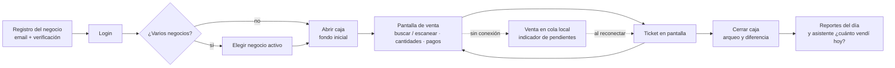
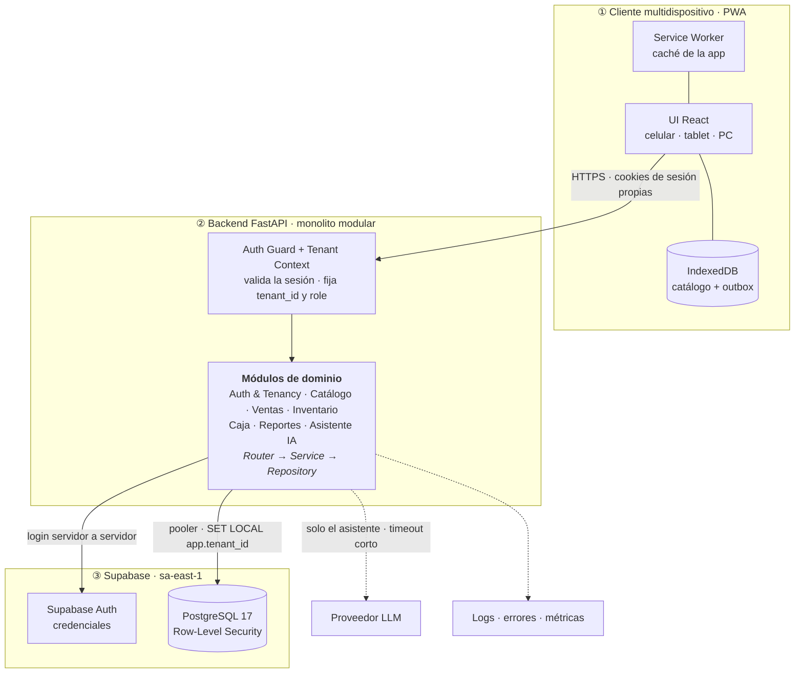
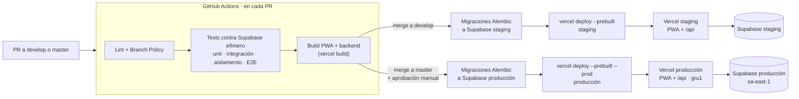
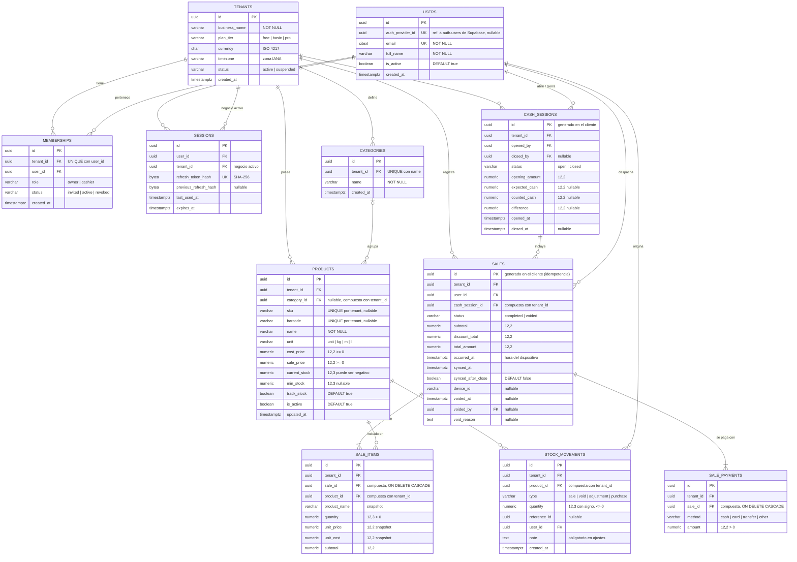

# Documentación técnica

Esta carpeta contiene la documentación técnica de **registro-venta-micro**.


## Índice

0. [Ficha del proyecto](#0-ficha-del-proyecto)
1. [Descripción general del producto](#1-descripción-general-del-producto)
2. [Arquitectura del sistema](#2-arquitectura-del-sistema)
3. [Modelo de datos](#3-modelo-de-datos)
4. [Especificación de la API](#4-especificación-de-la-api)
5. [Historias de usuario](#5-historias-de-usuario)
6. [Tickets de trabajo](#6-tickets-de-trabajo)
7. [Pull requests](#7-pull-requests)


---

## 0. Ficha del proyecto

### **0.1. Tu nombre completo:**

Nindirí Armenta Guerrero

### **0.2. Nombre del proyecto:**

registro-venta-micro

### **0.3. Descripción breve del proyecto:**

Aplicación web progresiva (PWA), **multidispositivo y multitenant**, para que micronegocios (kioscos, ferreterías, tiendas de barrio, puestos de mercado) registren sus ventas en segundos desde el celular, la tablet o la PC, **incluso sin conexión**, y controlen caja, stock y márgenes sin hardware dedicado. Cada negocio ve solo sus datos, con aislamiento impuesto por la base de datos (Row-Level Security).

### **0.4. URL del proyecto:**

> Pendiente: la URL de staging (Vercel) se publicará con la Entrega 2 (código funcional) y la de producción con la Entrega final.

### 0.5. URL o archivo comprimido del repositorio

Repositorio público: https://github.com/ninargue/registro-venta-micro

---

## 1. Descripción general del producto

> Este README describe el **MVP** que se construye en el proyecto.

### **1.1. Objetivo:**

Los micronegocios registran sus ventas en cuadernos, papeles sueltos o planillas aisladas, y muchas veces no las registran. Eso produce tres problemas concretos:

| Problema | Consecuencia |
|----------|--------------|
| **Descuadres de caja** | Al cierre el efectivo no coincide con lo vendido y no se sabe por qué. |
| **Pérdida de control de stock** | Los faltantes se descubren cuando un cliente pide el producto; las compras se hacen "a ojo". |
| **Nula visibilidad de márgenes** | El dueño sabe cuánto entró, pero no cuánto ganó. |

**registro-venta-micro** resuelve esto con una herramienta de **bajo costo, sin hardware dedicado, colaborativa y multidispositivo**: el cajero registra cada venta en pocos toques (incluso sin señal), el stock y la caja se actualizan solos, y el dueño ve ventas y margen del día.

**Para quién:**

- **Dueño / administrador (`owner`):** da de alta el negocio, carga el catálogo, invita cajeros, controla los cierres de caja y consulta reportes. Puede administrar varios negocios con una sola cuenta.
- **Cajero / empleado (`cashier`):** registra ventas y abre y cierra su turno de caja. No ve costos ni reportes globales.

Perfil de uso: celular, conexión móvil inestable, baja tolerancia a pantallas complejas.

### **1.2. Características y funcionalidades principales:**

Funcionalidades del **MVP**:

1. **Registro de negocio, login y roles**: Alta del negocio con su dueño; invitación de cajeros por email; una cuenta puede pertenecer a varios negocios con roles distintos (`owner`, `cashier`). Autenticación con Supabase Auth (verificación de email y recuperación de contraseña) y sesión propia en cookies seguras.
2. **Catálogo**: Categorías y productos con SKU, código de barras, unidad (unidad, kg, m, l), costo y precio de venta; búsqueda por código y por nombre parcial.
3. **Venta táctil y rápida**: Búsqueda o escaneo, cantidades fraccionarias, descuentos simples y **varios medios de pago** en una misma venta (efectivo, tarjeta, transferencia).
4. **Venta sin conexión**: La venta se guarda en el dispositivo y se sincroniza al recuperar señal, **sin duplicados** (identificador generado en el cliente e idempotencia en el servidor). El stock no bloquea la venta: si queda negativo se genera una alerta.
5. **Inventario**: Stock actual, historial de movimientos (kardex), ajustes e ingresos de mercadería, alertas de stock bajo o negativo.
6. **Caja**: Apertura con fondo inicial, arqueo y cierre por turno con diferencia entre efectivo esperado y contado.
7. **Anulación de ventas**: Con motivo obligatorio y reposición automática de stock.
8. **Reportes**: Ventas y margen bruto por día, por medio de pago y por producto.
9. **Asistente en lenguaje natural**: Preguntas como "¿cuánto vendí hoy?" respondidas con IA que **solo elige** reportes predefinidos; las cifras salen siempre de la base de datos.
10. **Aislamiento multitenant**: Cada negocio ve únicamente sus datos, garantizado por políticas RLS de PostgreSQL y tests automatizados.

**Fuera del MVP** (previsto para la fase 2): sincronización incremental del catálogo, sugerencia de categoría con IA, lectura de facturas de proveedores (OCR), imágenes de producto e impresión térmica.

### **1.3. Diseño y experiencia de usuario:**

> Entrega 1 (0 % código): todavía no hay pantallas implementadas. Las capturas y el videotutorial se incorporan en la Entrega 2. Aquí se describe el recorrido previsto y las pantallas clave.

**Principios:** mobile-first, botones grandes, venta resoluble en pocos toques, estado de conexión y ventas pendientes siempre visibles.



| Pantalla | Rol | Qué resuelve |
|----------|-----|--------------|
| Registro / login / elegir negocio | Todos | Entrar en segundos al negocio correcto. |
| Venta | `cashier`, `owner` | Buscar o escanear, sumar productos, cobrar con uno o varios medios de pago; avisa si falta stock sin impedir la venta. |
| Ventas pendientes | `cashier`, `owner` | Ver qué ventas esperan sincronizarse y reintentar. |
| Caja | `cashier`, `owner` | Abrir con fondo inicial, cerrar con arqueo y ver la diferencia. |
| Catálogo e inventario | `owner` | Cargar productos, precios y costos; ajustes e ingresos de stock; alertas. |
| Reportes y asistente | `owner` | Ventas y margen del día, por medio de pago y por producto; preguntas en lenguaje natural. |
| Equipo | `owner` | Invitar cajeros y revocar accesos. |

### **1.4. Instrucciones de instalación:**

> Entrega 1 (0 % código): estos son los pasos **previstos** para el entorno local (Supabase CLI en Docker). Se validarán y ajustarán al crear los scaffolds en la Entrega 2.

**Requisitos:** Git, Docker, [Supabase CLI](https://supabase.com/docs/guides/local-development), Python 3.12, Node.js 20 LTS.

```bash
# 1. Clonar
git clone https://github.com/ninargue/registro-venta-micro.git
cd registro-venta-micro

# 2. Levantar Supabase local (Postgres 17, Auth y Storage en Docker)
supabase start

# 3. Variables de entorno
#    Frontend: frontend/.env.development ya viene versionado (solo valores públicos, p. ej. VITE_API_URL)
#    Backend: lleva claves (aunque sean locales), por eso se copia desde el ejemplo y no se versiona
cp backend/.env.example backend/.env
#    Completar SUPABASE_URL y las claves con la salida de `supabase status`

# 4. Backend: dependencias, migraciones y semillas
cd backend
python -m venv .venv && source .venv/bin/activate   # Windows: .venv\Scripts\activate
pip install -e ".[dev]"
alembic upgrade head
python -m scripts.seed          # negocios, usuarios, productos y ventas ficticios
uvicorn app.main:app --reload   # http://localhost:8000/docs

# 5. Frontend (otra terminal)
cd frontend
npm ci
npm run dev                     # http://localhost:5173

# 6. Tests
cd backend && pytest            # unitarios, integración y aislamiento entre tenants
cd frontend && npm test && npx playwright test
```

Las credenciales de prueba (dueño y cajero de dos negocios distintos) se documentarán aquí al implementar las semillas ([#23](https://github.com/ninargue/registro-venta-micro/issues/23)).

---

## 2. Arquitectura del Sistema

### **2.1. Diagrama de arquitectura:**

**Patrón:** cliente-servidor **API-first**, con un **monolito modular** en capas en el backend y una **PWA offline-first** en el cliente. Supabase aporta PostgreSQL administrado y la autenticación, consumidos **solo desde el backend**.



**Por qué esta arquitectura**

| Decisión | Por qué | Beneficio | Sacrificio |
|----------|---------|-----------|------------|
| **Monolito modular** (no microservicios) | Una sola desarrolladora, dominio acotado y transaccional. | Despliegue y pruebas simples; una venta, su stock y sus pagos en una sola transacción. | Escala por réplicas del monolito; los módulos deben respetar sus límites por disciplina y revisión. |
| **PWA offline-first** | En mostrador no se puede rechazar una venta por falta de señal. | Un solo código para celular, tablet y PC, sin tiendas de apps; la venta nunca se pierde. | Stock eventualmente consistente (puede quedar negativo y se concilia); acceso a hardware limitado a las APIs del navegador. |
| **Base compartida con `tenant_id` + RLS** | Muchos negocios pequeños; costo mínimo por tenant. | El aislamiento lo impone la base aunque el código omita un filtro; una migración para todos. | Dependencia de políticas correctas, compensada con tests de aislamiento y verificación automática en CI. |
| **Supabase como plataforma** | Sin DBA ni equipo de seguridad; la auth propia es lo más riesgoso y costoso de soportar. | Backups, pooler, verificación de email y recuperación de contraseña administrados. | Dependencia moderada del proveedor, acotada con identidad y sesión propias y Postgres estándar. |
| **IA auxiliar, fuera del flujo transaccional** | Las cifras de caja y stock deben ser exactas. | Valor diferencial sin riesgo para ventas ni caja. | El asistente solo responde preguntas cubiertas por los reportes predefinidos. |

### **2.2. Descripción de componentes principales:**

| Componente | Tecnología | Responsabilidad |
|------------|------------|-----------------|
| **PWA** | React 18, Vite, TypeScript, TanStack Query, React Router, `vite-plugin-pwa` (Workbox) | Pantallas de venta, catálogo, caja y reportes; diseño táctil mobile-first; lectura de códigos de barras por cámara o lector USB/Bluetooth. |
| **Almacenamiento local** | IndexedDB vía Dexie | Copia del catálogo, caja abierta y **outbox** de ventas pendientes de sincronizar. |
| **API** | FastAPI, Pydantic v2 | API REST `/api/v1`, OpenAPI automático; validación estricta de payloads; tipos del cliente generados desde OpenAPI. |
| **Auth Guard + Tenant Context** | Dependencias de FastAPI, PyJWT | Valida el JWT propio y que su sesión siga vigente, resuelve `tenant_id` y `role`, verifica permisos y fija `SET LOCAL app.tenant_id` en cada transacción. |
| **Módulos de dominio** | Python (capas Router → Service → Repository) | Auth & Tenancy, Catálogo, Ventas, Inventario, Caja, Reportes y Asistente IA, cada uno con sus reglas de negocio. |
| **Acceso a datos** | SQLAlchemy 2 (async) + asyncpg, Alembic | Repositorios, unidad de trabajo por request y migraciones versionadas. |
| **Base de datos** | PostgreSQL 17 administrado por Supabase | Fuente de verdad; transacciones ACID; RLS por tenant; extensiones `citext` y `pg_trgm`. |
| **Autenticación** | Supabase Auth (consumido desde el backend con `httpx`) | Credenciales, verificación de email y recuperación de contraseña. El navegador nunca habla con Supabase; la sesión (`sessions`) es propia. |
| **Asistente IA** | Proveedor LLM con *tool calling* | Interpreta la pregunta y elige un reporte predefinido; nunca genera SQL. |
| **Hosting** | Vercel (CDN + funciones Python en `gru1`) | Sirve la PWA y la API en el mismo dominio; un deploy por versión con rollback inmediato. |
| **CI/CD** | GitHub Actions + Vercel CLI | Lint, tests (incluido aislamiento entre tenants), validación de nombres de rama, etiquetado de PRs, migraciones y despliegues por ambiente. |

### **2.3. Descripción de alto nivel del proyecto y estructura de ficheros**

> Estructura prevista: Monorepo con backend y frontend separados; el backend sigue un monolito modular en capas y el frontend se organiza por funcionalidad.

```
registro-venta-micro/
├── backend/                      # API FastAPI
│   ├── app/
│   │   ├── main.py               # creación de la app y registro de routers
│   │   ├── core/                 # config, base de datos, seguridad, tenant context, errores
│   │   └── modules/              # un paquete por módulo de dominio
│   │       ├── auth/  tenancy/  catalog/  sales/
│   │       ├── inventory/  cash/  reports/  assistant/
│   │       └── <módulo>/         # router.py · service.py · repository.py · schemas.py · models.py
│   ├── migrations/               # Alembic (esquema, RLS, roles, extensiones)
│   ├── scripts/seed.py           # semillas sintéticas reutilizables
│   └── tests/                    # unit/ · integration/ · isolation/
├── frontend/                     # PWA React + Vite
│   ├── src/
│   │   ├── app/                  # rutas, layout, proveedores
│   │   ├── features/             # auth · catalog · sales · cash · reports · assistant
│   │   ├── lib/                  # cliente API (generado de OpenAPI), Dexie, outbox
│   │   └── components/           # componentes de UI compartidos
│   └── tests/e2e/                # Playwright
├── supabase/                     # config.toml local y plantillas de correo
├── api/index.py                  # punto de entrada de Vercel: importa la app de backend/
├── vercel.json                   # build de la PWA, función Python y rewrites (/api/* y SPA)
├── .github/                      # workflows, templates de issues y PRs, CONTRIBUTING, SECURITY
├── README.md · prompts.md · CHANGELOG.md
```

| Carpeta | Propósito |
|---------|-----------|
| `backend/app/modules/` | **Monolito modular**: cada módulo expone su router y solo se comunica con otros a través de sus services, nunca accediendo a sus tablas. |
| `backend/app/core/` | Piezas transversales: configuración validada, sesión de base de datos con contexto de tenant, autenticación y manejo de errores. |
| `backend/migrations/` | Única vía para cambiar el esquema (nada de DDL desde el panel de Supabase). |
| `frontend/src/features/` | Organización por funcionalidad: pantalla, hooks y llamadas a la API de cada flujo juntos. |
| `frontend/src/lib/outbox` | Cola de ventas offline con reintentos e idempotencia. |

### **2.4. Infraestructura y despliegue**

**Infraestructura:** dos proveedores administrados, ambos en São Paulo para minimizar la latencia entre la API y la base.

| Pieza | Proveedor | Detalle |
|-------|-----------|---------|
| **Frontend (PWA)** | Vercel | Build estático de Vite servido desde la CDN de Vercel. |
| **Backend (API FastAPI)** | Vercel, funciones Python en región `gru1` (São Paulo) | La app FastAPI se expone como función serverless bajo `/api/*` del **mismo dominio** que la PWA: las cookies `SameSite=Strict` funcionan sin CORS. Escala automáticamente. |
| **Base de datos y Auth** | Supabase, región `sa-east-1` (São Paulo) | Postgres 17 y Supabase Auth. La API se conecta por el pooler en modo transacción, imprescindible con funciones serverless (cada invocación abre su conexión). |
| **CI/CD** | GitHub Actions | Tests, migraciones y despliegues; el auto-deploy de Vercel está desactivado para que nada se publique sin pasar por CI. |

Un único proyecto de Vercel sirve frontend y backend. `vercel.json` define el build de la PWA, la función Python (`api/index.py`, que solo importa la app de `backend/`) y dos reglas: `/api/*` → función y cualquier otra ruta → `index.html` (SPA). El backend sigue siendo una app FastAPI estándar: si en el futuro necesita procesos en segundo plano, puede moverse a un contenedor sin reescribirse.

**Ambientes:**

| Ambiente | Frontend + Backend | Base de datos y Auth | Se despliega desde | Datos |
|----------|--------------------|----------------------|--------------------|-------|
| Desarrollo | Local: `npm run dev` + `uvicorn` | `supabase start` (Docker) | Rama de trabajo | Semillas sintéticas |
| Test | Runner de CI | `supabase start` efímero en CI | Cada PR | Semillas + datos de cada test |
| Staging | Vercel, deploy de *preview* fijo de `develop` (plan Hobby) | Supabase Cloud (plan gratuito) | `develop` | Sintéticos, nunca copias de producción |
| Producción | Vercel, deploy de *production* (plan Pro) | Supabase Cloud (plan Pro, `sa-east-1`) | `master`, con aprobación manual | Reales |



**Proceso de despliegue:**

1. **En cada PR:** lint, Branch Policy y la suite completa contra un Supabase efímero, con migraciones y semillas aplicadas desde cero. Se genera el cliente TypeScript desde el OpenAPI del backend y se compila la PWA, para detectar contratos rotos antes del merge.
2. **Base de datos (al mergear):** un workflow aplica las migraciones de Alembic al Supabase del ambiente con el rol `app_migrate`, **antes** de publicar el código. Las migraciones son compatibles con la versión anterior del backend (columnas nuevas primero nulas), para que no haya corte durante el despliegue.
3. **Backend y frontend (al mergear):** el mismo workflow ejecuta `vercel build` y `vercel deploy --prebuilt` (`--prod` en producción). PWA y API se publican juntas, en una sola versión atómica. Vercel conserva cada deploy, así que el **rollback** es volver a promover el anterior.
4. **Producción:** solo desde `master` (merge de `release/*` o `hotfix/*`) y tras **aprobación manual** en el GitHub Environment `production`. Luego se crean el tag y las notas de versión, y un backport automático lleva los cambios a `develop`.
5. **PWA:** `index.html` y el Service Worker se sirven sin caché y los assets con hash como inmutables; al detectar una versión nueva, la app avisa al usuario para recargar.
6. **Verificación posterior:** `/api/v1/health` y `/api/v1/ready` (incluye conexión a la base) se consultan al terminar cada despliegue.

**Configuración y secretos:**

- **Vercel (runtime):** variables por ambiente (*Preview* para staging, *Production* para producción): URL de la base con el rol `app_api` por el pooler, URL y claves de Supabase, clave de firma de sesión, clave del proveedor LLM.
- **GitHub Environments (despliegue):** `VERCEL_TOKEN` e identificadores del proyecto, y la URL de la base con `app_migrate` para las migraciones. `staging` acepta `develop` y `master`; `production`, solo `master` y con revisores obligatorios.
- Los deploys de *preview* de otras ramas quedan desactivados para el backend: un PR con migraciones se valida en el ambiente de test, no contra la base de staging.

### **2.5. Seguridad**

| Práctica | Cómo se aplica |
|----------|----------------|
| **Aislamiento entre negocios en la base** | `tenant_id NOT NULL` en toda tabla operativa, `ENABLE` + `FORCE ROW LEVEL SECURITY` con política `tenant_id = current_setting('app.tenant_id')::uuid`, FK compuestas `(tenant_id, id)`. El backend fija `SET LOCAL app.tenant_id` desde el token en cada transacción. |
| **Rol de aplicación sin privilegios** | `app_api` no es dueño de las tablas ni tiene `BYPASSRLS`; las migraciones usan `app_migrate`, solo desde CI. |
| **Recursos de otro tenant ⇒ `404`** | Aunque se manipulen IDs en la URL o el body, la base no devuelve la fila y la API no revela su existencia. |
| **Autenticación delegada, sesión propia** | Supabase Auth gestiona credenciales, verificación de email y recuperación. El backend emite su propia sesión: access JWT de 15 min y refresh rotativo con detección de reuso, en cookies `HttpOnly; Secure; SameSite=Strict`; revocar es borrar la fila de `sessions`. |
| **Autorización por rol** | `owner` y `cashier`; el cajero no accede a costos, reportes ni ajustes de stock. Verificado en una dependencia de FastAPI por endpoint. |
| **Superficie mínima** | El navegador no incluye el SDK de Supabase; la Data API (PostgREST) está desactivada; CORS restringido al dominio de la PWA; rate limiting en login y en el asistente. |
| **Validación estricta** | Pydantic en todos los payloads (p. ej. la suma de pagos debe igualar el total, cantidades positivas). |
| **IA acotada** | El asistente no genera SQL: solo invoca reportes predefinidos que corren con el `tenant_id` del token y bajo RLS. |
| **Secretos fuera del repo** | `.env` ignorado, `.env.example` versionado; secret scanning con push protection y `gitleaks` en pre-commit; secretos de runtime en las variables de entorno de Vercel por ambiente y secretos de despliegue en GitHub Environments. |
| **Dependencias** | Dependabot semanal, `pip-audit` y `npm audit` en CI, CodeQL. |
| **Reporte de vulnerabilidades** | Canal privado de GitHub, descrito en [SECURITY.md](.github/SECURITY.md). |

Ejemplo de política RLS prevista:

```sql
ALTER TABLE sales ENABLE ROW LEVEL SECURITY;
ALTER TABLE sales FORCE ROW LEVEL SECURITY;
CREATE POLICY tenant_isolation ON sales
  USING (tenant_id = current_setting('app.tenant_id')::uuid)
  WITH CHECK (tenant_id = current_setting('app.tenant_id')::uuid);
```

### **2.6. Tests**

> Estrategia **prevista** (Entrega 1 sin código). La suite completa es parte de la Entrega final.

| Nivel | Herramientas | Qué se prueba (ejemplos) |
|-------|--------------|--------------------------|
| **Unitarios (backend)** | pytest | Cálculo de totales, descuentos y diferencia de caja; validación de que los pagos suman el total; reglas de rol. |
| **Integración (backend)** | pytest + httpx contra Supabase efímero | `POST /api/v1/sales` idempotente: reenviar el mismo `id` produce una sola venta y un solo descuento de stock; ventas concurrentes del mismo producto sin actualizaciones perdidas; venta con stock insuficiente se registra y genera alerta. |
| **Aislamiento entre tenants** | pytest | Por cada endpoint, un usuario del negocio A intenta leer y modificar recursos del negocio B y recibe `404`; test que recorre `pg_class` / `pg_policies` y falla si una tabla con `tenant_id` no tiene RLS forzada. |
| **Unitarios (frontend)** | Vitest | Cálculo del carrito; estados del outbox (pendiente, enviando, sincronizada, error). |
| **End-to-end** | Playwright | Venta completa en viewport de celular; venta en modo avión que se sincroniza al reconectar; cierre de caja; un cajero no ve costos. |

Todos corren en CI en cada PR.

---

## 3. Modelo de Datos

PostgreSQL 17 administrado por Supabase. Modelo relacional porque el núcleo es transaccional (una venta inserta cabecera, ítems y pagos y descuenta stock de forma atómica) y las consultas principales son agregaciones por fecha. Se muestran las tablas del **MVP**.

### **3.1. Diagrama del modelo de datos:**



### **3.2. Descripción de entidades principales:**

**Convenciones**

- Llaves primarias `uuid`. Las entidades que se crean sin conexión (`sales`, `sale_items`, `sale_payments`, `cash_sessions`) reciben el UUID desde el dispositivo, lo que permite la idempotencia.
- Montos en `numeric(12,2)`; cantidades en `numeric(12,3)` para ventas fraccionarias (kg, metros).
- Fechas en `timestamptz` (UTC); la zona horaria del negocio se usa para agrupar "por día".
- Toda tabla operativa tiene `tenant_id NOT NULL`, RLS forzada, `UNIQUE (tenant_id, id)` y FK **compuestas** `(tenant_id, x_id) → (tenant_id, id)`: la base impide relacionar filas de negocios distintos.
- `users` y `sessions` son **globales** (pertenecen a la persona, no a un negocio). Ninguna FK apunta a `auth.users` de Supabase.
- `memberships` suma una política RLS **solo de lectura** por `app.user_id`, para que el login liste los negocios de la persona antes de elegir el activo.

#### `tenants` — negocio (inquilino)

| Campo | Tipo | Nulo | Llave | Restricciones | Descripción |
|-------|------|------|-------|---------------|-------------|
| id | uuid | No | PK | | Identificador del negocio. |
| business_name | varchar(120) | No | | | Nombre comercial. |
| plan_tier | varchar(20) | No | | `CHECK IN ('free','basic','pro')` | Plan contratado (limita usuarios y funciones de IA). |
| currency | char(3) | No | | ISO 4217 | Moneda del negocio. |
| timezone | varchar(50) | No | | Zona IANA | Para cortes diarios de reportes. |
| status | varchar(20) | No | | `CHECK IN ('active','suspended')` | Estado del negocio. |
| created_at | timestamptz | No | | `DEFAULT now()` | |

#### `users` — identidad (global)

| Campo | Tipo | Nulo | Llave | Restricciones | Descripción |
|-------|------|------|-------|---------------|-------------|
| id | uuid | No | PK | | UUID propio; destino de todas las FK a usuarios. |
| auth_provider_id | uuid | Sí | | `UNIQUE` parcial | Referencia a `auth.users(id)` de Supabase. Nulo hasta vincular la identidad. Cambiar de proveedor es actualizar esta columna. |
| email | citext | No | | `UNIQUE` | Copia del email verificado en Supabase Auth; se usa para invitaciones y para mostrar. La credencial no vive aquí. |
| full_name | varchar(120) | No | | | |
| is_active | boolean | No | | `DEFAULT true` | Una cuenta inactiva no puede abrir ni renovar sesiones. |
| created_at | timestamptz | No | | | |

#### `memberships` — usuario ↔ negocio con rol

| Campo | Tipo | Nulo | Llave | Restricciones | Descripción |
|-------|------|------|-------|---------------|-------------|
| id | uuid | No | PK | | |
| tenant_id | uuid | No | FK → tenants | | |
| user_id | uuid | No | FK → users | `UNIQUE (tenant_id, user_id)` | |
| role | varchar(20) | No | | `CHECK IN ('owner','cashier')` | Rol en este negocio. |
| status | varchar(20) | No | | `CHECK IN ('invited','active','revoked')` | |
| created_at | timestamptz | No | | | |

#### `sessions` — sesiones propias (global)

| Campo | Tipo | Nulo | Llave | Restricciones | Descripción |
|-------|------|------|-------|---------------|-------------|
| id | uuid | No | PK | | Identificador de la sesión; viaja en el access token. |
| user_id | uuid | No | FK → users | `ON DELETE CASCADE` | |
| tenant_id | uuid | No | FK → tenants | | Negocio activo de la sesión; se valida contra `memberships` en cada request. |
| refresh_token_hash | bytea | No | | `UNIQUE` | SHA-256 del refresh token vigente; el token en claro nunca se guarda. |
| previous_refresh_hash | bytea | Sí | | | Hash del refresh anterior, para tolerar reintentos en redes inestables y detectar reuso. |
| device_label | varchar(120) | Sí | | | Navegador / dispositivo, para que la persona reconozca sus sesiones. |
| created_at | timestamptz | No | | | |
| last_used_at | timestamptz | No | | | Vence por inactividad a los 30 días. |
| expires_at | timestamptz | No | | | Vencimiento absoluto. |

Revocar una sesión es **borrar su fila**: el access token deja de valer en el siguiente request (ver 2.5).

#### `categories`

| Campo | Tipo | Nulo | Llave | Restricciones | Descripción |
|-------|------|------|-------|---------------|-------------|
| id | uuid | No | PK | | |
| tenant_id | uuid | No | FK → tenants | `UNIQUE (tenant_id, name)` | |
| name | varchar(80) | No | | | |
| created_at | timestamptz | No | | | |

#### `products`

| Campo | Tipo | Nulo | Llave | Restricciones | Descripción |
|-------|------|------|-------|---------------|-------------|
| id | uuid | No | PK | | |
| tenant_id | uuid | No | FK → tenants | | |
| category_id | uuid | Sí | FK → categories | compuesta con tenant_id | |
| sku | varchar(50) | Sí | | `UNIQUE (tenant_id, sku)` parcial | Código interno. |
| barcode | varchar(50) | Sí | | `UNIQUE (tenant_id, barcode)` parcial | Código de barras (EAN/UPC). |
| name | varchar(150) | No | | | |
| unit | varchar(10) | No | | `CHECK IN ('unit','kg','m','l')` | Unidad de venta. |
| cost_price | numeric(12,2) | No | | `>= 0` | Costo vigente. |
| sale_price | numeric(12,2) | No | | `>= 0` | Precio de venta vigente. |
| current_stock | numeric(12,3) | No | | `DEFAULT 0` (puede ser negativo, ver concurrencia de stock) | Stock actual (derivado de movimientos). |
| min_stock | numeric(12,3) | Sí | | | Umbral de alerta de stock bajo. |
| track_stock | boolean | No | | `DEFAULT true` | Falso para servicios o productos sin control. |
| is_active | boolean | No | | `DEFAULT true` | Baja lógica (no se borran productos con ventas). |
| created_at / updated_at | timestamptz | No | | | `updated_at` alimenta la sincronización incremental. |

#### `cash_sessions` — turnos de caja

| Campo | Tipo | Nulo | Llave | Restricciones | Descripción |
|-------|------|------|-------|---------------|-------------|
| id | uuid | No | PK | Generado en cliente | |
| tenant_id | uuid | No | FK → tenants | | |
| opened_by | uuid | No | FK → users | | Cajero que abre. |
| closed_by | uuid | Sí | FK → users | | |
| status | varchar(10) | No | | `CHECK IN ('open','closed')` | |
| opening_amount | numeric(12,2) | No | | `>= 0` | Fondo inicial. |
| expected_cash | numeric(12,2) | Sí | | | Calculado al cierre: fondo + ventas en efectivo − anulaciones en efectivo. |
| counted_cash | numeric(12,2) | Sí | | | Arqueo declarado. |
| difference | numeric(12,2) | Sí | | | `counted_cash − expected_cash`. |
| opened_at / closed_at | timestamptz | No / Sí | | | |

#### `sales` — cabecera de ticket

| Campo | Tipo | Nulo | Llave | Restricciones | Descripción |
|-------|------|------|-------|---------------|-------------|
| id | uuid | No | PK | Generado en cliente (idempotencia) | |
| tenant_id | uuid | No | FK → tenants | | |
| user_id | uuid | No | FK → users | | Quien despachó. |
| cash_session_id | uuid | No | FK → cash_sessions | compuesta con tenant_id | |
| status | varchar(10) | No | | `CHECK IN ('completed','voided')` | |
| subtotal | numeric(12,2) | No | | `>= 0` | Suma de ítems. |
| discount_total | numeric(12,2) | No | | `DEFAULT 0`, `>= 0` | |
| total_amount | numeric(12,2) | No | | `= subtotal − discount_total` | |
| occurred_at | timestamptz | No | | | Hora de la venta en el dispositivo (para reportes). |
| synced_at | timestamptz | No | | `DEFAULT now()` | Hora de recepción en servidor. |
| synced_after_close | boolean | No | | `DEFAULT false` | `true` si la venta (hecha sin conexión) llegó después del cierre de su caja; la caja se recalcula. |
| device_id | varchar(64) | Sí | | | Dispositivo de origen (diagnóstico). |
| voided_at / voided_by / void_reason | timestamptz / uuid / text | Sí | | | Datos de anulación. |

#### `sale_items` — renglones del ticket

| Campo | Tipo | Nulo | Llave | Restricciones | Descripción |
|-------|------|------|-------|---------------|-------------|
| id | uuid | No | PK | | |
| tenant_id | uuid | No | FK → tenants | | |
| sale_id | uuid | No | FK → sales | compuesta con tenant_id, `ON DELETE CASCADE` | |
| product_id | uuid | No | FK → products | compuesta con tenant_id | |
| product_name | varchar(150) | No | | | Snapshot del nombre. |
| quantity | numeric(12,3) | No | | `> 0` | |
| unit_price | numeric(12,2) | No | | `>= 0` | Snapshot del precio cobrado. |
| unit_cost | numeric(12,2) | No | | `>= 0` | Snapshot del costo, para el margen histórico. |
| subtotal | numeric(12,2) | No | | `= quantity × unit_price` (redondeado) | |

#### `sale_payments` — medios de pago de una venta

| Campo | Tipo | Nulo | Llave | Restricciones | Descripción |
|-------|------|------|-------|---------------|-------------|
| id | uuid | No | PK | | |
| tenant_id | uuid | No | FK → tenants | | |
| sale_id | uuid | No | FK → sales | compuesta con tenant_id, `ON DELETE CASCADE` | |
| method | varchar(20) | No | | `CHECK IN ('cash','card','transfer','other')` | |
| amount | numeric(12,2) | No | | `> 0` | La suma por venta debe igualar `total_amount` (validado en servicio). |

#### `stock_movements` — kardex

| Campo | Tipo | Nulo | Llave | Restricciones | Descripción |
|-------|------|------|-------|---------------|-------------|
| id | uuid | No | PK | | |
| tenant_id | uuid | No | FK → tenants | | |
| product_id | uuid | No | FK → products | compuesta con tenant_id | |
| type | varchar(20) | No | | `CHECK IN ('sale','void','adjustment','purchase')` | Origen del movimiento. |
| quantity | numeric(12,3) | No | | `<> 0` (con signo) | Negativo = salida, positivo = entrada. |
| reference_id | uuid | Sí | | | Venta u otro documento que lo origina. |
| user_id | uuid | No | FK → users | | |
| note | text | Sí | | | Motivo (obligatorio en ajustes, validado en servicio). |
| created_at | timestamptz | No | | | |

`products.current_stock` es un valor **materializado** que se actualiza en la misma transacción que cada movimiento; `stock_movements` permite auditarlo y reconstruirlo.

**Relaciones y cardinalidades**

| Origen | Destino | Cardinalidad | Implementación |
|--------|---------|--------------|----------------|
| tenants | memberships | 1:N | `memberships.tenant_id` |
| users | memberships | 1:N | `memberships.user_id` (users ↔ tenants es **N:M** vía memberships) |
| users | sessions | 1:N | `sessions.user_id`; cada sesión tiene un negocio activo |
| tenants | categories, products, cash_sessions, sales, stock_movements | 1:N | `tenant_id` en cada tabla |
| categories | products | 1:N (opcional) | FK compuesta `(tenant_id, category_id)` |
| cash_sessions | sales | 1:N | FK compuesta `(tenant_id, cash_session_id)` |
| sales | sale_items | 1:N (al menos 1) | FK compuesta `(tenant_id, sale_id)` |
| sales | sale_payments | 1:N (al menos 1) | FK compuesta `(tenant_id, sale_id)`; la suma iguala `total_amount` |
| products | sale_items | 1:N | FK compuesta `(tenant_id, product_id)`; precio y costo congelados en el ítem |
| products | stock_movements | 1:N | FK compuesta `(tenant_id, product_id)` |

**Índices y optimizaciones principales**

| Tabla | Índice / restricción | Motivo |
|-------|----------------------|--------|
| products | `UNIQUE (tenant_id, barcode) WHERE barcode IS NOT NULL` · `UNIQUE (tenant_id, sku) WHERE sku IS NOT NULL` | Escaneo rápido y unicidad del código por negocio. |
| products | GIN `pg_trgm` sobre `name` | Búsqueda por nombre parcial al vender. |
| sales | `(tenant_id, occurred_at DESC)` · `(tenant_id, cash_session_id)` | Reportes por fecha y cierre de caja. |
| sale_items · sale_payments | `(tenant_id, sale_id)` · `(tenant_id, product_id)` | Detalle de ticket, ventas por producto y por medio de pago. |
| stock_movements | `(tenant_id, product_id, created_at)` | Kardex por producto. |
| cash_sessions | `UNIQUE (tenant_id, opened_by) WHERE status = 'open'` | Una sola caja abierta por cajero. |
| sessions | `UNIQUE (refresh_token_hash)` · `(user_id)` | Renovación de sesión y listado de sesiones de una persona. |

**Concurrencia de stock:** el descuento es una sentencia atómica (`UPDATE … SET current_stock = current_stock - :qty`) dentro de la transacción de la venta, en orden de `product_id` para evitar *deadlocks*. No se rechaza la venta por stock insuficiente: si queda negativo se genera una alerta.

**Previsto para fases siguientes:** `audit_events` (auditoría inmutable de acciones sensibles) y `files` (imágenes de producto y fotos de facturas en Supabase Storage).

---

## 4. Especificación de la API

La API es REST, en JSON, y vive bajo `https://<host>/api/v1`. La autenticación usa las **cookies `HttpOnly` de la sesión propia**: el access token (JWT de 15 min) viaja en la cookie `access_token` y lleva `sub`, `tenant_id` y `role`. El negocio **siempre sale del token** y nunca del body ni de la URL. Todos los errores comparten el formato `{ "code", "message", "details" }`. Los códigos son: `401` si falta la sesión o venció, `403` si el rol no alcanza, `404` si el recurso no existe **o pertenece a otro negocio** (para no revelar que existe), `409` ante conflictos de estado y `422` si el payload no es válido. Los montos son `numeric(12,2)` y viajan como string decimal (`"1250.50"`); las cantidades son `numeric(12,3)` (`"0.750"`). Las fechas y horas van en ISO 8601 con zona.

```yaml
openapi: 3.1.0
info:
  title: registro-venta-micro API
  version: 1.0.0
  description: API del MVP. Multitenant; el tenant se resuelve desde el token de sesión.
servers:
  - url: https://api.example.com/api/v1
security:
  - cookieAuth: []
paths:
  /sales:
    post:
      operationId: createSale
      summary: Registrar una venta (idempotente)
      description: |
        Registra en una sola transacción la venta, sus ítems y pagos, y descuenta stock.
        El `id` lo genera el cliente. Si ya existe una venta con ese `id`, se devuelve con `200` sin duplicarla.
        Roles: `owner`, `cashier`.
      tags: [Ventas]
      requestBody:
        required: true
        content:
          application/json:
            schema: { $ref: '#/components/schemas/SaleCreate' }
      responses:
        '201':
          description: Venta creada.
          content:
            application/json:
              schema: { $ref: '#/components/schemas/Sale' }
        '200':
          description: La venta ya existía (reintento del outbox); se devuelve la registrada.
          content:
            application/json:
              schema: { $ref: '#/components/schemas/Sale' }
        '401': { $ref: '#/components/responses/Unauthorized' }
        '403': { $ref: '#/components/responses/Forbidden' }
        '409': { $ref: '#/components/responses/Conflict' }
        '422': { $ref: '#/components/responses/ValidationError' }
  /cash-sessions/{cash_session_id}/close:
    post:
      operationId: closeCashSession
      summary: Cerrar una caja con arqueo
      description: |
        Registra el efectivo contado y cierra la sesión. El servidor calcula `expected_cash` y `difference`.
        Rol: solo quien abrió la caja (`opened_by`); nadie más puede cerrarla, tampoco un `owner`.
      tags: [Caja]
      parameters:
        - name: cash_session_id
          in: path
          required: true
          schema: { type: string, format: uuid }
      requestBody:
        required: true
        content:
          application/json:
            schema: { $ref: '#/components/schemas/CashSessionClose' }
      responses:
        '200':
          description: Caja cerrada.
          content:
            application/json:
              schema: { $ref: '#/components/schemas/CashSession' }
        '401': { $ref: '#/components/responses/Unauthorized' }
        '403': { $ref: '#/components/responses/Forbidden' }
        '404': { $ref: '#/components/responses/NotFound' }
        '409': { $ref: '#/components/responses/Conflict' }
        '422': { $ref: '#/components/responses/ValidationError' }
  /reports/sales-summary:
    get:
      operationId: getSalesSummary
      summary: Resumen de ventas y margen bruto
      description: |
        Agrega las ventas `completed` del rango, por fecha local del negocio (`tenants.timezone`) según `occurred_at`.
        Rol: solo `owner` (incluye costos).
      tags: [Reportes]
      parameters:
        - name: from
          in: query
          required: true
          description: Fecha local inicial, inclusive.
          schema: { type: string, format: date }
        - name: to
          in: query
          required: true
          description: Fecha local final, inclusive. Rango máximo de 366 días.
          schema: { type: string, format: date }
        - name: group_by
          in: query
          required: false
          schema: { type: string, enum: [day, payment_method, product], default: day }
      responses:
        '200':
          description: Resumen calculado.
          content:
            application/json:
              schema: { $ref: '#/components/schemas/SalesSummary' }
        '401': { $ref: '#/components/responses/Unauthorized' }
        '403': { $ref: '#/components/responses/Forbidden' }
        '422': { $ref: '#/components/responses/ValidationError' }
components:
  securitySchemes:
    cookieAuth:
      type: apiKey
      in: cookie
      name: access_token
      description: JWT de sesión propia (15 min) emitido por el backend; cookie HttpOnly, Secure, SameSite=Strict.
  schemas:
    Money:
      type: string
      pattern: '^-?\d{1,10}\.\d{2}$'
      description: Monto decimal numeric(12,2).
      examples: ['1250.50']
    Quantity:
      type: string
      pattern: '^\d{1,9}(\.\d{1,3})?$'
      description: Cantidad decimal numeric(12,3), mayor que 0.
      examples: ['0.750']
    SaleItemCreate:
      type: object
      required: [id, product_id, quantity, unit_price]
      properties:
        id: { type: string, format: uuid, description: Generado en el cliente. }
        product_id: { type: string, format: uuid }
        quantity: { $ref: '#/components/schemas/Quantity' }
        unit_price: { $ref: '#/components/schemas/Money', description: Precio cobrado en el dispositivo; se respeta aunque difiera del vigente. }
    SalePaymentCreate:
      type: object
      required: [id, method, amount]
      properties:
        id: { type: string, format: uuid, description: Generado en el cliente. }
        method: { type: string, enum: [cash, card, transfer, other] }
        amount: { $ref: '#/components/schemas/Money', description: Mayor que 0. }
    SaleCreate:
      type: object
      required: [id, cash_session_id, occurred_at, items, payments, total_amount]
      properties:
        id: { type: string, format: uuid, description: Llave de idempotencia y PK de la venta. }
        cash_session_id: { type: string, format: uuid }
        occurred_at: { type: string, format: date-time, description: Hora de la venta en el dispositivo. }
        device_id: { type: string, maxLength: 64 }
        discount_total: { $ref: '#/components/schemas/Money', default: '0.00' }
        total_amount: { $ref: '#/components/schemas/Money', description: Total calculado por el cliente; el servidor lo verifica. }
        items:
          type: array
          minItems: 1
          items: { $ref: '#/components/schemas/SaleItemCreate' }
        payments:
          type: array
          minItems: 1
          items: { $ref: '#/components/schemas/SalePaymentCreate' }
    SaleItem:
      allOf:
        - $ref: '#/components/schemas/SaleItemCreate'
        - type: object
          properties:
            product_name: { type: string, description: Snapshot del nombre. }
            subtotal: { $ref: '#/components/schemas/Money' }
    StockAlert:
      type: object
      description: Producto que quedó con stock negativo (o bajo `min_stock`) tras la venta. No bloquea la venta.
      properties:
        product_id: { type: string, format: uuid }
        product_name: { type: string }
        current_stock: { type: string, description: numeric(12,3), puede ser negativo. }
        min_stock: { type: [string, 'null'] }
        type: { type: string, enum: [negative_stock, low_stock] }
    Sale:
      type: object
      properties:
        id: { type: string, format: uuid }
        cash_session_id: { type: string, format: uuid }
        user_id: { type: string, format: uuid }
        status: { type: string, enum: [completed, voided] }
        subtotal: { $ref: '#/components/schemas/Money' }
        discount_total: { $ref: '#/components/schemas/Money' }
        total_amount: { $ref: '#/components/schemas/Money' }
        occurred_at: { type: string, format: date-time }
        synced_at: { type: string, format: date-time }
        synced_after_close: { type: boolean, description: 'true si la venta llegó después del cierre de su caja; la caja se recalculó.' }
        items:
          type: array
          items: { $ref: '#/components/schemas/SaleItem' }
        payments:
          type: array
          items: { $ref: '#/components/schemas/SalePaymentCreate' }
        stock_alerts:
          type: array
          description: Vacío si ningún producto quedó en alerta. En un reintento (200) se devuelve vacío.
          items: { $ref: '#/components/schemas/StockAlert' }
    CashSessionClose:
      type: object
      required: [counted_cash]
      properties:
        counted_cash: { $ref: '#/components/schemas/Money', description: Efectivo contado en el arqueo, mayor o igual a 0. }
    CashSession:
      type: object
      properties:
        id: { type: string, format: uuid }
        status: { type: string, enum: [open, closed] }
        opened_by: { type: string, format: uuid }
        closed_by: { type: [string, 'null'], format: uuid }
        opening_amount: { $ref: '#/components/schemas/Money' }
        expected_cash: { $ref: '#/components/schemas/Money', description: Fondo + ventas en efectivo − anulaciones en efectivo. }
        counted_cash: { $ref: '#/components/schemas/Money' }
        difference: { $ref: '#/components/schemas/Money', description: counted_cash − expected_cash (negativo = faltante). }
        opened_at: { type: string, format: date-time }
        closed_at: { type: [string, 'null'], format: date-time }
    SalesSummaryRow:
      type: object
      properties:
        key: { type: string, description: 'Fecha (YYYY-MM-DD), método de pago o product_id, según group_by.' }
        label: { type: string }
        sales_count: { type: integer }
        net_sales: { $ref: '#/components/schemas/Money' }
        cost_total: { type: [string, 'null'], description: Nulo con group_by=payment_method. }
        gross_margin: { type: [string, 'null'], description: Nulo con group_by=payment_method. }
    SalesSummary:
      type: object
      properties:
        from: { type: string, format: date }
        to: { type: string, format: date }
        group_by: { type: string, enum: [day, payment_method, product] }
        currency: { type: string, examples: [ARS] }
        totals:
          type: object
          properties:
            sales_count: { type: integer }
            gross_sales: { $ref: '#/components/schemas/Money' }
            discount_total: { $ref: '#/components/schemas/Money' }
            net_sales: { $ref: '#/components/schemas/Money' }
            cost_total: { $ref: '#/components/schemas/Money' }
            gross_margin: { $ref: '#/components/schemas/Money' }
            gross_margin_pct: { type: string, description: Porcentaje con 2 decimales. }
        rows:
          type: array
          items: { $ref: '#/components/schemas/SalesSummaryRow' }
    Error:
      type: object
      required: [code, message]
      properties:
        code: { type: string, examples: [PAYMENTS_TOTAL_MISMATCH] }
        message: { type: string }
        details: { type: [object, array, 'null'] }
  responses:
    Unauthorized:
      description: Sin sesión o access token vencido (el cliente debe renovarlo).
      content: { application/json: { schema: { $ref: '#/components/schemas/Error' } } }
    Forbidden:
      description: El rol del token no tiene permiso.
      content: { application/json: { schema: { $ref: '#/components/schemas/Error' } } }
    NotFound:
      description: El recurso no existe o pertenece a otro negocio.
      content: { application/json: { schema: { $ref: '#/components/schemas/Error' } } }
    Conflict:
      description: Conflicto de estado (caja cerrada, id reutilizado con otro contenido).
      content: { application/json: { schema: { $ref: '#/components/schemas/Error' } } }
    ValidationError:
      description: Payload o parámetros inválidos.
      content: { application/json: { schema: { $ref: '#/components/schemas/Error' } } }
```

### 4.1 `POST /api/v1/sales`: registrar venta

```http
POST /api/v1/sales
Cookie: access_token=<jwt>
Content-Type: application/json

{
  "id": "7b1e4c2a-9f3d-4e8a-b6c1-2d5f8a9e0c11",
  "cash_session_id": "3c9a1f70-2b4e-4d1a-9e6f-8a7b5c4d3e21",
  "occurred_at": "2026-11-06T14:32:10-03:00",
  "device_id": "pwa-android-01",
  "discount_total": "0.00",
  "total_amount": "1250.50",
  "items": [
    { "id": "a1f0c3d2-1111-4a2b-8c3d-000000000001", "product_id": "5e2d...01", "quantity": "2.000", "unit_price": "450.00" },
    { "id": "a1f0c3d2-1111-4a2b-8c3d-000000000002", "product_id": "5e2d...02", "quantity": "0.750", "unit_price": "467.33" }
  ],
  "payments": [
    { "id": "b2e1d4c3-2222-4b3c-9d4e-000000000001", "method": "cash", "amount": "1000.00" },
    { "id": "b2e1d4c3-2222-4b3c-9d4e-000000000002", "method": "card", "amount": "250.50" }
  ]
}
```

Respuesta `201 Created` (resumida):

```json
{
  "id": "7b1e4c2a-9f3d-4e8a-b6c1-2d5f8a9e0c11",
  "status": "completed",
  "subtotal": "1250.50",
  "discount_total": "0.00",
  "total_amount": "1250.50",
  "occurred_at": "2026-11-06T17:32:10Z",
  "synced_at": "2026-11-06T17:32:11Z",
  "items": [{ "id": "a1f0...0001", "product_name": "Yerba 1 kg", "quantity": "2.000", "unit_price": "450.00", "subtotal": "900.00" }],
  "payments": [{ "id": "b2e1...0001", "method": "cash", "amount": "1000.00" }],
  "stock_alerts": [
    { "product_id": "5e2d...02", "product_name": "Queso cremoso", "current_stock": "-0.250", "min_stock": "1.000", "type": "negative_stock" }
  ]
}
```

Reglas de negocio:

- **Idempotencia:** `INSERT … ON CONFLICT (id) DO NOTHING`. Si el `id` ya existe, se responde `200` con la venta guardada y no se vuelve a descontar stock. Si el `id` existe con otro contenido (ítems o pagos distintos), se responde `409 SALE_ID_CONFLICT`.
- **Totales:** el servidor recalcula `subtotal = Σ round(quantity × unit_price, 2)` y `total_amount = subtotal − discount_total`. Si no coincide con el `total_amount` enviado, o si `Σ payments.amount ≠ total_amount`, responde `422` (`TOTAL_MISMATCH` / `PAYMENTS_TOTAL_MISMATCH`). Los snapshots `product_name` y `unit_cost` los toma el servidor del producto, nunca del cliente.
- **Stock no bloqueante:** se descuenta con `UPDATE` atómico en orden de `product_id` y se registra un `stock_movements` de tipo `sale` por ítem (solo si `track_stock`). Un stock negativo **no rechaza** la venta: se informa en `stock_alerts`.
- **Caja:** `cash_session_id` debe ser una caja del negocio (normalmente `open`); para un `cashier`, además, debe ser su propia caja (`opened_by = sub`). Si la caja no existe o pertenece a otro negocio, responde `422 CASH_SESSION_NOT_FOUND`; si está **cerrada** (venta hecha sin conexión que llega después del cierre), la venta **se acepta igual**: se guarda con `synced_after_close = true`, se recalculan `expected_cash` y `difference` de esa caja y el owner la ve marcada en caja y reportes. La venta nunca se pierde. `user_id` siempre es el `sub` del token.

### 4.2 `POST /api/v1/cash-sessions/{cash_session_id}/close`: cerrar caja

```http
POST /api/v1/cash-sessions/3c9a1f70-2b4e-4d1a-9e6f-8a7b5c4d3e21/close
Cookie: access_token=<jwt>
Content-Type: application/json

{ "counted_cash": "15230.00" }
```

Respuesta `200 OK`:

```json
{
  "id": "3c9a1f70-2b4e-4d1a-9e6f-8a7b5c4d3e21",
  "status": "closed",
  "opened_by": "9d8c7b6a-0000-4000-8000-000000000003",
  "closed_by": "9d8c7b6a-0000-4000-8000-000000000003",
  "opening_amount": "5000.00",
  "expected_cash": "15280.00",
  "counted_cash": "15230.00",
  "difference": "-50.00",
  "opened_at": "2026-11-06T11:00:00Z",
  "closed_at": "2026-11-06T23:05:42Z"
}
```

Reglas de negocio:

- **Permisos:** solo puede cerrarla quien la abrió (`opened_by = sub`); cualquier otro usuario, incluido un `owner`, recibe `403`. Una caja de otro negocio responde `404`.
- **Cálculo en servidor:** `expected_cash = opening_amount + Σ pagos cash de ventas de la sesión − Σ pagos cash de ventas anuladas`, y `difference = counted_cash − expected_cash`. El cliente no envía ni puede alterar estos valores.
- **Estado:** si la caja ya está `closed`, responde `409 CASH_SESSION_ALREADY_CLOSED`. Antes de llamar, el cliente exige que el outbox de esa sesión esté vacío (regla del cierre de caja).
- **Registro del cierre:** se guardan `closed_by` y `closed_at`. Si después llega una venta tardía, `expected_cash` y `difference` se recalculan (ver 4.1). La auditoría en `audit_events` llega después del MVP.

### 4.3 `GET /api/v1/reports/sales-summary`: resumen de ventas y margen

```http
GET /api/v1/reports/sales-summary?from=2026-11-01&to=2026-11-07&group_by=day
Cookie: access_token=<jwt>
```

Respuesta `200 OK` (resumida):

```json
{
  "from": "2026-11-01",
  "to": "2026-11-07",
  "group_by": "day",
  "currency": "ARS",
  "totals": {
    "sales_count": 184,
    "gross_sales": "412300.00",
    "discount_total": "3200.00",
    "net_sales": "409100.00",
    "cost_total": "281450.00",
    "gross_margin": "127650.00",
    "gross_margin_pct": "31.20"
  },
  "rows": [
    { "key": "2026-11-06", "label": "jue 06/11", "sales_count": 31, "net_sales": "70250.50", "cost_total": "48100.00", "gross_margin": "22150.50" }
  ]
}
```

Reglas de negocio:

- **Solo `owner`:** un `cashier` recibe `403`, porque el reporte expone costos. El `tenant_id` sale del token y RLS filtra el resto.
- **Rango en hora local:** `from` y `to` son fechas inclusivas en `tenants.timezone`, y se agrupa por `occurred_at` convertido a esa zona. Si `from > to` o el rango supera 366 días, responde `422`.
- **Cálculo:** solo cuentan las ventas `completed`. `net_sales = Σ total_amount`, `cost_total = Σ quantity × unit_cost` (snapshot) y `gross_margin = net_sales − cost_total`. Con `group_by=product`, el descuento de cabecera se prorratea según el subtotal del ítem. Con `group_by=payment_method`, `net_sales` es `Σ sale_payments.amount` y el costo y el margen van en `null`.

---

## 5. Historias de Usuario

Las historias siguen el criterio **INVEST** (independientes, negociables, valiosas, estimables, pequeñas y testeables) y cubren solo el alcance del MVP. El backlog completo, con su desglose técnico, está en [GitHub Issues](https://github.com/ninargue/registro-venta-micro/issues).

**Historia de Usuario 1 — Registrar una venta rápida, incluso sin conexión**

| Campo | Valor |
|-------|-------|
| ID | HU-01 |
| Rol | Cajero / empleado (`cashier`); también aplica al `owner` cuando atiende |
| Prioridad (MoSCoW) | **Must have** |
| Estimación | 8 puntos |
| Issues relacionados | [#18](https://github.com/ninargue/registro-venta-micro/issues/18) Pantalla de venta táctil · [#19](https://github.com/ninargue/registro-venta-micro/issues/19) Cola offline (outbox) · [#10](https://github.com/ninargue/registro-venta-micro/issues/10) Registro transaccional e idempotente |
| Endpoint | `POST /api/v1/sales` |

**Enunciado:** Como **cajero**, quiero **registrar una venta en pocos toques buscando o escaneando productos, aunque no haya señal**, para **atender rápido al cliente sin anotar nada en papel y sin perder ninguna venta**.

**Contexto / valor para el negocio:** hoy las ventas se anotan en cuadernos o directamente no se anotan, lo que origina los descuadres de caja y la pérdida de control de stock. Si registrar es más lento que anotar, el cajero no lo hace; y si la conexión móvil cae, la venta no puede quedar bloqueada. Cada venta registrada alimenta el stock, el arqueo y el margen.

**Criterios de aceptación:**

```gherkin
Escenario: Venta con conexión y pago mixto
  Dado que el cajero tiene una caja abierta y el catálogo del negocio cargado
  Y el producto "Yerba 1 kg" tiene precio de venta 3.500 y stock 10
  Cuando agrega 2 unidades de "Yerba 1 kg" por escaneo
  Y registra un pago de 5.000 en efectivo y 2.000 con tarjeta
  Y confirma la venta
  Entonces ve el ticket en pantalla de inmediato
  Y el servidor responde 201 Created con la venta registrada
  Y el stock de "Yerba 1 kg" queda en 8 con un movimiento de inventario de tipo "sale"

Escenario: Venta sin conexión y sincronización posterior
  Dado que el dispositivo está sin conexión y el cajero tiene una caja abierta
  Cuando confirma una venta
  Entonces la venta se guarda localmente con un UUID generado en el dispositivo
  Y ve el ticket en pantalla y un indicador de "1 venta pendiente de sincronizar"
  Cuando el dispositivo recupera la conexión
  Entonces la venta se envía a POST /api/v1/sales y el indicador desaparece
  Y la hora de la venta en los reportes es la del dispositivo (occurred_at)

Escenario: Reintento de una venta ya registrada (idempotencia)
  Dado que una venta con id "8f1c…" ya fue registrada en el servidor
  Pero el dispositivo no recibió la respuesta por un corte de red
  Cuando el outbox reenvía la misma venta con el mismo id
  Entonces el servidor responde 200 OK con la venta existente
  Y no se crea una venta duplicada ni se descuenta stock dos veces

Escenario: Stock insuficiente no bloquea la venta
  Dado que "Pilas AA" tiene stock 1 en el catálogo local
  Cuando el cajero agrega 3 unidades
  Entonces ve un aviso de stock insuficiente pero puede confirmar la venta
  Y al sincronizar, el stock queda en -2 y se genera una alerta de stock negativo para el dueño

Escenario: Pagos que no cubren el total
  Dado un carrito con total 7.000
  Cuando el cajero registra pagos que suman 6.000 e intenta confirmar
  Entonces el botón de confirmar permanece deshabilitado y se muestra el faltante de 1.000
  Y si un cliente envía igualmente ese payload, la API responde 422 sin registrar la venta

Escenario: Aislamiento entre negocios
  Dado un cajero con sesión activa en el negocio A
  Cuando envía una venta que referencia un producto o una caja del negocio B
  Entonces la API responde 404 sin revelar la existencia del recurso
  Y no se registra ninguna venta ni movimiento de stock en ninguno de los dos negocios
```

**Reglas de negocio:**

- Toda venta requiere una caja abierta del cajero (`cash_session_id`) y al menos un ítem con cantidad positiva (se admiten fracciones, p. ej. 0,750 kg).
- La suma de los pagos (`cash`, `card`, `transfer`, `other`) debe igualar `total_amount = subtotal − discount_total`.
- Venta, ítems, pagos, descuento de stock y movimientos se registran en una sola transacción; el descuento es atómico y en orden de `product_id`.
- Cada ítem congela nombre, precio cobrado y costo (snapshot) para que el margen histórico no cambie si cambia el catálogo.
- El precio cobrado en el dispositivo se respeta aunque difiera del vigente en el servidor.

**Fuera de alcance de esta historia:** anulación de ventas (#13), impresión térmica del ticket y facturación electrónica, procesamiento real del pago (solo se registra el medio), sincronización incremental del catálogo (en el MVP se cachea completo).

**Dependencias:** autenticación y contexto de tenant (#5, #6), catálogo (#9), apertura de caja (#12), base de la PWA (#16).

**Notas de UX:**

- Pantalla única: buscador o escáner arriba, carrito en el centro y botón **Cobrar** grande y fijo abajo; botones táctiles de al menos 48 px.
- Flujo típico de 3 toques tras agregar productos: *Cobrar → medio de pago → Confirmar*; "efectivo por el total" como opción por defecto, con cálculo del vuelto.
- Meta de tiempo (sección 1.5): p50 < 30 s con búsqueda manual (p95 < 60 s) y p50 < 10 s con escáner (p95 < 20 s), medidos desde el primer producto hasta el ticket.
- El estado de conexión y las ventas pendientes se muestran siempre, sin interrumpir el flujo.

---

**Historia de Usuario 2 — Cerrar la caja con arqueo**

| Campo | Valor |
|-------|-------|
| ID | HU-02 |
| Rol | Cajero / empleado (`cashier`) cierra su caja; el dueño (`owner`) consulta el resultado |
| Prioridad (MoSCoW) | **Must have** |
| Estimación | 5 puntos |
| Issues relacionados | [#12](https://github.com/ninargue/registro-venta-micro/issues/12) Caja: apertura, arqueo y cierre · [#20](https://github.com/ninargue/registro-venta-micro/issues/20) Caja y reportes en la UI |
| Endpoint | `POST /api/v1/cash-sessions/{cash_session_id}/close` |

**Enunciado:** Como **cajero**, quiero **cerrar mi turno declarando el efectivo que cuento y ver al instante la diferencia con lo esperado**, para **entregar la caja con un número claro**; y como **dueño**, quiero **ver ese resultado por turno**, para **detectar descuadres a tiempo**.

**Contexto / valor para el negocio:** el descuadre de caja es la primera ineficiencia del problema: al final del día el efectivo no coincide y nadie sabe por qué. Un arqueo por turno, calculado por el sistema a partir de las ventas registradas, convierte esa duda en una diferencia concreta, atribuible a un cajero y a un turno.

**Criterios de aceptación:**

```gherkin
Escenario: Cierre de caja sin diferencia
  Dado que el cajero abrió su caja con un fondo inicial de 10.000
  Y registró ventas cobradas en efectivo por 45.000 y con tarjeta por 20.000
  Cuando declara 55.000 de efectivo contado y confirma el cierre
  Entonces el sistema calcula un efectivo esperado de 55.000 y una diferencia de 0
  Y la caja queda en estado "closed" con hora y usuario de cierre

Escenario: Cierre con faltante
  Dado una caja con efectivo esperado de 55.000
  Cuando el cajero declara 53.500 y confirma
  Entonces la caja se cierra con una diferencia de -1.500 destacada como faltante
  Y el dueño ve ese cierre con su diferencia en el panel de caja

Escenario: No se puede cerrar con ventas pendientes de sincronizar
  Dado que el dispositivo tiene 2 ventas de esta caja en el outbox
  Cuando el cajero intenta cerrar la caja
  Entonces la app no permite el cierre e indica "Hay 2 ventas pendientes de sincronizar"
  Y ofrece reintentar la sincronización
  Y al vaciarse el outbox el cierre queda habilitado

Escenario: Nadie puede cerrar la caja de otra persona
  Dado que la cajera Ana tiene una caja abierta
  Cuando el cajero Luis o la dueña Marta envían el cierre de la caja de Ana
  Entonces la API responde 403 y la caja de Ana sigue abierta

Escenario: Venta sin conexión que llega después del cierre
  Dado que Ana cerró su caja con diferencia 0
  Y una venta en efectivo de esa caja, hecha sin conexión, llega después del cierre
  Cuando el servidor la recibe
  Entonces la venta se registra marcada como tardía
  Y el efectivo esperado y la diferencia de la caja se recalculan
  Y la dueña la ve marcada en caja y reportes

Escenario: Aislamiento entre negocios
  Dado un usuario con sesión activa en el negocio A
  Cuando intenta cerrar una caja que pertenece al negocio B
  Entonces la API responde 404 y la caja del negocio B no se modifica

Escenario: Cierre repetido
  Dado una caja ya cerrada
  Cuando se vuelve a enviar el cierre de esa caja
  Entonces la API responde 409 y no altera el arqueo registrado
```

**Reglas de negocio:**

- Efectivo esperado = fondo inicial + ventas cobradas en efectivo − anulaciones en efectivo; diferencia = contado − esperado (positiva = sobrante, negativa = faltante).
- Una sola caja abierta por cajero y por negocio; toda venta pertenece a una caja abierta.
- El efectivo esperado lo calcula el servidor; el cliente solo envía el efectivo contado.
- Solo quien abrió la caja puede cerrarla (tampoco la dueña).
- Una caja cerrada no admite cambios manuales; solo se recalcula si llega una venta tardía hecha sin conexión, que nunca se rechaza.

**Fuera de alcance de esta historia:** conteo por denominación de billetes, retiros o ingresos de efectivo a mitad de turno, arqueo de medios no efectivos contra liquidaciones bancarias, reapertura de cajas cerradas.

**Dependencias:** HU-01 (ventas asociadas a la caja) y la cola offline (#19), que debe estar vacía para cerrar; apertura de caja (#12).

**Notas de UX:**

- Un solo campo numérico grande con teclado numérico y un botón **Cerrar caja**; antes de confirmar se muestra el resumen (fondo, ventas en efectivo, esperado, contado, diferencia).
- La diferencia se muestra con color e ícono (sobrante / faltante / sin diferencia), no solo con signo.
- Meta: cierre de caja en < 2 min (sección 1.5).

---

**Historia de Usuario 3 — Conocer las ventas y el margen del día**

| Campo | Valor |
|-------|-------|
| ID | HU-03 |
| Rol | Dueño / administrador (`owner`) |
| Prioridad (MoSCoW) | **Must have** (reportes) · **Should have** (asistente en lenguaje natural) |
| Estimación | 5 puntos |
| Issues relacionados | [#14](https://github.com/ninargue/registro-venta-micro/issues/14) Reportes básicos · [#20](https://github.com/ninargue/registro-venta-micro/issues/20) Caja y reportes en la UI · [#21](https://github.com/ninargue/registro-venta-micro/issues/21) Asistente en lenguaje natural |
| Endpoint | `GET /api/v1/reports/sales-summary` |

**Enunciado:** Como **dueño**, quiero **ver cuánto vendí y cuánto gané hoy (o en un rango de fechas), en un panel o preguntándolo con mis palabras ("¿cuánto vendí hoy?")**, para **decidir precios y compras con datos y no "a ojo"**.

**Contexto / valor para el negocio:** el dueño sabe cuánto entró, pero no cuánto ganó. Como cada ítem guarda el costo del momento de la venta, el sistema puede calcular el margen bruto real por día, por medio de pago y por producto. El asistente baja la barrera para usuarios con poca alfabetización digital, sin arriesgar la exactitud de las cifras.

**Criterios de aceptación:**

```gherkin
Escenario: Resumen del día con margen
  Dado que hoy, en la zona horaria del negocio, se registraron 3 ventas completadas
  Y suman 30.000 de venta y 21.000 de costo según el snapshot de los ítems
  Cuando el dueño abre el reporte del día
  Entonces ve ventas 30.000, costo 21.000, margen bruto 9.000 (30 %) y 3 tickets
  Y ve el desglose por medio de pago y los productos más vendidos

Escenario: Consulta en lenguaje natural
  Dado el mismo escenario de ventas del día
  Cuando el dueño pregunta al asistente "¿cuánto vendí hoy?"
  Entonces el asistente elige el reporte predefinido de resumen de ventas para el día actual
  Y responde con cifras idénticas a las de GET /api/v1/reports/sales-summary

Escenario: Rango sin ventas
  Dado que no hubo ventas entre el 01/11 y el 03/11
  Cuando el dueño consulta ese rango
  Entonces ve totales en 0 y el mensaje "No hay ventas en este período"
  Y no se muestra un margen porcentual indefinido

Escenario: Un cajero no accede a reportes ni costos
  Dado un usuario con rol "cashier"
  Cuando solicita GET /api/v1/reports/sales-summary o usa el asistente
  Entonces la API responde 403
  Y la opción de reportes no aparece en su menú

Escenario: Aislamiento entre negocios
  Dado un dueño que administra los negocios A y B con sesión activa en A
  Cuando consulta el resumen del día
  Entonces solo ve ventas del negocio A, aunque B tenga ventas en las mismas fechas

Escenario: Proveedor de IA no disponible
  Dado que el proveedor de IA no responde dentro de 15 s
  Cuando el dueño hace una pregunta al asistente
  Entonces ve "El asistente no está disponible; podés usar el panel de reportes"
  Y el panel de reportes, las ventas y la caja siguen funcionando con normalidad
```

**Reglas de negocio:**

- Solo cuentan ventas en estado `completed`; las anuladas se excluyen.
- Los cortes por día usan `occurred_at` en la zona horaria del negocio (`tenants.timezone`).
- Margen bruto = Σ(cantidad × precio cobrado) − Σ(cantidad × costo snapshot), neto de descuentos.
- El asistente **no genera SQL** ni tiene herramientas de escritura: solo elige una función de reporte predefinida y sus parámetros, que se ejecuta con el `tenant_id` del token y bajo RLS; las cifras mostradas salen de la base, nunca del texto del modelo.
- Preguntas no cubiertas por el catálogo de reportes se responden indicando qué consultas están disponibles; rate limiting por negocio.

**Fuera de alcance de esta historia:** exportación a Excel/PDF, comparativas y proyecciones, reportes contables o fiscales, consultas por voz, sugerencia de categorías y lectura de facturas con IA (Fase 2).

**Dependencias:** HU-01 (ventas con snapshot de costo), funciones de reporte (#14) previas al asistente (#21), feature flag de IA.

**Notas de UX:**

- El panel abre en "Hoy" con tres cifras grandes (ventas, margen, tickets) y accesos rápidos a "Ayer", "Esta semana" y "Este mes".
- El asistente ofrece preguntas sugeridas como botones ("¿Cuánto vendí hoy?", "¿Qué producto se vendió más esta semana?") para evitar escribir.
- Cada respuesta del asistente enlaza al reporte de origen, para que el dueño pueda verificar las cifras.

---

## 6. Tickets de Trabajo

Se documentan tres tickets del MVP, uno por capa, elegidos porque concentran los riesgos técnicos principales del sistema: el aislamiento entre negocios (base de datos), la venta transaccional e idempotente (backend) y la venta sin conexión (frontend). Los tres están en el [backlog de GitHub](https://github.com/ninargue/registro-venta-micro/issues) y en el [Roadmap](https://github.com/users/ninargue/projects/3). Cada uno se desarrolla en su propia rama creada desde `develop` y se integra por Pull Request con el template del repositorio ([CONTRIBUTING](.github/CONTRIBUTING.md)).

---

**Ticket 1 — [Base de datos] Políticas RLS, roles de base de datos y aislamiento entre negocios**

| Campo | Valor |
|-------|-------|
| ID / issue | [#4](https://github.com/ninargue/registro-venta-micro/issues/4) (con apoyo de [#3](https://github.com/ninargue/registro-venta-micro/issues/3)) |
| Tipo | Feature (seguridad) |
| Capa | Base de datos |
| Prioridad | Alta: bloquea todo el backend de M2 |
| Estimación | 3 h (las tablas, `UNIQUE (tenant_id, id)` y las FK compuestas se crean en #3, también de 3 h; este ticket las verifica) |
| Hito | M1 · Fundaciones |
| Rama sugerida | `feature/4-rls-roles` |
| Etiquetas | `capa:db`, `mvp`, `seguridad`, `modulo:tenancy`, `migracion` |
| Historias de usuario | Transversal: HU-01 (registrar venta), HU-02 (cerrar caja), HU-03 (ventas y margen del día) |
| Dependencias | #1 (monorepo), #2 (CI), #3 (esquema inicial). Lo necesitan #6, #7 y todos los módulos de M2. |

**Descripción y objetivo.** Que el aislamiento entre negocios lo garantice PostgreSQL y no el código: aunque un endpoint olvide filtrar por `tenant_id` o un usuario manipule IDs, la base no devuelve ni modifica filas de otro negocio. Se crean los roles `app_migrate` (dueño de las tablas, solo desde CI) y `app_api` (runtime, no dueño, sin `BYPASSRLS`) definidos para la plataforma Supabase (ver 2.5).

**Alcance técnico**

- `db/bootstrap/roles.sql` (idempotente, ejecutado con el usuario administrador de Supabase una vez por ambiente y en cada corrida de CI): `CREATE ROLE app_migrate LOGIN` y `CREATE ROLE app_api LOGIN NOBYPASSRLS NOSUPERUSER NOCREATEROLE`; `REVOKE ALL ON SCHEMA public FROM anon, authenticated`.
- `backend/alembic/versions/0001_*` (de #3): `CREATE EXTENSION IF NOT EXISTS citext` y `pg_trgm`, tablas, `UNIQUE (tenant_id, id)` y FK compuestas.
- `backend/alembic/versions/0002_rls_y_privilegios.py` (este ticket), con `upgrade()` y `downgrade()` completos:

```sql
-- para cada tabla operativa: memberships, categories, products, cash_sessions,
-- sales, sale_items, sale_payments, stock_movements
ALTER TABLE products ENABLE ROW LEVEL SECURITY;
ALTER TABLE products FORCE ROW LEVEL SECURITY;
CREATE POLICY tenant_isolation ON products
  USING      (tenant_id = NULLIF(current_setting('app.tenant_id', true), '')::uuid)
  WITH CHECK (tenant_id = NULLIF(current_setting('app.tenant_id', true), '')::uuid);

GRANT SELECT, INSERT, UPDATE, DELETE ON products, ... TO app_api;
-- audit_events (solo INSERT/SELECT) llega después del MVP
```

- `current_setting(..., true)` con `NULLIF` hace que **sin contexto** la política evalúe `NULL` y no devuelva filas, en vez de lanzar error ([criterio de #4](https://github.com/ninargue/registro-venta-micro/issues/4)).
- La lista de tablas operativas vive en una constante (`backend/app/db/tenancy.py: TENANT_TABLES`) que usan la migración y los tests; `users` y `sessions` quedan fuera por ser globales.
- `backend/tests/db/test_rls_catalogo.py` y `backend/tests/db/test_rls_aislamiento.py`.

**Pasos de implementación**

1. Crear la rama `feature/4-rls-roles` desde `develop` actualizado.
2. Escribir `db/bootstrap/roles.sql` e integrarlo en el arranque local (`supabase start` + script) y en el workflow de CI antes de `alembic upgrade head`.
3. Configurar `alembic/env.py` para conectarse con `app_migrate` por el pooler de sesión y el backend para conectarse con `app_api` por el pooler en modo transacción con `statement_cache_size=0`.
4. Generar la migración `0002` con Alembic, escribir a mano `ENABLE`/`FORCE`/`CREATE POLICY`/`GRANT` recorriendo `TENANT_TABLES`, y su `downgrade()` (`DROP POLICY`, `NO FORCE`, `DISABLE`, `REVOKE`).
5. Aplicar `upgrade` → `downgrade` → `upgrade` contra una base limpia y correr `alembic check`.
6. Escribir el test de catálogo y el test empírico (ver *Tests*).
7. Revisar el *Security Advisor* de Supabase local: ninguna tabla operativa sin RLS.
8. Actualizar el diccionario de datos (sección 3) si cambió algún nombre y abrir el PR.

**Criterios de aceptación**

- [ ] Las 9 tablas operativas tienen `relrowsecurity` y `relforcerowsecurity` en `true` y al menos una política en `pg_policies`.
- [ ] `app_api` no es superusuario, no tiene `BYPASSRLS` y no es dueño de ninguna tabla.
- [ ] El backend se conecta con `app_api`; las migraciones, con `app_migrate`.
- [ ] Sin `app.tenant_id` fijado, toda consulta de `app_api` a una tabla operativa devuelve 0 filas sin error.
- [ ] Con el contexto del negocio B no se lee, actualiza ni borra una fila del negocio A, aun conociendo su `id`.
- [ ] Insertar una fila con `tenant_id` distinto al del contexto falla por `WITH CHECK`.
- [ ] Con solo `app.user_id` fijado, una persona lista sus membresías de todos sus negocios y no ve las de otras personas; no puede insertarlas ni modificarlas.
- [ ] Una FK compuesta impide que un `sale_item` del negocio B referencie un producto del negocio A.
- [ ] `SET LOCAL` no sobrevive al `COMMIT`: la siguiente transacción en la misma conexión no tiene contexto.
- [ ] La migración sube y baja limpiamente; `alembic check` pasa en CI.

**Tests requeridos**

- *Integración (catálogo)*, contra PostgreSQL real de `supabase start`; debe devolver 0 filas:

```sql
SELECT c.relname
FROM pg_class c
JOIN pg_namespace n ON n.oid = c.relnamespace AND n.nspname = 'public'
JOIN pg_attribute a ON a.attrelid = c.oid AND a.attname = 'tenant_id' AND NOT a.attisdropped
WHERE c.relkind = 'r'
  AND c.relname <> ALL (:tablas_globales)            -- ['sessions']
  AND (NOT c.relrowsecurity OR NOT c.relforcerowsecurity
       OR NOT EXISTS (SELECT 1 FROM pg_policies p
                      WHERE p.schemaname = 'public' AND p.tablename = c.relname));
```

  Así, **una tabla nueva con `tenant_id` y sin RLS hace fallar el build** aunque nadie la agregue a la lista. Se complementa con consultas a `pg_roles` (`rolbypassrls`, `rolsuper`), `pg_tables.tableowner` y `has_table_privilege('app_api', 'audit_events', 'UPDATE')`.
- *Integración (empírico)*: con dos negocios sembrados y conectado como `app_api`, cubrir cada criterio de aceptación de lectura, escritura, `WITH CHECK` (SQLSTATE `42501`), FK compuesta (`23503`), ausencia de contexto y no fuga de `SET LOCAL` entre transacciones.
- La suite de aislamiento por endpoint (respuestas `404`) es #7 y reutiliza estos fixtures.

**Definición de terminado**

- PR hacia `develop` con el template completo, incluidas las secciones *Si toca datos de negocio* y *Si toca el esquema*, y `Closes #4`.
- Título con Conventional Commits: `feat(db): habilita RLS forzada y roles app_migrate/app_api`.
- CI en verde: lint, migraciones desde cero, `alembic check`, semillas y tests.
- Diccionario de datos (sección 3) actualizado si cambió algo; ninguna aserción de test modificada para que pase.

**Riesgos y notas**

- **`memberships` y el login (decidido):** la política por tenant impediría listar los negocios de una persona antes de elegir uno. Se agrega una **segunda política, solo de lectura**, por `app.user_id`; el backend fija `SET LOCAL app.user_id` desde el token o tras validar las credenciales. Las políticas permisivas se combinan con `OR`: la persona ve sus propias membresías en cualquier negocio, pero no puede crearlas ni modificarlas fuera del negocio activo.

```sql
-- memberships: además de la política por tenant, una de solo lectura por persona,
-- para listar los negocios propios en el login, antes de elegir negocio activo
CREATE POLICY own_memberships ON memberships FOR SELECT
  USING (user_id = NULLIF(current_setting('app.user_id', true), '')::uuid);
```
- **Eventos de plataforma con `tenant_id` nulo** en `audit_events` no pasan el `WITH CHECK` por tenant: necesitan una política de inserción específica o un rol de plataforma separado.
- **`tenants`** no tiene `tenant_id`; el registro de un negocio nuevo ocurre sin contexto. Conviene una política `id = app.tenant_id` para lectura y un camino de alta explícito.
- `FORCE ROW LEVEL SECURITY` también aplica a `app_migrate`: las migraciones con *backfill* de datos deben fijar el contexto o ejecutarse con un rol de plataforma.
- En Supabase las extensiones se instalan por convención en el esquema `extensions`; hay que verificar que `citext` y los operadores de `pg_trgm` queden en el `search_path` de ambos roles.
- `users` y `sessions` quedan sin RLS: el *Security Advisor* las marcará. Se acepta porque la Data API está desactivada y `anon`/`authenticated` no tienen privilegios, o se les activa RLS con una política `TO app_api USING (true)`.

---

**Ticket 2 — [Backend] `POST /api/v1/sales` transaccional e idempotente**

| Campo | Valor |
|-------|-------|
| ID / issue | [#10](https://github.com/ninargue/registro-venta-micro/issues/10) |
| Tipo | Feature |
| Capa | Backend |
| Prioridad | Alta: es el flujo central del producto |
| Estimación | 5 h |
| Hito | M2 · Backend núcleo |
| Rama sugerida | `feature/10-registro-ventas` |
| Etiquetas | `capa:backend`, `mvp`, `modulo:ventas`, `modulo:inventario`, `sync-offline` |
| Historias de usuario | HU-01 (registrar venta); alimenta HU-02 (cerrar caja) y HU-03 (ventas y margen del día) |
| Dependencias | #3, #4 (Ticket 1), #6 (`TenantContext`), #7 (fixtures de aislamiento), #9 (productos), #12 (sesiones de caja). Lo necesitan #13, #14 y #19 (Ticket 3). |

**Descripción y objetivo.** Registrar una venta con sus ítems y pagos, descontar stock y crear los movimientos de inventario en **una sola transacción ACID**, de forma que reenviar la misma venta desde la cola offline nunca la duplique. El stock no bloquea la venta: si queda negativo se registra igual y se informa la alerta.

**Alcance técnico**

- `backend/app/modules/sales/schemas.py`: `SaleCreate` (Pydantic v2) con `id: UUID` (del cliente), `cash_session_id`, `occurred_at` (con zona horaria), `device_id`, `discount_total`, `total_amount` (calculado por el cliente y verificado por el servidor), `items[]` (`id` UUID del cliente, `product_id`, `quantity > 0` con 3 decimales, `unit_price >= 0` con 2), `payments[]` (`id` UUID del cliente, `method` en `cash|card|transfer|other`, `amount > 0`). Montos como `Decimal`, nunca `float`. Respuesta `Sale` con `stock_alerts[]`, según el contrato de la [sección 4](#4-especificación-de-la-api).
- `router.py`: `POST /api/v1/sales`, roles `owner` y `cashier`. `user_id` y `tenant_id` salen del token, **nunca del payload**.
- `service.py` (`SaleService.register`): validaciones de negocio y orquestación; delega el stock a `InventoryService.apply_sale(...)` del módulo Inventario, sin tocar sus tablas directamente.
- `repository.py`: SQL con SQLAlchemy 2 async; una transacción por request (Unit of Work) con `SET LOCAL app.tenant_id` fijado por `TenantContext`.

```text
BEGIN; SET LOCAL app.tenant_id = :t                          -- TenantContext (#6)
INSERT INTO sales (...) VALUES (...) ON CONFLICT (id) DO NOTHING RETURNING id
si no devolvió fila → SELECT venta existente con ítems y pagos → COMMIT → 200 OK
productos = SELECT id, name, cost_price, track_stock FROM products WHERE id = ANY(:ids)
INSERT sale_items (snapshot product_name, unit_price del cliente, unit_cost del servidor)
INSERT sale_payments
para cada product_id ORDENADO, con cantidades agregadas y track_stock = true:
    UPDATE products SET current_stock = current_stock - :qty, updated_at = now()
     WHERE tenant_id = :t AND id = :p RETURNING current_stock
    INSERT stock_movements (type = 'sale', quantity = -:qty, reference_id = sale.id)
    si current_stock < 0 (o < min_stock) → stock_alerts += {product_id, product_name, current_stock, type}
COMMIT → 201 Created
```

- Errores (según la sección 4): `422` si el payload es inválido, los totales no coinciden (`TOTAL_MISMATCH`, `PAYMENTS_TOTAL_MISMATCH`) o `cash_session_id` / algún `product_id` no existe **en el negocio** (incluye los de otro negocio, que la RLS vuelve invisibles); `409` si la caja está cerrada (`CASH_SESSION_CLOSED`) o si se reusa un `id` con otro contenido (`SALE_ID_CONFLICT`); `401` sin sesión válida.

**Pasos de implementación**

1. Crear la rama `feature/10-registro-ventas` desde `develop`.
2. Definir esquemas Pydantic y regenerar el OpenAPI (fuente de los tipos TypeScript del cliente).
3. Implementar las validaciones: al menos un ítem y un pago; `subtotal = Σ round(quantity × unit_price, 2)` con redondeo `ROUND_HALF_UP`; `total_amount = subtotal − discount_total >= 0`; `Σ payments.amount = total_amount`.
4. Implementar el repositorio con `ON CONFLICT (id) DO NOTHING` y la rama de "venta ya existente".
5. Implementar `InventoryService.apply_sale` con `UPDATE` atómico en orden de `product_id` y movimientos de kardex.
6. Conectar el router con `TenantContext` y el requisito de rol.
7. Escribir los tests (ver abajo), incluida la concurrencia, y la entrada del endpoint en la documentación de la API.
8. Abrir el PR.

**Criterios de aceptación**

- [ ] Una venta nueva responde `201` con la venta, sus ítems, pagos y `stock_alerts`.
- [ ] Reenviar el mismo `id` responde `200` con la venta ya registrada; hay una sola fila en `sales` y un solo descuento de stock.
- [ ] Si la suma de pagos no iguala el total, responde `422` y no se persiste nada.
- [ ] Los ítems guardan `product_name` y `unit_cost` del servidor y `unit_price` del dispositivo (el precio cobrado en el dispositivo se respeta).
- [ ] Un stock que queda negativo no rechaza la venta y aparece en `stock_alerts`.
- [ ] Los productos con `track_stock = false` no generan movimiento ni cambian stock.
- [ ] Los `UPDATE` de stock se ejecutan en orden de `product_id`; dos ventas concurrentes no se bloquean mutuamente.
- [ ] Un `product_id` o `cash_session_id` de otro negocio responde `422` sin revelar que existe.
- [ ] Si falla cualquier paso, no queda ninguna fila parcial (rollback completo).
- [ ] `occurred_at` se guarda tal como llega; `synced_at` lo fija el servidor.

**Tests requeridos**

- *Unitarios* (`pytest`): cálculo de subtotales y redondeo, validación de pagos, agregación y orden de ítems por `product_id`.
- *Integración* (`pytest` + `httpx` contra Supabase efímero): venta nueva; reenvío idempotente (3 envíos → 1 venta, 1 descuento); stock negativo con alerta; rollback ante un producto inexistente; producto sin control de stock; aislamiento entre negocios (fixtures de #7).
- *Concurrencia*: N ventas simultáneas (`asyncio.gather`, conexiones separadas) del mismo producto → `current_stock` final = inicial − Σ cantidades y Σ `stock_movements` coincidente; dos ventas con los mismos productos en orden inverso no producen *deadlock*.
- *E2E*: cubierto por #22 junto con el Ticket 3.

**Definición de terminado**

- PR hacia `develop` con el template, secciones *Si toca datos de negocio* y *Si toca ventas, caja o sincronización*, y `Closes #10`.
- Título: `feat(ventas): registra ventas idempotentes con descuento atómico de stock`.
- CI en verde (Ruff con reglas `ASYNC`, tests de integración y de concurrencia).
- OpenAPI y tipos del cliente regenerados; documentación del endpoint actualizada.

**Riesgos y notas**

- **Mismo `id` con contenido distinto** (bug del cliente): con `DO NOTHING` se devolvería la venta original en silencio. Se compara un hash del payload y se responde `409 SALE_ID_CONFLICT`, como define la sección 4.
- **Venta que llega con la caja ya cerrada** (otro dispositivo, datos locales restaurados): el cliente lo evita en el mismo dispositivo. **Decisión:** el servidor la acepta igual, la marca con `sales.synced_after_close = true` y recalcula `expected_cash` y `difference` de la caja; ya reflejado en el modelo de datos (`synced_after_close`).
- **Desfase de reloj del dispositivo**: se guarda `synced_at`; marcar ventas con diferencia anómala queda fuera de este ticket.
- Pooler en modo transacción: sin caché de *prepared statements* y contexto solo con `SET LOCAL`.
- Ninguna IA interviene en totales ni stock.

---

**Ticket 3 — [Frontend] Cola offline de ventas (outbox) en la PWA**

| Campo | Valor |
|-------|-------|
| ID / issue | [#19](https://github.com/ninargue/registro-venta-micro/issues/19) |
| Tipo | Feature |
| Capa | Frontend |
| Prioridad | Alta (con plan de contingencia en 5.4) |
| Estimación | 4 h |
| Hito | M3 · Frontend PWA |
| Rama sugerida | `feature/19-outbox-ventas` |
| Etiquetas | `capa:frontend`, `mvp`, `modulo:ventas`, `modulo:caja`, `sync-offline` |
| Historias de usuario | HU-01 (registrar venta), HU-02 (cerrar caja) |
| Dependencias | #10 (Ticket 2), #16 (PWA, cliente API y login), #18 (pantalla de venta), #20 (UI de caja). |

**Descripción y objetivo.** Que la venta nunca se pierda ni se bloquee por falta de señal: se guarda primero en IndexedDB con un UUID generado en el dispositivo, se muestra el ticket de inmediato y se envía a `POST /api/v1/sales` cuando hay conexión, con reintentos y backoff. La caja no puede cerrarse mientras haya ventas sin sincronizar.

**Alcance técnico**

- `frontend/src/offline/db.ts`: base Dexie versionada.

```ts
db.version(1).stores({
  outbox:   'id, status, cashSessionId, nextAttemptAt, createdAt', // id = UUID de la venta
  products: 'id, barcode, sku, name',                              // caché del catálogo
});
// OutboxEntry: { id, status: 'pendiente'|'enviando'|'sincronizada'|'error',
//   payload: SaleCreate, cashSessionId, attempts, nextAttemptAt, lastError?, createdAt, syncedAt? }
```

- `frontend/src/offline/outbox.ts`: `enqueueSale(payload)` guarda la venta y descuenta el stock local **en la misma transacción Dexie**; `id` con `crypto.randomUUID()`.
- `frontend/src/offline/sync.ts`: proceso de envío con un único envío en curso por dispositivo (Web Locks API, `navigator.locks.request('outbox-sync', ...)`, para coordinar varias pestañas). Se dispara al encolar, al iniciar la app, con el evento `online`, al volver a primer plano (`visibilitychange`) y con un temporizador.
- Clasificación de respuestas: `201`/`200` → `sincronizada` (y se actualiza el stock local con el del servidor); error de red, *timeout*, `429` o `5xx` → `pendiente` con `nextAttemptAt = now + min(2^attempts × 1 s, 5 min) ± 20 %`; `401` → renovar sesión y reintentar sin contar intento; `404`/`409`/`422` → `error` (requiere atención, sin reintento automático).
- `frontend/src/offline/useOutboxStatus.ts`: `useLiveQuery` de Dexie con los conteos por estado.
- `frontend/src/components/PendingSyncBadge.tsx`: indicador siempre visible en la barra superior ("3 ventas sin sincronizar"), con detalle de las que están en `error`.
- Pantalla de cierre de caja (#20): botón deshabilitado con mensaje si existe alguna entrada de esa `cashSessionId` distinta de `sincronizada`.
- Al iniciar: `navigator.storage.persist()` y reseteo de entradas `enviando` huérfanas a `pendiente` (la pestaña pudo cerrarse a mitad del envío; reenviar es seguro por idempotencia).
- Tipos del payload generados desde el OpenAPI del backend.

**Pasos de implementación**

1. Crear la rama `feature/19-outbox-ventas` desde `develop`.
2. Definir el esquema Dexie y los tipos; escribir `enqueueSale` con transacción sobre `outbox` y `products`.
3. Conectar la pantalla de venta (#18): al confirmar, `enqueueSale` y ticket en pantalla, sin esperar a la red.
4. Implementar `sync.ts` con el bloqueo, los disparadores, la clasificación de respuestas y el backoff con *jitter*.
5. Implementar `useOutboxStatus` y `PendingSyncBadge`.
6. Bloquear el cierre de caja con pendientes y mostrar la cantidad.
7. Solicitar almacenamiento persistente y recuperar entradas `enviando` al iniciar.
8. Escribir los tests unitarios y el E2E en modo avión; probar a mano en un celular real con la PWA instalada.
9. Abrir el PR con capturas en celular y PC.

**Criterios de aceptación**

- [ ] Con la red desactivada, una venta se confirma, muestra el ticket y queda `pendiente`.
- [ ] Al volver la conexión, la venta se envía sola y pasa a `sincronizada` sin intervención.
- [ ] Tras reintentos (incluida una respuesta perdida después de que el servidor registró la venta), el servidor tiene una sola venta.
- [ ] Los reintentos respetan el backoff exponencial con tope de 5 minutos.
- [ ] El indicador muestra en todo momento la cantidad de ventas pendientes y las que están en `error`.
- [ ] Una respuesta `422` deja la venta en `error`, visible, y no se reintenta en bucle.
- [ ] El botón de cierre de caja está deshabilitado mientras haya ventas de esa caja sin sincronizar.
- [ ] Dos pestañas abiertas no envían la misma venta en paralelo.
- [ ] Cerrar la app con una venta `enviando` no la pierde: al reabrir vuelve a `pendiente` y se envía.

**Tests requeridos**

- *Unitarios* (Vitest + `fake-indexeddb` + MSW): `enqueueSale` atómico; transiciones de estado por cada código de respuesta; cálculo del backoff; recuperación de `enviando`; bloqueo de cierre de caja.
- *Integración de componentes* (React Testing Library): `PendingSyncBadge` reacciona a cambios en Dexie; botón de cierre deshabilitado con pendientes.
- *E2E* (Playwright, contra backend y Supabase locales): `context.setOffline(true)` → vender → ver pendiente → `setOffline(false)` → ver sincronizada y verificar por API una sola venta; intento de cerrar caja con pendientes. Se integra en la suite de #22.

**Definición de terminado**

- PR hacia `develop` con el template, sección *Si toca ventas, caja o sincronización*, capturas en celular y PC, y `Closes #19`.
- Título: `feat(sync): agrega cola offline de ventas con reintentos y backoff`.
- CI en verde (lint, tipos, Vitest y E2E).
- Documentación de arquitectura (3.3) actualizada si el flujo cambió.

**Riesgos y notas**

- **iOS** puede purgar el almacenamiento de PWAs poco usadas y no soporta Background Sync: el envío solo ocurre con la app abierta; por eso el indicador es visible y se sincroniza en cuanto hay conexión.
- **Sesión vencida durante días sin conexión**: el refresh token de 30 días por inactividad lo cubre; si también venció, las ventas quedan en el dispositivo hasta volver a iniciar sesión, nunca se borran.
- **Cambiar de negocio o cerrar sesión con pendientes** debe advertirse: las ventas de un negocio no se envían con el token de otro.
- Las entradas `sincronizadas` se limpian tras unos días para no crecer sin límite.
- **Contingencia**: si el ticket se complica, se entrega la PWA online con la idempotencia ya resuelta en el backend y #19 pasa a Fase 2.

---

## 7. Pull Requests

> Se completa en la Entrega 2, con los primeros PRs de código.
