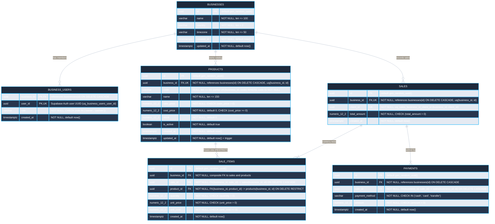

# Modelo de Datos Consolidado (`registro-venta-micro`)

Diagrama Entidad-Relación (ERD) del esquema operativo en PostgreSQL 17 (Alembic aplicado: `d4e7f1a2b9c3`; incluye diseño consolidado `US-03-T06` para `sales`, `sale_items` y `payments` en `openspec/specs/sales-schema-and-rls/spec.md` y `openspec/changes/archive/2026-11-19-us-03-t06-esquema-ventas-rls-db`).  
Todas las tablas operativas están protegidas con `ENABLE` y `FORCE ROW LEVEL SECURITY` usando `app.current_business_id` (y `app.current_user_id` en `business_users` / `businesses` durante login y onboarding).

## Convenciones transversales
- **Identificadores:** `UUID` generados con `gen_random_uuid()` y claves únicas compuestas `(business_id, id)` en tablas operativas padre (`products`, `sales`) para soportar FKs compuestas entre tablas del mismo negocio.
- **Montos, cantidades y stock:** `numeric(12,2)` (prohibido `float` / `double precision`).
- **Fechas:** `timestamptz` en UTC (agrupación diaria mediante `timezone` del comercio).
- **Seguridad:** `REVOKE ALL` a `PUBLIC, anon, authenticated` y `GRANT SELECT, INSERT, UPDATE, DELETE` a `app_api` (heredado por `app_runtime` con `NOBYPASSRLS`).
