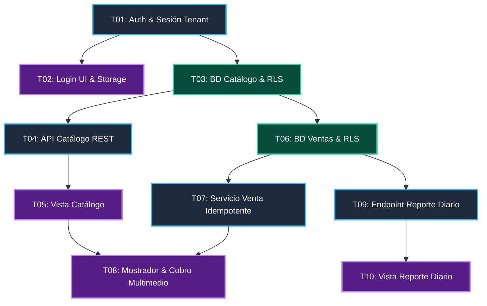

# Backlog Priorizado y Grafo de Dependencias — registro-venta-micro (MVP)

> **Ciclo:** it-project-orchestrator (stories-to-tickets)  
> **Fecha:** 2026-11-09  
> **Alcance:** MVP Acotado a 3 funcionalidades principales (Auth/Catálogo, Venta Multimedio, Reporte Diario)  

---

## 1. Grafo de Dependencias Técnicas



### Leyenda de Colores
- 🟦 **Azul (borde celeste):** Backend (`FastAPI` · Endpoints y Servicios)
- 🟩 **Verde (borde esmeralda):** Base de Datos (`PostgreSQL` · Esquemas, Migraciones Alembic y RLS)
- 🟪 **Morado (borde lila):** Frontend (`React / PWA` · Vistas y Componentes)

---

## 2. Secuencia de Implementación por Fases

| Fase | Tickets | Capa | Trabajo en Paralelo |
|---|---|---|---|
| **Fase 1: Fundación y Auth** | `TICKET-01`<br>`TICKET-02` | Backend<br>Frontend | Una vez listo T01, T02 y T03 se pueden abordar en paralelo. |
| **Fase 2: Catálogo Básico** | `TICKET-03`<br>`TICKET-04`<br>`TICKET-05` | Base de datos<br>Backend<br>Frontend | T03 habilita el esquema de catálogo y las tablas de ventas. |
| **Fase 3: Núcleo Transaccional de Ventas** | `TICKET-06`<br>`TICKET-07`<br>`TICKET-08` | Base de datos<br>Backend<br>Frontend | Corazón del sistema: cobro multimedio, recálculo `Decimal` e idempotencia. |
| **Fase 4: Reporte Diario y Margen** | `TICKET-09`<br>`TICKET-10` | Backend<br>Frontend | Consume las ventas registradas para calcular totales y rentabilidad. |

---

## 3. T-shirt Sizing y Matriz de Riesgo

| Ticket | Título | Capa | Talla | Riesgo | Justificación Técnica |
|---|---|---|:---:|:---:|---|
| **TICKET-01** | Auth & Emisión de Sesión Tenant | Backend | **M** | Medio | Integración con Supabase Auth y seteo de `SET LOCAL app.current_business_id`. |
| **TICKET-02** | Pantalla Login & Token Storage | Frontend | **S** | Bajo | Formulario estándar con redirección reactiva. |
| **TICKET-03** | Esquema Catálogo con RLS | Database | **S** | Bajo | Tabla `products` con migración Alembic y test RLS. |
| **TICKET-04** | API REST Catálogo | Backend | **M** | Bajo | CRUD estándar con esquemas Pydantic `Decimal`. |
| **TICKET-05** | Vista de Catálogo en PWA | Frontend | **M** | Bajo | Grilla táctil reactiva con buscador. |
| **TICKET-06** | Esquema Ventas & Idempotencia RLS | Database | **M** | Medio | Tablas `sales`, `sale_items`, `payments` y clave única de idempotencia. |
| **TICKET-07** | Servicio Venta Idempotente | Backend | **L** | Medio | Transacción ACID crítica: recálculo `Decimal`, desglose de pagos y respuesta idempotente. |
| **TICKET-08** | Pantalla Mostrador & Cobro Multimedio | Frontend | **L** | Medio | UI táctil de carrito, modal de cobros combinados y generación de UUID v4. |
| **TICKET-09** | Endpoint Reporte Diario de Margen | Backend | **M** | Bajo | Agregaciones SQL por fecha y medio de pago, cálculo de margen bruto. |
| **TICKET-10** | Vista de Reporte Diario | Frontend | **S** | Bajo | Pantalla con KPIs visuales y desglose de recaudación. |

---

## 4. Matriz Impacto vs. Complejidad

```
 ALTO  │
       │  [Quick Wins ⭐]               [Proyectos Clave]
       │  ⭐ T01 (Auth Tenant)           T07 (Venta Idempotente BE)
       │  ⭐ T03 (Esquema Catálogo)      T08 (Mostrador Multimedio FE)
       │  ⭐ T09 (Reporte Diario BE)     T06 (Esquema Ventas RLS)
IMPACTO│
       ├─────────────────────────────────────────────────────────────
       │  [Tareas Menores]              [Evaluar / Descartables]
       │  T02 (Login UI FE)             (Stock dinámico - POST-MVP)
       │  T04 (API Catálogo BE)         (Arqueos y sesiones - POST-MVP)
       │  T05 (Catálogo UI FE)          (IA Assistant - POST-MVP)
       │  T10 (Reporte UI FE)
 BAJO  │
       └─────────────────────────────────────────────────────────────
          BAJA                        COMPLEJIDAD               ALTA
```

- **Quick Wins (⭐):** `T01`, `T03` y `T09` entregan alto valor inmediato con bajo esfuerzo.
- **Ruta Crítica:** `T01` → `T03` → `T06` → `T07` → `T08`.
