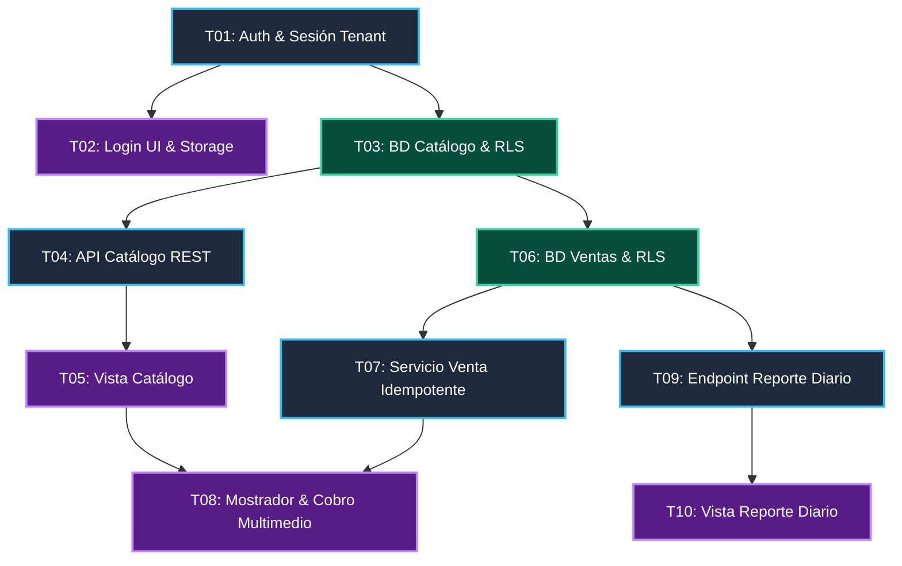

# Backlog Priorizado y Grafo de Dependencias — registro-venta-micro (MVP)

> **Ciclo:** it-project-orchestrator (stories-to-tickets)  
> **Fecha:** 2026-11-09  
> **PRD de Referencia:** [0001_registro-venta-micro_mvp.md](../../prd/0001_registro-venta-micro_mvp.md) (y documento de alcance: [0001_alcance_mvp.md](../../prd/0001_alcance_mvp.md))  
> **Alcance:** MVP Acotado a 3 funcionalidades principales (Auth/Catálogo, Venta Multimedio, Reporte Diario)  

---

## 1. Grafo de Dependencias Técnicas



### Leyenda de Colores
- 🟩 Base de Datos (`PostgreSQL` · Esquemas, Migraciones Alembic y RLS)
- 🟦 Backend (`FastAPI` · Endpoints y Servicios)
- 🟪 Frontend (`React / PWA` · Vistas y Componentes)

---

## 2. Secuencia de Implementación por Fases

| Fase | Tickets | Capa | Trabajo en Paralelo |
|---|---|---|---|
| **Fase 1: Fundación y Auth** | `TICKET-01`<br>`TICKET-02` | Backend<br>Frontend | Una vez listo T01, T02 y T03 se pueden abordar en paralelo. |
| **Fase 2: Catálogo Básico** | `TICKET-03`<br>`TICKET-04`<br>`TICKET-05` | Base de datos<br>Backend<br>Frontend | T03 habilita el esquema de catálogo y las tablas de ventas. |
| **Fase 3: Núcleo Transaccional de Ventas** | `TICKET-06`<br>`TICKET-07`<br>`TICKET-08` | Base de datos<br>Backend<br>Frontend | Corazón del sistema: cobro multimedio, recálculo `Decimal` e idempotencia. |
| **Fase 4: Reporte Diario y Margen** | `TICKET-09`<br>`TICKET-10` | Backend<br>Frontend | Consume las ventas registradas para calcular totales y rentabilidad. |

---

## 3. T-shirt Sizing y Matriz de Riesgo

| Ticket | Título | Capa | Talla | Riesgo | Justificación Técnica |
|---|---|---|:---:|:---:|---|
| [**TICKET-01**](E1-catalogo/tickets-us-01-auth-y-negocio.md) | Auth, Onboarding & Sesión Tenant | Backend | **M** | Medio | Supabase Auth, endpoint `/onboarding` para creación de comercio con `timezone` y RLS. |
| [**TICKET-02**](E1-catalogo/tickets-us-01-auth-y-negocio.md) | Pantalla Login & Onboarding en PWA | Frontend | **S** | Bajo | Formulario de credenciales con paso simple de bienvenida para usuario nuevo. |
| [**TICKET-03**](E1-catalogo/tickets-us-02-gestion-catalogo.md) | Esquema Catálogo con RLS y Stock | Database | **S** | Bajo | Tabla `products` con columnas `sale_price`, `cost_price` y `stock` (`numeric(12,2)`). |
| [**TICKET-04**](E1-catalogo/tickets-us-02-gestion-catalogo.md) | API REST Catálogo de Productos | Backend | **M** | Bajo | CRUD estándar con esquemas Pydantic `Decimal` (precios brutos sin impuestos). |
| [**TICKET-05**](E1-catalogo/tickets-us-02-gestion-catalogo.md) | Vista de Catálogo en PWA | Frontend | **M** | Bajo | Grilla táctil reactiva con buscador y stock visible. |
| [**TICKET-06**](E2-ventas/tickets-us-03-venta-multimedio-idempotente.md) | Esquema Ventas & Idempotencia RLS | Database | **M** | Medio | Tablas `sales`, `sale_items`, `payments` y clave única de idempotencia `(business_id, client_id)`. |
| [**TICKET-07**](E2-ventas/tickets-us-03-venta-multimedio-idempotente.md) | Servicio Venta Idempotente & Stock | Backend | **L** | Medio | Transacción ACID: recálculo `Decimal`, descuento atómico de stock (permite negativo) y respuesta idempotente. |
| [**TICKET-08**](E2-ventas/tickets-us-03-venta-multimedio-idempotente.md) | Mostrador, Vuelto en Efectivo & Cobro | Frontend | **L** | Medio | UI táctil de carrito, calculador de vuelto en efectivo y UUID persistido en carrito. |
| [**TICKET-09**](E3-reportes/tickets-us-04-reporte-ventas-y-margen.md) | Endpoint Reporte Diario en Hora Local | Backend | **M** | Bajo | Agregaciones SQL por fecha local (`timezone`), cálculo de margen bruto y protección división por cero. |
| [**TICKET-10**](E3-reportes/tickets-us-04-reporte-ventas-y-margen.md) | Vista de Reporte Diario | Frontend | **S** | Bajo | Pantalla con KPIs visuales y desglose por medio de pago. |

---

## 4. Matriz Impacto vs. Complejidad

```
 IMPACTO
  ALTO  │ [Quick Wins ⭐]             [Core MVP - Transaccional]  [Post-MVP / Alta Complejidad]
        │ ⭐ T01 (Auth & Onboarding)   T07 (Venta Idemp. + Stock)  • Motor de impuestos (IVA)
        │ ⭐ T03 (Esquema Catálogo)    T08 (Mostrador con Vuelto)  • Notas de crédito y débito
        │ ⭐ T09 (Reporte Diario)      T06 (Esquema Ventas RLS)    • Arqueos y sesiones de caja
        │                                                          • Gestión empleados y roles
        ├────────────────────────────────────────────────────────────────────────────────────────
 MEDIO/ │ [Habilitadores / UI]        [Gestión de Catálogo]       [Descartables / Baja prioridad]
  BAJO  │ T02 (Login/Onboarding UI)   T04 (API Catálogo BE)       • Asistente IA lenguaje natural
        │ T10 (Vista Reporte UI)      T05 (Vista Catálogo FE)     • Sincronización offline multi-tab
        └────────────────────────────────────────────────────────────────────────────────────────
                  BAJA                         MEDIA                         ALTA
                                            COMPLEJIDAD
```

- **Quick Wins (⭐):** `T01`, `T03` y `T09` entregan alto valor inmediato con bajo esfuerzo (complejidad baja).
- **Core MVP (Complejidad Media):** `T06`, `T07` y `T08` resuelven el corazón transaccional de ventas, stock e idempotencia sin sobrediseñar.
- **Post-MVP (Alto Impacto / Alta Complejidad):** Requerimientos como el motor impositivo, notas de crédito, arqueos ciegos y gestión de empleados aportan valor pero su alta complejidad técnica y fiscal sobrecargaría el lanzamiento inicial.
- **Ruta Crítica:** `T01` → `T03` → `T06` → `T07` → `T08`.
