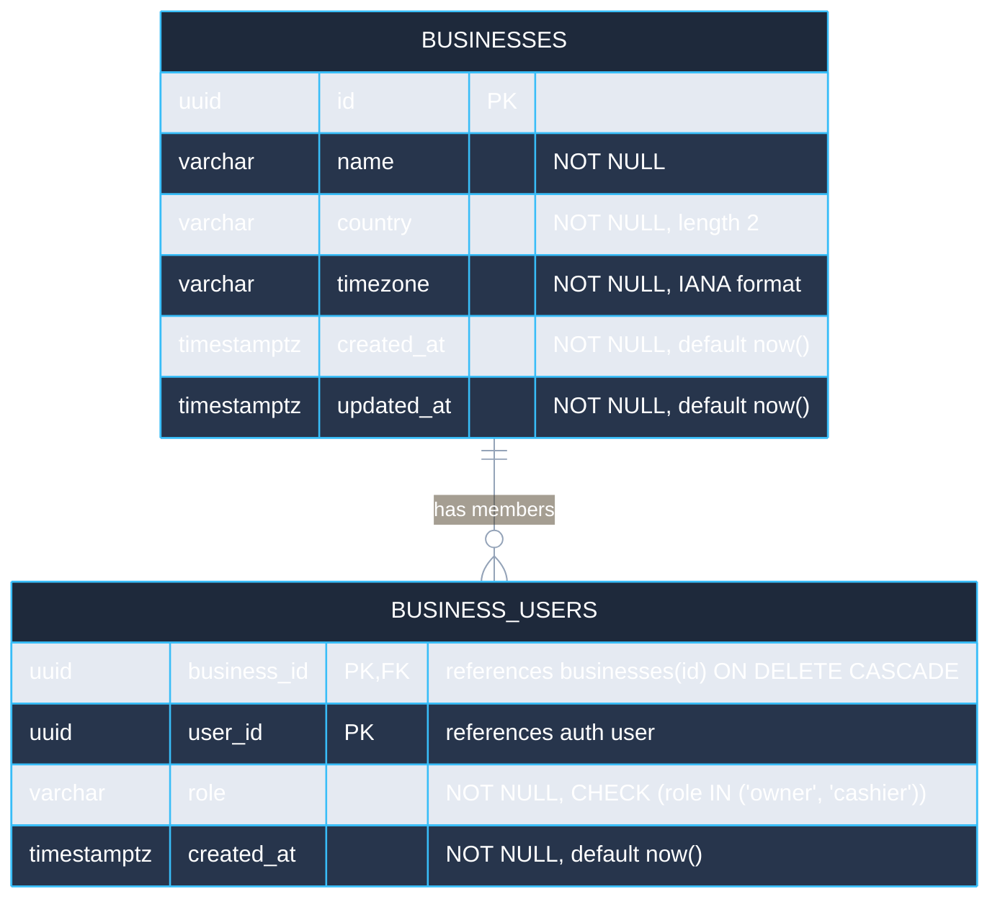

## Context

El proyecto `registro-venta-micro` opera bajo un modelo multitenant con aislamiento riguroso en PostgreSQL mediante Row-Level Security (RLS). Este cambio formaliza el modelo fundacional de datos: la tabla `businesses` y la tabla de membresía `business_users`. Toda consulta transaccional posterior depende de que estas tablas existan y de que las políticas RLS respondan a la variable de sesión `app.current_business_id`.

### Convenciones e Infraestructura Detectada

```yaml
engine: "postgres"
migrations_dir: "backend/migrations"
security_dir: "backend/migrations"
seeds_dir: "backend/scripts"
tests_dir: "backend/tests"
migration_mode: "forward-only"
rls_mode: "dedicated"
requires_seeds: false
test_cmd: "cd backend && uv run pytest"
validation_cmd: "none"
up_cmd: "cd backend && uv run alembic upgrade head"
down_cmd: "cd backend && uv run alembic downgrade -1"
snapshot_cmd: "none"
```

## Estado observado de la base

- **Fecha de inspección**: 2026-11-16
- **Fuente**: Repositorio local (`backend/migrations/versions/`) y base de datos local.
- **Tablas existentes**: Únicamente `alembic_version` tras la migración baseline (`ba617f3a8caa_baseline.py`). Estado categorizado como **Greenfield de Dominio**. No existen tablas operativas ni datos previos en conflicto.

## Reversibilidad y Compatibilidad

| Operación | Tablas | Filas Actuales | Clasificación | Estrategia de Rollback |
|---|---|---|---|---|
| `CREATE TABLE businesses` | `businesses` | 0 | `reversible` | `DROP TABLE IF EXISTS businesses CASCADE;` en `downgrade()` |
| `CREATE TABLE business_users` | `business_users` | 0 | `reversible` | `DROP TABLE IF EXISTS business_users CASCADE;` en `downgrade()` |
| `ENABLE ROW LEVEL SECURITY` | `businesses`, `business_users` | 0 | `reversible` | `ALTER TABLE ... DISABLE ROW LEVEL SECURITY;` en `downgrade()` |
| `CREATE POLICY tenant_isolation` | `businesses`, `business_users` | 0 | `reversible` | `DROP POLICY IF EXISTS ... ON ...;` en `downgrade()` |

## Normalización y Modelo Relacional

El modelo se encuentra en Tercera Forma Normal (3NF). La entidad `businesses` almacena los atributos intrínsecos de cada comercio, mientras que la tabla asociativa `business_users` desvincula la identidad de autenticación del usuario (`user_id` originado en Supabase Auth) del comercio concreto, permitiendo que un mismo usuario pueda participar en distintos negocios con roles diferenciados (`owner`, `cashier`).

### Diagrama Entidad-Relación (ERD)



## Diccionario Físico de Datos

### Tabla: `businesses`
| Columna | Tipo | Nulabilidad | Default | Constraints | Descripción |
|---|---|---|---|---|---|
| `id` | `UUID` | NOT NULL | `gen_random_uuid()` | PRIMARY KEY | Identificador único del comercio (tenant_id) |
| `name` | `VARCHAR(100)` | NOT NULL | - | `CHECK (char_length(trim(name)) > 0)` | Nombre fantasía o razón del negocio [PII Leve] |
| `country` | `VARCHAR(2)` | NOT NULL | - | `CHECK (char_length(country) = 2)` | Código ISO 3166-1 alfa-2 del país |
| `timezone` | `VARCHAR(50)` | NOT NULL | - | - | Zona horaria IANA canónica para reportes diarios |
| `created_at` | `TIMESTAMPTZ` | NOT NULL | `CURRENT_TIMESTAMP` | - | Marca de tiempo de alta |
| `updated_at` | `TIMESTAMPTZ` | NOT NULL | `CURRENT_TIMESTAMP` | - | Marca de tiempo de última modificación |

### Tabla: `business_users`
| Columna | Tipo | Nulabilidad | Default | Constraints | Descripción |
|---|---|---|---|---|---|
| `business_id` | `UUID` | NOT NULL | - | PK, FK -> `businesses(id)` ON DELETE CASCADE | Comercio al que pertenece la membresía |
| `user_id` | `UUID` | NOT NULL | - | PK | Identificador del usuario (Supabase Auth) |
| `role` | `VARCHAR(20)` | NOT NULL | - | `CHECK (role IN ('owner', 'cashier'))` | Rol operativo dentro del negocio |
| `created_at` | `TIMESTAMPTZ` | NOT NULL | `CURRENT_TIMESTAMP` | - | Marca de tiempo de asignación |

## Estrategia de Seguridad RLS

1. **Activación de RLS**:
   - `ALTER TABLE businesses ENABLE ROW LEVEL SECURITY;`
   - `ALTER TABLE businesses FORCE ROW LEVEL SECURITY;`
   - `ALTER TABLE business_users ENABLE ROW LEVEL SECURITY;`
   - `ALTER TABLE business_users FORCE ROW LEVEL SECURITY;`
2. **Políticas de Aislamiento**:
   - En `businesses`: `USING (id = NULLIF(current_setting('app.current_business_id', true), '')::uuid)`
   - En `business_users`: `USING (business_id = NULLIF(current_setting('app.current_business_id', true), '')::uuid)`
   - Política permisiva para onboarding: Permite el `INSERT` inicial durante el flujo de creación de un negocio cuando el usuario autenticado aún no posee `current_business_id`.
