## Context

El sistema `registro-venta-micro` opera bajo un modelo multitenant con aislamiento estricto mediante Row-Level Security (RLS) forzada en PostgreSQL 17. El contrato de base de datos (`businesses`, `business_users`, restricción `uq_business_users_user_id` sobre `user_id`, políticas RLS granulares y rol no privilegiado `app_api`) ya fue implementado, validado y archivado en el cambio `#53` (`openspec/specs/businesses-schema-and-rls/spec.md`, migraciones `20261116_0002-c843e91d84f1_create_businesses_and_rls.py` y `20261117_0003-e4a7c2b91f03_fix_businesses_rls_and_unique_user.py`, y modelos ORM en `backend/app/modules/auth/models.py`).

La capa backend consume dicho esquema de forma **100% inmutable** (`Gate 3` prohíbe cualquier `diff` en `backend/migrations`) y adopta la **Opción A** cerrada en `#53`:
- Conservar `app.current_business_id` como variable de contexto de tenant (sin renombrar a `app.tenant_id`).
- Incorporar `app.current_user_id` para consultas de membresía en login (`SELECT` en `business_users`) e inserción autenticada en onboarding (`INSERT` en `business_users`).
- Ejecutar todas las operaciones de usuario bajo el rol `app_api` (`NOSUPERUSER NOBYPASSRLS`, sin privilegio `TRUNCATE` y prohibiendo `service_role`). Conforme a `openspec/specs/db/known-gotchas.md`, en entornos locales/CI donde `DATABASE_URL` conecta como `postgres` y `app_api` es `NOLOGIN`, la sesión transaccional ejecuta `SET LOCAL ROLE app_api` (habilitado por `GRANT app_api TO CURRENT_USER` en migración `0003`).

### Convenciones e Infraestructura Detectada

```yaml
stack: "Python 3.14 / FastAPI"
backend_dir: "backend/app"
arch_pattern: "monolito-modular-capas"
db_mode: "with-db"
db_dirs: "backend/migrations"
migration_exts: ".py"
typegen_cmd: "none"
rls_mode: "in-situ"
auth_mode: "jwt"
contract_style: "code-first"
openapi_path: "none"
openapi_export_cmd: "none"
tests_dir: "backend/tests"
lint_cmd: "cd backend && uv run ruff check . && uv run ruff format --check ."
typecheck_cmd: "cd backend && uv run mypy app"
test_cmd: "cd backend && uv run pytest"
test_fast_cmd: "cd backend && uv run pytest tests/unit"
test_integration_cmd: "cd backend && uv run pytest tests/integration"
test_migrate_cmd: "cd backend && uv run alembic upgrade head"
scaffold_cmd: "none"
seed_cmd: "none"
mutation_cmd: "none"
```

## Goals / Non-Goals

**Goals:**
- Implementar `POST /api/v1/auth/login` autenticando credenciales contra Supabase Auth (`httpx`), resolviendo membresía bajo `SET LOCAL ROLE app_api` + `SET LOCAL app.current_user_id` (y leyendo `businesses` tras fijar `SET LOCAL app.current_business_id`) y emitiendo JWT en cookie `HttpOnly; SameSite=Strict`.
- Implementar `POST /api/v1/auth/onboarding` generando `business_id = uuid4()` en Python y fijando `SET LOCAL ROLE app_api` + `SET LOCAL app.current_user_id` + `SET LOCAL app.current_business_id` antes de `INSERT INTO businesses ... RETURNING` + `INSERT INTO business_users` (`role = 'owner'`).
- Validar `country` contra `COUNTRY_TIMEZONES` y validar `timezone` (tanto explícito opcional como resuelto desde país) usando `zoneinfo.ZoneInfo` en Pydantic v2 (con `tzdata` en `pyproject.toml`).
- Garantizar unicidad e idempotencia ante reintentos/concurrencia sobre `UNIQUE (user_id)` (`uq_business_users_user_id`, SQLSTATE `23505`) devolviendo `409 Conflict` tras rollback completo de la transacción.
- Proveer utilidades core de sesión/BD y seguridad (`backend/app/core/config.py`, `backend/app/core/db.py`, `backend/app/core/security.py`) reutilizables por todos los módulos de dominio (`get_tenant_db`).
- Cubrir login, onboarding, validación IANA `ZoneInfo`, concurrencia (`409`) y aislamiento RLS bajo `app_api` en `backend/tests/`.

**Non-Goals:**
- Crear o modificar migraciones Alembic (`backend/migrations/`) o modelos SQLAlchemy (`backend/app/modules/auth/models.py`), ya cerrados e inmutables tras `#53`.
- Interfaz gráfica en frontend (Issue `#40`).
- Login social OAuth, recuperación de contraseñas, rotación persistida de refresh tokens o invitación de cajeros/multi-negocio (fuera del MVP).

## Architecture & Data Flow

```mermaid
%%{init: {'theme': 'base', 'themeVariables': { 'primaryColor': '#1e293b', 'primaryTextColor': '#ffffff', 'primaryBorderColor': '#38bdf8', 'lineColor': '#94a3b8', 'actorBkg': '#1e293b', 'actorTextColor': '#ffffff', 'actorBorderColor': '#38bdf8', 'signalColor': '#94a3b8', 'signalTextColor': '#ffffff' }}}%%
sequenceDiagram
    autonumber
    participant C as PWA Client
    participant R as Auth Router
    participant S as Auth / Onboarding Service
    participant SA as Supabase Auth (httpx)
    participant DB as PostgreSQL 17 (RLS app_api)

    rect rgb(30, 41, 59)
        Note over C,DB: Flujo 1 — Login (POST /api/v1/auth/login)
        C->>R: POST /api/v1/auth/login (email, password)
        R->>S: login(email, password)
        S->>SA: POST /auth/v1/token?grant_type=password
        SA-->>S: 200 user_id (sub) | 400/401 Error
        S->>DB: BEGIN + SET LOCAL ROLE app_api + app.current_user_id
        S->>DB: SELECT business_id, role FROM business_users
        alt Membresia encontrada
            S->>DB: SET LOCAL app.current_business_id = business_id
            S->>DB: SELECT id, name, country, timezone FROM businesses
            S-->>R: LoginResponse(requires_onboarding=false, business)
        else Sin comercio asignado
            S-->>R: LoginResponse(requires_onboarding=true, business=null)
        end
        R-->>C: 200 OK + Set-Cookie access_token (HttpOnly JWT)
    end

    rect rgb(30, 41, 59)
        Note over C,DB: Flujo 2 — Onboarding (POST /api/v1/auth/onboarding)
        C->>R: POST /api/v1/auth/onboarding + Cookie access_token
        R->>R: Validar JWT (user_id) y Pydantic (country + ZoneInfo)
        R->>S: onboard(user_id, name, country, timezone)
        S->>S: business_id = uuid4()
        S->>DB: BEGIN + SET LOCAL ROLE app_api + app.current_user_id + app.current_business_id
        S->>DB: INSERT INTO businesses (...) RETURNING *
        S->>DB: INSERT INTO business_users (business_id, user_id, 'owner')
        alt Violacion uq_business_users_user_id (23505)
            DB-->>S: IntegrityError (23505)
            S->>DB: ROLLBACK completo (0 huerfanos)
            S-->>R: ConflictError -> 409 Conflict
        else Commit exitoso
            DB-->>S: COMMIT
            S-->>R: BusinessResponse + nuevo JWT con business_id
            R-->>C: 201 Created + Set-Cookie access_token actualizado
        end
    end
```



## API & Schema Contracts (Code-First)

### 1. Configuración (`backend/app/core/config.py`)

`Settings(BaseSettings)` conserva `database_url: str` y agrega configuración tipada sin secretos hardcodeados:
- `supabase_url: str | None = None`
- `supabase_anon_key: str | None = None` (prohibido usar `service_role` en flujos de usuario)
- `jwt_secret_key: str | None = None`
- `jwt_algorithm: str = "HS256"`
- `access_token_expire_minutes: int = 15`
- `cookie_name: str = "access_token"`
- `cookie_secure: bool = True` (configurable a `False` en desarrollo local/tests HTTP)
- `db_pool_statement_cache_size: int = 0` (requerido para compatibilidad con pooler de transacciones de Supabase / PgBouncer)

> **Nota de compatibilidad CI/Alembic:** `alembic` y los tests de integración existentes (`test_db_businesses.py`) invocan `get_settings()` en entornos donde solo `DATABASE_URL` está definido (`ci-backend.yml`). Por ello `supabase_url`, `supabase_anon_key` y `jwt_secret_key` tienen default `None` en `Settings` y se validan en forma *fail-closed* al invocar dependencias/servicios de autenticación (`RuntimeError` / HTTP 500 si faltan en runtime).

### 2. Modelos de Entrada/Salida Pydantic v2 (`backend/app/modules/auth/schemas.py`)

- **Catálogo `COUNTRY_TIMEZONES`** (ISO 3166-1 alpha-2 -> IANA TZ `<= 50` chars, todos válidos en `ZoneInfo`):
  - `"AR": "America/Argentina/Buenos_Aires"`
  - `"UY": "America/Montevideo"`
  - `"CL": "America/Santiago"`
  - `"CO": "America/Bogota"`
  - `"MX": "America/Mexico_City"`
  - `"PE": "America/Lima"`
  - `"PY": "America/Asuncion"`
  - `"BO": "America/La_Paz"`
  - `"EC": "America/Guayaquil"`
  - `"BR": "America/Sao_Paulo"`
  - `"ES": "Europe/Madrid"`
  - `"US": "America/New_York"`

- **Esquemas y Validadores**:
  - `LoginRequest`:
    - `email: str` (stripped, lowercase, validado formato email `^[^@\s]+@[^@\s]+\.[^@\s]+$`)
    - `password: str` (`min_length=1`)
  - `UserPayload`: `id: uuid.UUID`, `email: str`
  - `BusinessSummary`: `id: uuid.UUID`, `name: str`, `country: str`, `timezone: str`, `role: Literal["owner", "cashier"]`
  - `LoginResponse`: `user: UserPayload`, `requires_onboarding: bool`, `business: BusinessSummary | None = None`
  - `OnboardingRequest`:
    - `name: str` (stripped, `min_length=1`, `max_length=100`; no admite cadena solo espacios)
    - `country: str` (stripped, uppercased, longitud exacta `2`, debe existir en `COUNTRY_TIMEZONES`; si no existe -> `422`)
    - `timezone: str | None = None` (opcional; si se envía: stripped, no vacío, `max_length=50`, validado con `zoneinfo.ZoneInfo(value)`; si es `None`, se resuelve `COUNTRY_TIMEZONES[country]` en `@model_validator(mode="after")` y se valida también con `zoneinfo.ZoneInfo` y longitud `<= 50`)
  - `BusinessResponse`: `id: uuid.UUID`, `name: str`, `country: str`, `timezone: str`, `role: Literal["owner", "cashier"] = "owner"`, `created_at: datetime`
  - `ErrorResponse`: `code: str`, `message: str`, `details: Any | None = None`

### 3. Rutas y Códigos HTTP (`backend/app/modules/auth/router.py`, prefijo `/api/v1`)

| Operación | Auth | Respuestas | Cookie emitida |
|---|---|---|---|
| `POST /api/v1/auth/login` | Pública | `200 OK` (`LoginResponse`), `401` (`INVALID_CREDENTIALS`), `422` (payload inválido) | `access_token=<jwt>; HttpOnly; SameSite=Strict; Path=/` (+ `Secure` según `cookie_secure`) |
| `POST /api/v1/auth/onboarding` | Cookie JWT válida (`sub`) | `201 Created` (`BusinessResponse`), `401` (`UNAUTHENTICATED`), `409` (`BUSINESS_ALREADY_EXISTS`), `422` (`country`/`timezone`/`name` inválido) | Refresca `access_token=<jwt>` incluyendo `business_id` y `role="owner"` |

### 4. Claims JWT y Dependencias Transaccionales RLS (`core/security.py`, `core/db.py`)

- **Claims del JWT propio (`PyJWT`)**:
  - `sub: str` (`user_id` UUID de Supabase Auth)
  - `email: str`
  - `business_id: str | None` (`None` si `requires_onboarding=True`; UUID string tras login con negocio u onboarding)
  - `role: Literal["owner", "cashier"] | None`
  - `iat: int`, `exp: int` (15 minutos)
- **Dependencias de Base de Datos (`core/db.py`)**:
  - `get_user_db(current_user)`: abre transacción async, ejecuta `SET LOCAL ROLE app_api` y `SELECT set_config('app.current_user_id', :user_id, true)` (equivalente parametrizado de `SET LOCAL app.current_user_id = '<user_id>'`, seguro con `asyncpg` que no acepta `$1` en sentencias `SET LOCAL`).
  - `get_tenant_db(current_user)`: si `current_user.business_id is None`, responde `403 Forbidden` (`code="ONBOARDING_REQUIRED"`) sin abrir contexto de tenant; si existe, abre transacción async y ejecuta `SET LOCAL ROLE app_api`, `SELECT set_config('app.current_user_id', :user_id, true)` y `SELECT set_config('app.current_business_id', :business_id, true)` antes de ceder `AsyncSession`.

## Decisions

1. **Inmutabilidad del Modelo de Datos (`#53`)**:
   - *Por qué*: `businesses`, `business_users`, `uq_business_users_user_id`, las políticas RLS granulares y el rol `app_api` ya están migrados en `0002`/`0003` y sincronizados con `backend/app/modules/auth/models.py` (`alembic check` limpio). Gate 3 exige `No-DB-Diff`.
   - *Decisión*: El repositorio importa y consume directamente `Business` y `BusinessUser` sin crear migraciones ni modificar `models.py`.

2. **Búsqueda en Dos Pasos durante Login bajo Opción A**:
   - *Por qué*: En `#53`, `business_users_select_isolation` permite `SELECT` por `app.current_user_id`, pero `businesses_tenant_isolation` exige `app.current_business_id`. Si el repositorio hiciera `JOIN businesses` antes de fijar `app.current_business_id`, PostgreSQL devolvería 0 filas silenciosamente para `businesses`.
   - *Decisión*: Dentro de la transacción de login se ejecuta primero `SET LOCAL app.current_user_id` y se consulta `business_users`; solo si existe `business_id`, se fija `SET LOCAL app.current_business_id` y se lee `businesses`.

3. **Onboarding Atómico con UUID en Python e Idempotencia por `UNIQUE (user_id)`**:
   - *Por qué*: `INSERT INTO businesses ... RETURNING` evalúa la política `SELECT` (`businesses_tenant_isolation`), la cual falla si `app.current_business_id` no coincide con el `id` insertado. Además, dos peticiones concurrentes de onboarding podrían superar una validación previa en memoria.
   - *Decisión*: Generar `business_id = uuid4()` en Python, ejecutar `SET LOCAL ROLE app_api`, `SET LOCAL app.current_user_id` y `SET LOCAL app.current_business_id = str(business_id)`, y luego ejecutar `INSERT INTO businesses ... RETURNING` + `INSERT INTO business_users (role='owner')`. Tanto un chequeo previo (`business_id` ya en sesión o fila existente en `business_users`) como la captura de `IntegrityError` con SQLSTATE `23505` hacen `rollback` completo de la transacción (evitando comercios huérfanos en `businesses`) y devuelven `409 Conflict`.

4. **Validación IANA de `timezone` con `zoneinfo.ZoneInfo` y `tzdata` (Hallazgo #5 de `#53`)**:
   - *Por qué*: La columna `businesses.timezone` en BD solo valida `VARCHAR(50) NOT NULL`, por lo que sin validación IANA en la frontera API podrían persistirse cadenas arbitrarias que romperían reportes por fecha local (`AT TIME ZONE b.timezone` en `#46`/F3). Adicionalmente, en Windows Python 3.14 `ZoneInfo` requiere el paquete `tzdata` para resolver claves IANA.
   - *Decisión*: Agregar `tzdata` vía `uv add tzdata`, mantener el catálogo determinista `COUNTRY_TIMEZONES` para autocompletar por país cuando `timezone` se omite, y validar con `zoneinfo.ZoneInfo` + longitud `<= 50` toda zona recibida explícitamente o resuelta por país.

5. **Ejecución Transaccional Parametrizada de Contexto RLS (`set_config(..., true)` + `SET LOCAL ROLE app_api`)**:
   - *Por qué*: PostgreSQL/asyncpg no admite bind parameters (`$1`) en sentencias `SET LOCAL var = :val`, y `postgres` en Supabase local puede tener `BYPASSRLS` si no se cambia de rol.
   - *Decisión*: Usar `SELECT set_config('app.current_user_id', :uid, true)` y `SELECT set_config('app.current_business_id', :bid, true)` (semántica idéntica a `SET LOCAL`, alcance exclusivo de transacción) precedidos por `SET LOCAL ROLE app_api`. El motor async configura `connect_args={"statement_cache_size": settings.db_pool_statement_cache_size}` (`0` por defecto).

## Risks / Trade-offs

- **[Risk]** En Windows sin el paquete `tzdata`, `zoneinfo.ZoneInfo("America/Argentina/Buenos_Aires")` lanza `ZoneInfoNotFoundError`.  
  → **Mitigación**: Instalar `tzdata` en `backend/pyproject.toml` con `cd backend && uv add tzdata` como primera tarea de `tasks.md`.
- **[Risk]** `GET`/`JOIN` sobre `businesses` antes de fijar `app.current_business_id` devuelve 0 filas por `businesses_tenant_isolation`.  
  → **Mitigación**: Consulta secuencial documentada en `AuthRepository` (`business_users` bajo `app.current_user_id` → `SET LOCAL app.current_business_id` → `businesses`).
- **[Risk]** Carrera concurrente en onboarding deja fila huérfana en `businesses` porque `businesses_onboarding_insert` tiene `WITH CHECK (true)`.  
  → **Mitigación**: `businesses` y `business_users` se insertan dentro de una única transacción; al capturar `IntegrityError` (`23505`), la transacción ejecuta rollback total antes de responder `409 Conflict`.
- **[Risk]** El job `tests` de `.github/workflows/ci-backend.yml` solo exporta `DATABASE_URL` en `env:`.  
  → **Mitigación**: Variables de Supabase Auth y JWT opcionales (`None`) en `Settings` con verificación explícita al usar servicios de auth, permitiendo que `alembic` y tests de BD previos corran sin cambios en CI.
