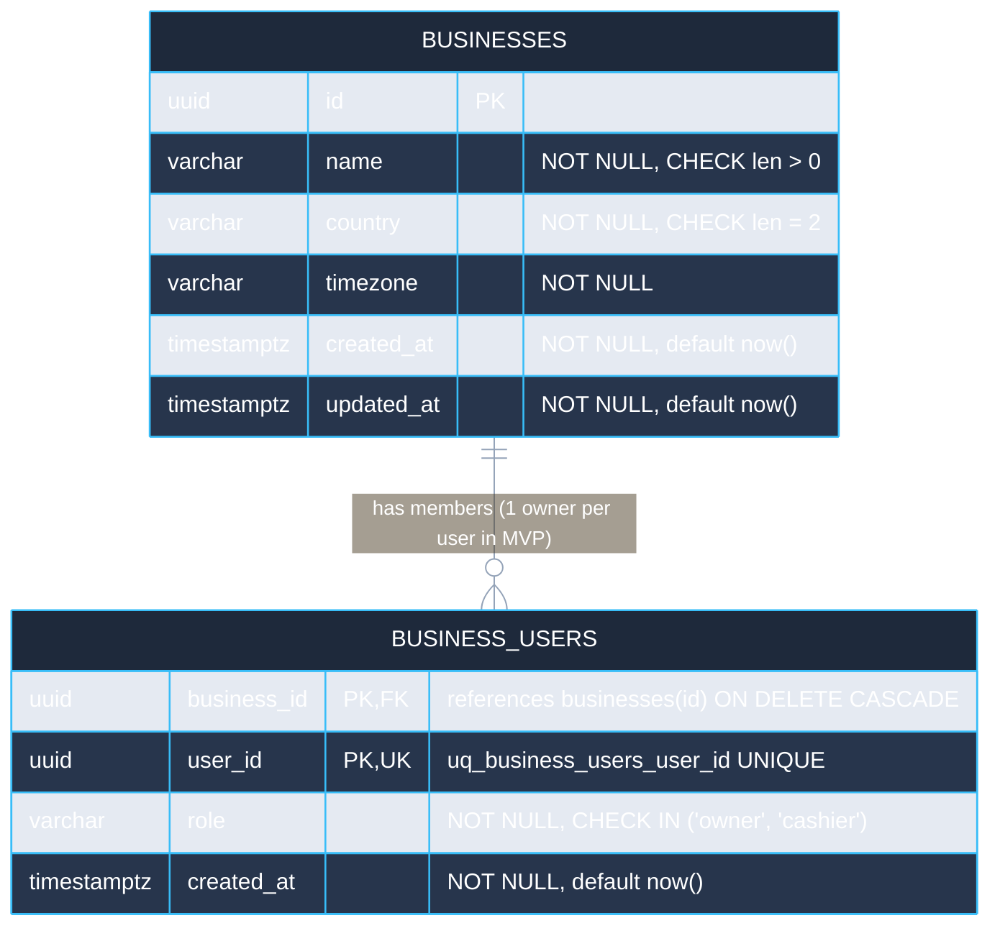

## Context

La auditoría adversarial ejecutada sobre `businesses-schema-and-rls` (Issue #53, bloqueante de #39 / PR #52) identificó cuatro defectos críticos/altos en la capa de base de datos introducida por la migración `20261116_0002-c843e91d84f1_create_businesses_and_rls.py`:

1. **Deadlock de login en `business_users`**: La única política de lectura (`business_users_tenant_isolation`) exige `app.current_business_id`, dato que el backend aún no conoce durante el login (solo dispone del `user_id` autenticado en Supabase Auth).
2. **Inserción abierta en `business_users`**: `business_users_onboarding_insert` usa `FOR INSERT WITH CHECK (true)`, permitiendo insertar membresías arbitrarias para cualquier `user_id` o sin contexto de usuario. Además, al ser `business_users_tenant_isolation` una política `FOR ALL`, se combina con `OR` en `INSERT`.
3. **Ausencia de `UNIQUE (user_id)` en `business_users`**: El MVP define un modelo de comercio único por dueño (`docs/prd/0001_alcance_mvp.md`), pero el esquema solo tiene PK compuesta `(business_id, user_id)` y un índice no único `ix_business_users_user_id`, permitiendo que un mismo usuario quede asociado a múltiples negocios ante reintentos concurrentes de onboarding.
4. **Permisos DCL faltantes para `app_api`**: La migración `0002` otorgó permisos únicamente a `authenticated, service_role`, omitiendo el rol de runtime `app_api` referenciado en `backend/app/core/config.py` y `README.md`. Además, ningún script del repo ni de CI (`.github/workflows/ci-backend.yml`) crea `app_api` antes de `alembic upgrade head`.

Por **decisión explícita del usuario (Opción A)**, se mantiene `app.current_business_id` como variable de sesión de negocio (sin renombrar a `app.tenant_id`) y se incorpora `app.current_user_id`.

### Convenciones e Infraestructura Detectada

```yaml
engine: "postgres"
migrations_dir: "backend/migrations"
security_dir: "backend/migrations"
seeds_dir: "none"
tests_dir: "backend/tests"
tests_domain_convention: "backend/tests/integration/test_db_<dominio>.py"
migration_mode: "forward-only"
rls_mode: "in-situ"
requires_seeds: false
test_cmd: "cd backend && uv run pytest"
validation_cmd: "cd backend && uv run ruff check . && uv run ruff format --check . && uv run mypy app"
sql_from_cmd: "cd backend && uv run alembic upgrade head --sql"
typecheck_cmd: "cd backend && uv run mypy app"
up_cmd: "cd backend && uv run alembic upgrade head"
down_cmd: "cd backend && uv run alembic downgrade -1"
snapshot_cmd: "none"
```

> **Nota de compatibilidad con runners (`validate-db-migrations.js` / `db-verify-gate.js`)**:
> Las migraciones viven en Python/Alembic (`backend/migrations/versions/*.py`) con políticas RLS embebidas (`rls_mode: "in-situ"`). Se declara `migration_mode: "forward-only"` con `sql_from_cmd: "cd backend && uv run alembic upgrade head --sql"` porque `db-verify-gate.js` no expone `--down-sql-from-cmd`; no obstante, la migración Python debe implementar `upgrade()` y `downgrade()` simétricos completos para satisfacer `alembic downgrade base && alembic upgrade head` y `alembic check` en `.github/workflows/ci-backend.yml`.

## Goals / Non-Goals

**Goals:**
- Resolver el deadlock de login en `business_users` habilitando `SELECT` por `app.current_user_id` además de `app.current_business_id`.
- Blindar `INSERT`, `UPDATE` y `DELETE` en `business_users` con políticas granulares por operación que impidan inserciones impersonadas (`WITH CHECK (true)` eliminado) y tenant hijacking.
- Garantizar un único negocio por usuario (`UNIQUE (user_id)` en BD y `backend/app/modules/auth/models.py`).
- Provisionar de forma idempotente el rol no privilegiado `app_api` (`NOSUPERUSER NOBYPASSRLS`) y otorgarle privilegios DML explícitos sobre `businesses` y `business_users` operando bajo RLS.
- Cubrir todos los vectores de ataque y flujos de login/onboarding en `backend/tests/integration/test_db_businesses.py`.

**Non-Goals:**
- Renombrar `app.current_business_id` a `app.tenant_id` (descartado por decisión explícita Opción A).
- Validación IANA de `timezone` en esquemas Pydantic (hallazgo medio #5 de `capa:backend`, diferido a `#39`).
- Modificación de migraciones Alembic ya existentes (`20261102_0001-...` o `20261116_0002-...`), prohibida por el job `migrations-integrity` de CI.
- Implementación de endpoints/repositorios FastAPI (`#39`) ni tablas de catálogo o ventas (`#42`, `#46`).

## Estado observado de la base

- **Fecha de inspección**: `2026-11-17`
- **Disponibilidad de `DB_DEV_RO_URL`**: **No disponible en vivo** — Docker / PostgreSQL local (Supabase) no se encuentra levantado durante la fase de exploración, por lo que no fue posible consultar `information_schema` ni contar filas en vivo vía `DB_DEV_RO_URL`.
- **Fuente inspeccionada**: Repositorio local (`backend/migrations/versions/20261102_0001-ba617f3a8caa_baseline.py`, `backend/migrations/versions/20261116_0002-c843e91d84f1_create_businesses_and_rls.py`, salida offline de `uv run alembic upgrade head --sql`, `backend/app/modules/auth/models.py`, `backend/tests/integration/test_db_businesses.py`, `supabase/config.toml` y `.github/workflows/ci-backend.yml`).
- **Esquema observado (hasta revisión `c843e91d84f1`)**:
  - `public.businesses`: `id` (`UUID`, PK `pk_businesses`, default `gen_random_uuid()`), `name` (`VARCHAR(100)` NOT NULL, `chk_businesses_name_not_empty`), `country` (`VARCHAR(2)` NOT NULL, `chk_businesses_country_length`), `timezone` (`VARCHAR(50)` NOT NULL), `created_at` / `updated_at` (`TIMESTAMPTZ` NOT NULL, default `now()`). RLS habilitada y forzada (`businesses_tenant_isolation` `FOR ALL`, `businesses_onboarding_insert` `FOR INSERT WITH CHECK (true)`).
  - `public.business_users`: `business_id` (`UUID` NOT NULL, FK -> `businesses(id) ON DELETE CASCADE`), `user_id` (`UUID` NOT NULL), `role` (`VARCHAR(20)` NOT NULL, `chk_business_users_role_valid`), `created_at` (`TIMESTAMPTZ` NOT NULL, default `now()`). PK compuesta `pk_business_users (business_id, user_id)`, índice no único `ix_business_users_user_id (user_id)`. RLS habilitada y forzada (`business_users_tenant_isolation` `FOR ALL`, `business_users_onboarding_insert` `FOR INSERT WITH CHECK (true)`).
  - **Roles y DCL**: `0002` solo ejecuta `GRANT ALL ON TABLE ... TO authenticated, service_role;`. No existe migración ni script `roles.sql` que cree `app_api` en CI o en Supabase local (`supabase/config.toml`).
  - **ORM vs Migración**: `BusinessUser` en `backend/app/modules/auth/models.py` no declara `UniqueConstraint("user_id")` ni índice explícito.

## Reversibilidad

> **Nota sobre conteo de filas**: `DB_DEV_RO_URL` no está disponible en vivo (Docker/PostgreSQL local apagado el `2026-11-17`). El repositorio corresponde a un **Greenfield de dominio** (tablas creadas en este mismo PR `#52` / `#39` sin datos productivos).

| Operación | Tablas | Filas reales (vía RO + fecha) | Clasificación | Rollback / Compensatoria |
|---|---|---|---|---|
| `DROP INDEX ix_business_users_user_id` + `ADD CONSTRAINT uq_business_users_user_id UNIQUE (user_id)` | `business_users` | N/A (`DB_DEV_RO_URL` offline el `2026-11-17`; greenfield) | `reversible` *(o `falla-en-alto` si existieran duplicados de `user_id`)* | En `downgrade()`: `DROP CONSTRAINT uq_business_users_user_id` y recrear `CREATE INDEX ix_business_users_user_id ON business_users (user_id)`. |
| Reemplazo de `business_users_tenant_isolation` (`FOR ALL`) y `business_users_onboarding_insert` (`WITH CHECK (true)`) por políticas granulares (`SELECT`, `INSERT`, `UPDATE`, `DELETE`) | `business_users` | N/A (`DB_DEV_RO_URL` offline el `2026-11-17`) | `reversible` | En `downgrade()`: `DROP POLICY` de las 4 políticas nuevas y restauración exacta de las 2 políticas previas de `c843e91d84f1`. |
| Creación idempotente del rol `app_api` (`NOLOGIN NOSUPERUSER NOCREATEDB NOCREATEROLE NOBYPASSRLS`) | Roles PostgreSQL | Cluster-level | `reversible` | No se ejecuta `DROP ROLE app_api` en `downgrade()` para evitar fallos si el rol fue pre-creado por Supabase/infra o referenciado fuera de esta migración. |
| `GRANT USAGE ON SCHEMA public TO app_api` y `GRANT SELECT, INSERT, UPDATE, DELETE ON TABLE ... TO app_api` | `businesses`, `business_users` | N/A (`DB_DEV_RO_URL` offline el `2026-11-17`) | `reversible` | En `downgrade()`: `REVOKE ALL ON TABLE business_users FROM app_api;` y `REVOKE ALL ON TABLE businesses FROM app_api;`. |

## Normalización

- **Regla nueva**: `UNIQUE (user_id)` (`uq_business_users_user_id`) sobre `business_users`.
- **Impacto sobre datos existentes**: No hay datos productivos ni seeds en el repositorio; en ambientes de prueba/desarrollo con tablas vacías, 0 filas violan la restricción. Si en un entorno local persistente existieran filas de prueba donde un mismo `user_id` pertenezca a más de un negocio, la creación de `uq_business_users_user_id` abortará de forma segura sin pérdida de datos; la remediación previa consiste en eliminar las membresías de prueba duplicadas conservando el comercio activo del usuario (regla MVP: 1 comercio por dueño).
- **Expand / Contract**: No aplica porque no se elimina ni renombra ninguna columna con datos.

## Decisions

1. **Nueva migración incremental Alembic (revisando `c843e91d84f1`) en lugar de editar `20261116_0002`**:
   - *Por qué*: El workflow `.github/workflows/ci-backend.yml` (`migrations-integrity`) prohíbe modificar o eliminar migraciones existentes respecto a la rama base y además valida `alembic downgrade base && alembic upgrade head` + `alembic check`. Crear la revisión `0003` mantiene intacta la trazabilidad e implementa reversibilidad limpia hasta `base`.
   - *Sincronización ORM*: Se debe añadir `UniqueConstraint("user_id", name="uq_business_users_user_id")` en `BusinessUser.__table_args__` (`backend/app/modules/auth/models.py`) para que `uv run alembic check` no reporte deriva de esquema.
   - *Alternativa descartada*: Editar `0002` in-place (rompería entornos que ya aplicaron `c843e91d84f1` y el check `DMR` de CI si `0002` ya está en base).

2. **Políticas RLS granulares en `business_users` con `app.current_business_id` + `app.current_user_id` (Opción A)**:
   - *Por qué*: Mantener `FOR ALL` en `business_users_tenant_isolation` haría que PostgreSQL combinara `FOR ALL` (`business_id = current_business_id`) con `FOR INSERT` (`OR`) permitiendo insertar filas para otro `user_id` cuando `app.current_business_id` está fijado. Separar las 4 operaciones cierra esa brecha:
     - **`SELECT` (`business_users_select_isolation`)**:
       `USING (business_id = NULLIF(current_setting('app.current_business_id', true), '')::uuid OR user_id = NULLIF(current_setting('app.current_user_id', true), '')::uuid)`
       Resuelve el deadlock de login (solo `app.current_user_id` fijado) sin exponer membresías de otros usuarios, y mantiene la consulta por tenant cuando `app.current_business_id` está fijado.
     - **`INSERT` (`business_users_insert_own_user`)**:
       `WITH CHECK (user_id = NULLIF(current_setting('app.current_user_id', true), '')::uuid AND (NULLIF(current_setting('app.current_business_id', true), '')::uuid IS NULL OR business_id = NULLIF(current_setting('app.current_business_id', true), '')::uuid))`
       Exige identidad coincidente con `app.current_user_id`, bloquea inserciones sin contexto o para terceros, y si `app.current_business_id` está fijado exige coherencia de tenant; combinado con `UNIQUE (user_id)` previene duplicados de onboarding.
     - **`UPDATE` (`business_users_update_isolation`)**:
       `USING (business_id = NULLIF(current_setting('app.current_business_id', true), '')::uuid)`
       `WITH CHECK (business_id = NULLIF(current_setting('app.current_business_id', true), '')::uuid)`
       Evita *tenant hijacking* (cambiar `business_id` de una membresía hacia otro negocio) y bloquea updates sin contexto de negocio.
     - **`DELETE` (`business_users_delete_isolation`)**:
       `USING (business_id = NULLIF(current_setting('app.current_business_id', true), '')::uuid)`
       Restringe borrados directos al negocio activo.
   - *Alternativa descartada*: Renombrar a `app.tenant_id` (descartado por Opción A) o usar solo `user_id` en `SELECT` eliminando `business_id` (rompería listados por tenant en futuras features multi-usuario).

3. **Reemplazo de `ix_business_users_user_id` por `uq_business_users_user_id`**:
   - *Por qué*: `UNIQUE (user_id)` crea implícitamente un índice B-tree único sobre `user_id`, garantizando `Index Scan` tanto para `WHERE user_id = ...` como para la evaluación RLS `user_id = current_setting('app.current_user_id', true)::uuid`, evitando mantener dos índices idénticos sobre la misma columna y permitiendo que `models.py` refleje exactamente la constraint para `alembic check`.
   - *Alternativa descartada*: Mantener ambos índices (`ix_business_users_user_id` + `uq_business_users_user_id`), lo cual duplicaría almacenamiento y escritura.

4. **Creación idempotente de `app_api` y privilegios DML explícitos (`SELECT, INSERT, UPDATE, DELETE`) sin `TRUNCATE`**:
   - *Por qué*: En CI (`supabase db start`) y local no existe un script previo que cree el rol `app_api`, por lo que un `GRANT ... TO app_api` directo fallaría con `role "app_api" does not exist`. Ejecutar `DO $$ BEGIN IF NOT EXISTS (SELECT 1 FROM pg_roles WHERE rolname = 'app_api') THEN CREATE ROLE app_api NOLOGIN NOSUPERUSER NOCREATEDB NOCREATEROLE NOBYPASSRLS; END IF; END $$;` garantiza compatibilidad universal sin pisar el rol `LOGIN` con contraseña en entornos Cloud pre-configurados.
   - *Mínimo privilegio (DCL)*: Aunque el ticket resume `GRANT ALL ON TABLE businesses, business_users TO app_api;`, en PostgreSQL `GRANT ALL` incluye `TRUNCATE`, operación que **omite las políticas RLS** y permitiría borrar todos los tenants. Siguiendo `README.md` (§2.5) y la regla de mínimo privilegio, se otorgan sentencias separadas `GRANT SELECT, INSERT, UPDATE, DELETE ON TABLE businesses TO app_api;` y `GRANT SELECT, INSERT, UPDATE, DELETE ON TABLE business_users TO app_api;` más `GRANT USAGE ON SCHEMA public TO app_api;` (en sentencias independientes para compatibilidad con el parser de `validate-db-migrations.js`).

5. **Comportamiento de `businesses` durante onboarding (`INSERT ... RETURNING`)**:
   - *Por qué*: Se mantienen `businesses_tenant_isolation` (`FOR ALL`) y `businesses_onboarding_insert` (`FOR INSERT WITH CHECK (true)`) conforme al alcance acotado del ticket #53. No obstante, se documenta como contrato obligatorio para `#39` que si el repositorio ORM ejecuta `INSERT INTO businesses ... RETURNING ...` (ej. `session.flush()`), PostgreSQL evalúa la política `SELECT` sobre la fila devuelta, por lo que el backend deberá fijar `SET LOCAL app.current_business_id = '<new_business_id>'` (además de `SET LOCAL app.current_user_id = '<user_id>'`) en la transacción de onboarding usando el UUID generado en Python.

### Modelo Entidad-Relación (ERD)



### Diccionario Físico de Datos

#### Tabla: `public.businesses` *(sin cambios de columnas)*
| Columna | Tipo Nativo | Nulabilidad | Default | Constraints / Índices | Seguridad / PII |
|---|---|---|---|---|---|
| `id` | `UUID` | `NOT NULL` | `gen_random_uuid()` | `PRIMARY KEY (id)` (`pk_businesses`, B-tree) | Clave de multi-tenancy (`app.current_business_id`) |
| `name` | `VARCHAR(100)` | `NOT NULL` | - | `CHECK (char_length(trim(name)) > 0)` (`chk_businesses_name_not_empty`) | `[PII Leve]` Nombre comercial |
| `country` | `VARCHAR(2)` | `NOT NULL` | - | `CHECK (char_length(country) = 2)` (`chk_businesses_country_length`) | ISO 3166-1 alfa-2 |
| `timezone` | `VARCHAR(50)` | `NOT NULL` | - | - | Zona horaria IANA (validación Pydantic en `#39`) |
| `created_at` | `TIMESTAMPTZ` | `NOT NULL` | `now()` | - | Auditoría |
| `updated_at` | `TIMESTAMPTZ` | `NOT NULL` | `now()` | - | Auditoría |

#### Tabla: `public.business_users`
| Columna | Tipo Nativo | Nulabilidad | Default | Constraints / Índices | Seguridad / PII |
|---|---|---|---|---|---|
| `business_id` | `UUID` | `NOT NULL` | - | `PRIMARY KEY (business_id, user_id)` (`pk_business_users`, B-tree prefijo), `FK -> businesses(id) ON DELETE CASCADE` (`fk_business_users_business_id`) | Multi-tenancy (`app.current_business_id`) |
| `user_id` | `UUID` | `NOT NULL` | - | `PRIMARY KEY (business_id, user_id)`, **`UNIQUE (user_id)` (`uq_business_users_user_id`, índice único B-tree)** | `[PII / Identidad]` UUID Supabase Auth (`app.current_user_id`) |
| `role` | `VARCHAR(20)` | `NOT NULL` | - | `CHECK (role IN ('owner', 'cashier'))` (`chk_business_users_role_valid`) | Autorización RBAC |
| `created_at` | `TIMESTAMPTZ` | `NOT NULL` | `now()` | - | Auditoría |

## Risks / Trade-offs

- **[Risk] `businesses_onboarding_insert` mantiene `WITH CHECK (true)`**: Un proceso que opere con `app_api` sin contexto podría insertar un registro huérfano en `businesses` (aunque no podrá leerlo ni vincularlo a `business_users` sin `app.current_user_id`).  
  → **Mitigación**: El navegador nunca habla con PostgreSQL ni PostgREST; todo acceso pasa por FastAPI y `business_users` queda blindado por `app.current_user_id` + `UNIQUE (user_id)`. Se documenta para hardening posterior si se requiere exigir `app.current_user_id IS NOT NULL` también en `businesses`.
- **[Risk] Entorno `app_api` preexistente con credenciales en staging/producción vs CI efímero**: Si la migración intentara recrear `app_api` incondicionalmente, fallaría en ambientes donde ya existe.  
  → **Mitigación**: Uso de bloque `DO $$ ... IF NOT EXISTS (SELECT 1 FROM pg_roles WHERE rolname = 'app_api') ... $$` que crea `app_api` con `NOLOGIN NOSUPERUSER NOCREATEDB NOCREATEROLE NOBYPASSRLS` solo cuando no existe.
- **[Risk] Deriva entre SQLAlchemy `models.py` y migraciones Alembic**: Un `UNIQUE (user_id)` en migración sin su reflejo en `BusinessUser` haría fallar `uv run alembic check` en `.github/workflows/ci-backend.yml`.  
  → **Mitigación**: Incluir la actualización de `UniqueConstraint("user_id", name="uq_business_users_user_id")` en `backend/app/modules/auth/models.py` y verificar `alembic check` cuando Postgres esté activo.
- **[Risk] Validación offline sin PostgreSQL levantado durante concepción**: Docker/Postgres no está en ejecución actualmente (`DB_DEV_RO_URL` no disponible).  
  → **Mitigación**: El diseño se basó en inspección directa de las migraciones y SQL generado por Alembic offline; las pruebas DB-TDD, roundtrip y verificación en verde se ejecutarán cuando el entorno de pruebas efímero (`DB_TEST_URL`) esté disponible.

## Migration Plan

1. **Tests DB-TDD en ROJO (`backend/tests/integration/test_db_businesses.py`)**: Añadir tests adversariales para deadlock de login (`app.current_user_id`), aislamiento cruzado de usuarios, rechazo de `INSERT` impersonado/sin contexto, `UNIQUE (user_id)`, prevención de `UPDATE` cross-tenant y ejecución bajo rol `app_api` sin `BYPASSRLS`.
2. **Modelo ORM + Nueva Migración Alembic**:
   - Actualizar `BusinessUser.__table_args__` en `backend/app/modules/auth/models.py` agregando `UniqueConstraint("user_id", name="uq_business_users_user_id")`.
   - Generar nueva migración en `backend/migrations/versions/` con `down_revision = "c843e91d84f1"`: reemplazar `ix_business_users_user_id` por `uq_business_users_user_id`, sustituir políticas RLS en `business_users` por políticas granulares (`SELECT`, `INSERT`, `UPDATE`, `DELETE`), asegurar rol `app_api` no privilegiado y otorgar `GRANT USAGE` + `GRANT SELECT, INSERT, UPDATE, DELETE` sobre `businesses` y `business_users`, con `downgrade()` simétrico completo.
3. **Validación**: Ejecutar `alembic upgrade head`, `alembic check`, `alembic downgrade base`, `alembic upgrade head`, `ruff`, `mypy` y `pytest`.
