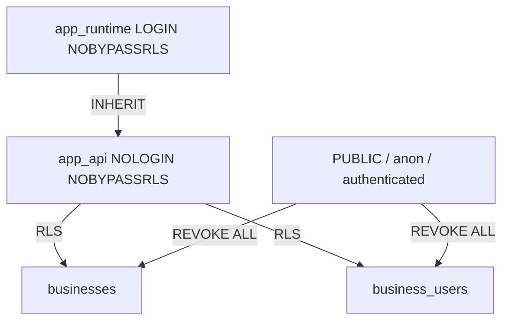

# Design: Endurecimiento RLS, DCL y Rol Runtime (`issue-54-hardening-auth-rls-db`)

## Convenciones de infraestructura detectadas
- `engine`: postgres (PostgreSQL 17 vía Supabase local)
- `migrations_dir`: `backend/migrations/versions`
- `security_dir`: `in-situ` (políticas RLS y DCL dentro de las migraciones Alembic)
- `rls_mode`: `in-situ`
- `migration_mode`: `symmetric` (`upgrade()` y `downgrade()` en el mismo archivo `.py` de Alembic)
- `requires_seeds`: `false`
- `tests_dir`: `backend/tests/integration`
- `test_cmd`: `cd backend && uv run pytest tests/integration/test_db_businesses.py`
- `up_cmd`: `cd backend && uv run alembic upgrade head`
- `down_cmd`: `cd backend && uv run alembic downgrade -1`

## Estado observado de la base
- Revisión Alembic actual: `e4a7c2b91f03 (head)` (`20261117_0003-e4a7c2b91f03_fix_businesses_rls_and_unique_user.py`).
- Tablas existentes: `businesses`, `business_users` con `ENABLE` y `FORCE ROW LEVEL SECURITY`.
- Rol `app_api` (`NOLOGIN NOBYPASSRLS`) existente con `GRANT SELECT, INSERT, UPDATE, DELETE` sobre `businesses` y `business_users`.
- `authenticated` y `service_role` aún tienen `GRANT ALL` heredado de la migración `0002`.

## Arquitectura de la migración 0004

### Detalle de cambios DDL/DCL
1. **Política `businesses_onboarding_insert`:**
   - `DROP POLICY IF EXISTS businesses_onboarding_insert ON businesses;`
   - `CREATE POLICY businesses_onboarding_insert ON businesses FOR INSERT WITH CHECK (NULLIF(current_setting('app.current_user_id', true), '')::uuid IS NOT NULL AND id = NULLIF(current_setting('app.current_business_id', true), '')::uuid);`
2. **Revocación DCL:**
   - `REVOKE ALL ON TABLE businesses, business_users FROM PUBLIC, anon, authenticated;`
3. **Políticas en `business_users`:**
   - `business_users_insert_own_user`: exige `user_id = NULLIF(current_setting('app.current_user_id', true), '')::uuid AND business_id = NULLIF(current_setting('app.current_business_id', true), '')::uuid`.
   - `business_users_update_isolation` y `business_users_delete_isolation`: mantienen `business_id = NULLIF(current_setting('app.current_business_id', true), '')::uuid` y agregan `AND (NULLIF(current_setting('app.current_user_role', true), '') IS NULL OR current_setting('app.current_user_role', true) = 'owner')`.
4. **Rol runtime `app_runtime`:**
   - Creación idempotente: `CREATE ROLE app_runtime LOGIN NOSUPERUSER NOCREATEDB NOCREATEROLE NOBYPASSRLS PASSWORD 'app_runtime_dev_password';`
   - `GRANT app_api TO app_runtime;` y `GRANT app_runtime TO CURRENT_USER;` (según gotcha Supabase PG17).
5. **Trigger `updated_at` en `businesses`:**
   - Función `public.set_businesses_updated_at()` (`RETURNS TRIGGER AS $$ BEGIN NEW.updated_at = clock_timestamp(); RETURN NEW; END; $$ LANGUAGE plpgsql;`) — usa `clock_timestamp()` para que incluso dentro de una misma transacción de test el `UPDATE` avance `updated_at`.
   - Trigger `trg_businesses_set_updated_at BEFORE UPDATE ON businesses FOR EACH ROW EXECUTE FUNCTION public.set_businesses_updated_at();`.

## Reversibilidad
- `downgrade()` restaura las políticas de `e4a7c2b91f03`, restaura `GRANT ALL` a `authenticated`, elimina el trigger y función `set_businesses_updated_at`, y revoca/elimina `app_runtime`.
- Clasificación: `reversible` (sin pérdida de datos).
