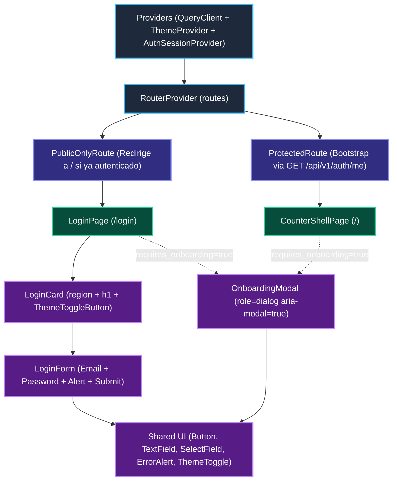
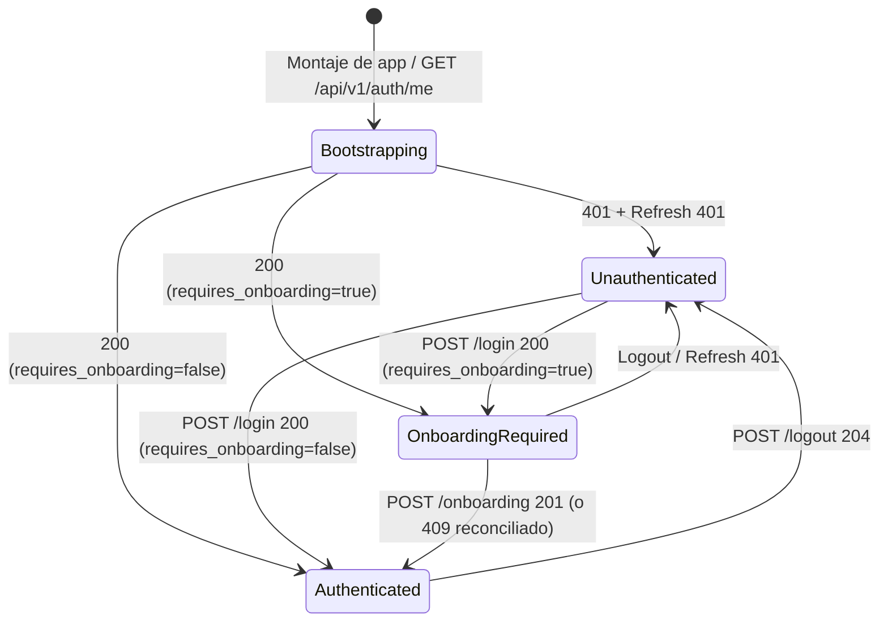

# Design: Interfaz de Login, Onboarding y almacenamiento de sesión (`issue-40-login-onboarding-frontend`)

## Convenciones de infraestructura detectadas

- `frontend_dir`: `frontend/src`
- `tests_dir`: `frontend/src/test`
- `e2e_tests_dir`: `frontend/tests/e2e`
- `openapi_path`: `docs/api/openapi.json`
- `ui_spec_path`: `docs/ui/auth-onboarding-ui-spec.json`
- `tokens_path`: `frontend/src/index.css`
- `catalog_cmd`: `cd frontend && npm test -- src/test/auth/ui-catalog.test.tsx`
- `a11y_cmd`: `cd frontend && npm test -- src/test/auth/`
- `e2e_cmd`: `cd frontend && npm run test:e2e`
- `state_lib`: `@tanstack/react-query` + React Context (`AuthSessionProvider`)
- `offline_store`: `dexie` (instalado en `package.json`; no usado en login/onboarding online-only; metadatos públicos en `localStorage`)
- `pwa_mode`: `deferred` (`vite-plugin-pwa` presente en `devDependencies`, Workbox diferido para tickets offline según `AGENTS.md`)
- `lint_cmd`: `cd frontend && npm run lint`
- `format_check_cmd`: `cd frontend && npm run format:check`
- `typecheck_cmd`: `cd frontend && npm run typecheck`
- `test_cmd`: `cd frontend && npm test`
- `build_dev_cmd`: `cd frontend && npm run build`
- `build_prod_cmd`: `cd frontend && npm run build`
- `bundle_dir`: `frontend/dist/assets`
- `max_bundle_kb`: `350`

---

## Context

El backend ya expone `/api/v1/auth/login`, `/api/v1/auth/onboarding`, `/api/v1/auth/me`, `/api/v1/auth/refresh` y `/api/v1/auth/logout` documentados en `docs/api/openapi.json` y especificados en `openspec/specs/auth-onboarding/spec.md`, emitiendo cookies `HttpOnly; SameSite=Strict` (`access_token` y `refresh_token`) bajo ADR-0002 y errores planos `ErrorResponse` bajo ADR-0003.

El frontend actual es un scaffold mínimo (`React 19`, `React Router 8`, `TanStack Query 5`, `Tailwind CSS v4`, `Vitest`, `MSW`, `Playwright`) con una ruta `/` (`<h1>registro-venta-micro</h1>`), `frontend/src/shared/constants/countries.ts` (`SUPPORTED_COUNTRIES` y `COUNTRY_TIMEZONES`) y tokens en `frontend/src/index.css`. Además existen `frontend/src/app/router.test.tsx` y `frontend/tests/e2e/smoke.spec.ts` que verifican la presencia de `<h1>registro-venta-micro</h1>` al entrar a `/`.

---

## Inventario del sistema de diseño

1. **Componentes y variantes existentes en `frontend/src`:**
   - `frontend/src/app/providers.tsx` (`Providers`): wrapper con `QueryClientProvider` (instancia única global actualmente).
   - `frontend/src/app/router.tsx` (`routes`, `router`): ruta única `/` con `<h1>registro-venta-micro</h1>` inline.
   - Primitivas UI reutilizables existentes: **0** (greenfield visual).
2. **Tokens existentes en `tokens_path` (`frontend/src/index.css`):**
   - Colores bajo `@theme` alineados a `docs/ui/auth-onboarding-ui-spec.json` y ADR-0007:
     `--color-primary` (`#4f46e5`), `--color-primary-hover` (`#4338ca`), `--color-primary-light` (`#eef2ff`), `--color-primary-dark` (`#3730a3`), `--color-background-light` (`#f9fafb`), `--color-background-dark` (`#111827`), `--color-surface-light` (`#ffffff`), `--color-surface-dark` (`#1f2937`), `--color-text-light` (`#111827`), `--color-text-dark` (`#f9fafb`), `--color-text-muted-light` (`#4b5563`), `--color-text-muted-dark` (`#9ca3af`), `--color-border-light` (`#e5e7eb`), `--color-border-dark` (`#374151`), `--color-error` (`#dc2626`), `--color-error-light` (`#fef2f2`), `--color-success` (`#16a34a`).
   - Tipografía: `--font-sans` (pila nativa del sistema).
   - Utilitario táctil POS: `.touch-target` (`min-height: 48px; min-width: 48px;`).
   - Modo oscuro: `.dark body` con `color-scheme: light dark`.
   - Extensión mínima sugerida en `index.css` (`@theme`): `--radius-control: 0.5rem` (8px) y `--color-error-dark: #450a0a` (o uso de tokens existentes con opacidad) para estados de error en modo oscuro sin colores literales fuera de `index.css`.
3. **Piezas fuera de catálogo:** Ninguna actualmente. Según ADR-0007, no se incorporan librerías de componentes UI externas; toda pieza nueva se declara en `tasks.md` con origen `nueva-declarada`.
4. **Conteo inicial de colores literales fuera de `tokens_path`:** `0` ocurrencias en `0` archivos (`frontend/src/**/*.{ts,tsx,css}` excluyendo `frontend/src/index.css`).

---

## Goals / Non-Goals

**Goals:**
- Implementar `/login` y `OnboardingModal` fieles a `docs/ui/auth-onboarding-ui-spec.json` y accesibles por teclado y lector de pantalla.
- Integrar el ciclo completo `/login`, `/onboarding`, `/me`, `/refresh` y `/logout` con `credentials: "include"` y trazabilidad 1:1 contra `docs/api/openapi.json`.
- Persistir únicamente metadatos públicos de contexto en `localStorage`, garantizando cero tokens JWT o contraseñas en almacenamiento accesible por JS.
- Mantener compatibilidad total con los tests base existentes (`router.test.tsx` y `smoke.spec.ts`).

**Non-Goals:**
- Vistas de catálogo (`US-02`), mostrador de ventas (`US-03`) o reportes (`US-04`).
- Registro de cuentas nuevas, recuperación de contraseña o selector multi-comercio.
- Integración de `Dexie` o registro de Service Worker (`vite-plugin-pwa`).

---

## Jerarquía de componentes y rutas



### Arquitectura de archivos prevista en `frontend/src`

- `frontend/src/lib/api-client.ts`: wrapper `apiFetch` con `credentials: "include"`, serialización JSON, parseo de `ErrorResponse` (`ApiError`) y deduplicación de `POST /api/v1/auth/refresh` ante `401`.
- `frontend/src/features/auth/types.ts`: tipos DTO derivados 1:1 de `docs/api/openapi.json` y tipo `PublicAuthContext`.
- `frontend/src/features/auth/api.ts`: funciones `loginRequest`, `onboardingRequest`, `fetchMeRequest`, `refreshSessionRequest`, `logoutRequest`.
- `frontend/src/features/auth/storage.ts`: lectura/escritura/limpieza segura de `PublicAuthContext` en `localStorage` (sin tokens) y preferencia de tema claro/oscuro.
- `frontend/src/features/auth/validation.ts`: validaciones puras de `LoginRequest` y `OnboardingRequest` alineadas con Pydantic.
- `frontend/src/features/auth/AuthContext.tsx`: proveedor de sesión (`status`, `context`, `login`, `completeOnboarding`, `logout`, `rehydrateSession`).
- `frontend/src/shared/ui/`: primitivas accesibles (`Button.tsx`, `TextField.tsx`, `SelectField.tsx`, `ErrorAlert.tsx`, `ThemeToggleButton.tsx`).
- `frontend/src/features/auth/components/LoginForm.tsx` y `OnboardingModal.tsx`.
- `frontend/src/features/auth/pages/LoginPage.tsx` y `frontend/src/app/CounterShellPage.tsx` (placeholder mínimo de `/` con `<h1>registro-venta-micro</h1>`, nombre del comercio, email y botón `"Cerrar sesión"`).
- `frontend/src/app/providers.tsx` y `frontend/src/app/router.tsx`: integración de `ThemeProvider`, `AuthSessionProvider` y rutas `/login` y `/` (con fallback `*` hacia `/`).

---

## Trazabilidad 1:1 con OpenAPI (`docs/api/openapi.json`)

| Operación OpenAPI | Request DTO | Response Exitosa | Errores Mapeados (`ErrorResponse`: `{ code, message, details }`) |
|---|---|---|---|
| `POST /api/v1/auth/login` (`login_api_v1_auth_login_post`) | `LoginRequest`: `{ email: string (max 254), password: string (1..128) }` | `200`: `LoginResponse` `{ user: UserPayload, requires_onboarding: boolean, business: BusinessSummary \| null }` + cookies `HttpOnly` | `401` (`INVALID_CREDENTIALS`), `422` (`VALIDATION_ERROR`), `429` (`RATE_LIMIT_EXCEEDED` / `UPSTREAM_RATE_LIMITED`), `502` (`AUTH_UPSTREAM_UNAVAILABLE`), `503` (`AUTH_UPSTREAM_TIMEOUT`) |
| `POST /api/v1/auth/onboarding` (`onboarding_api_v1_auth_onboarding_post`) | `OnboardingRequest`: `{ name: string (1..100), country: string, timezone?: string \| null }` | `201`: `BusinessResponse` `{ id, name, country, timezone, role, created_at }` + cookies `HttpOnly` refrescadas | `401` (`UNAUTHENTICATED`), `403`, `409` (`BUSINESS_ALREADY_EXISTS`), `422` (`VALIDATION_ERROR`) |
| `GET /api/v1/auth/me` (`me_api_v1_auth_me_get`) | — (cookie `access_token`) | `200`: `LoginResponse` | `401` (`UNAUTHENTICATED`) |
| `POST /api/v1/auth/refresh` (`refresh_api_v1_auth_refresh_post`) | — (cookie `refresh_token`) | `200`: `LoginResponse` + nuevas cookies `HttpOnly` | `401` (`UNAUTHENTICATED`) |
| `POST /api/v1/auth/logout` (`logout_api_v1_auth_logout_post`) | — | `204`: sin body (expira cookies `access_token` y `refresh_token`) | — |

### Detalle de tipos DTO (sin campos inventados)

- `UserPayload`: `{ id: string; email: string }`
- `BusinessSummary`: `{ id: string; name: string; country: string; timezone: string; role: "owner" | "cashier" }`
- `LoginResponse`: `{ user: UserPayload; requires_onboarding: boolean; business?: BusinessSummary | null }`
- `BusinessResponse`: `{ id: string; name: string; country: string; timezone: string; role: "owner" | "cashier"; created_at: string }`
- `OnboardingRequest`: `{ name: string; country: string; timezone?: string | null }` (la UI envía `{ name, country }` y puede mostrar `COUNTRY_TIMEZONES[country]` como texto informativo debajo del selector; el backend resuelve y valida el `timezone` IANA canónico).
- `ErrorResponse`: `{ code: string; message: string; details?: unknown | null }`

---

## Esquema de estado global y ciclo de sesión



1. **Estado en TanStack Query + Context:**
   - Query key `["auth", "session"]` ejecuta `fetchMeRequest()` con `retry: false` y `refetchOnWindowFocus: false` (o controlado por `apiFetch` con refresh único).
   - `Providers` acepta `queryClient?: QueryClient` opcional (por defecto crea instancia por árbol/aplicación o fallback estable) para garantizar aislamiento entre pruebas sin romper `router.test.tsx`.
2. **Renovación automática ante `401` (`apiFetch`):**
   - Si `/api/v1/auth/me` o `/api/v1/auth/onboarding` responden `401`, `apiFetch` ejecuta `POST /api/v1/auth/refresh` (deduplicando promesas concurrentes en una referencia compartida) una sola vez.
   - Si `/refresh` devuelve `200`, actualiza el contexto en caché/`localStorage` y reintenta la operación original (para `/me`, basta la respuesta de `/refresh`; para `/onboarding`, reintenta `POST /api/v1/auth/onboarding` o informa al usuario si falló).
   - Si `/refresh` devuelve `401`, limpia `localStorage`, invalida caché de sesión y redirige a `/login`.
3. **Protección de compatibilidad en ruta `/`:**
   - Durante `Bootstrapping` en `/`, `CounterShellPage` / `ProtectedRoute` muestra `<main aria-busy="true"><h1>registro-venta-micro</h1><p role="status">Verificando sesión...</p></main>`. Esto garantiza que `router.test.tsx` (aserción síncrona de `h1`) y `smoke.spec.ts` (E2E en `/`) pasen de forma determinista sin falsos negativos ni hacks.

---

## Persistencia local y seguridad

- **Clave única en `localStorage`:** `rvm.auth.context`
- **Estructura persistida (estrictamente pública, no sensible):**
  ```json
  {
    "user": { "id": "uuid", "email": "dueno@negocio.com" },
    "requires_onboarding": false,
    "business": {
      "id": "uuid",
      "name": "Kiosco Central",
      "country": "AR",
      "timezone": "America/Argentina/Buenos_Aires",
      "role": "owner"
    }
  }
  ```
- **Reglas de seguridad:**
  - Prohibido almacenar `access_token`, `refresh_token`, cadenas JWT o contraseñas en `localStorage`, `sessionStorage` o IndexedDB.
  - Todas las peticiones usan `credentials: "include"` contra rutas relativas `/api/v1/auth/*` (mismo origen en producción Vercel y proxy de Vite en desarrollo).
  - La preferencia de tema (`rvm.ui.theme` -> `"light" | "dark"`) se guarda separada de los datos de sesión y no se borra al cerrar sesión.
  - Si `GET /api/v1/auth/me` falla por error de red (sin HTTP response) y existe `rvm.auth.context` previo con `requires_onboarding === false`, el contexto público permanece disponible para renderizado UI offline-aware sin simular autenticación en `/login` ni onboarding offline; cualquier respuesta `401` definitiva limpia `rvm.auth.context`.

---

## Estrategia de mocks MSW (ADR-0006) y pruebas E2E

1. **Handlers globales en `frontend/src/test/mocks/handlers.ts`:**
   - `GET /api/v1/health` -> `200 { status: "healthy" }`
   - `GET /api/v1/auth/me` -> por defecto `401` (`UNAUTHENTICATED`) para representar un navegador anónimo limpio; los escenarios autenticados sobrescriben por test con `server.use(...)`.
   - `POST /api/v1/auth/refresh` -> por defecto `401` (`UNAUTHENTICATED`).
   - `POST /api/v1/auth/login` -> `200 LoginResponse` por defecto; cada test sobrescribe para `requires_onboarding: true`, `401`, `422`, `429`, `502`, `503` y `HttpResponse.error()`.
   - `POST /api/v1/auth/onboarding` -> `201 BusinessResponse` por defecto; sobrescrito en tests para `409`, `422`, `401`.
   - `POST /api/v1/auth/logout` -> `204`.
2. **Hardening de `frontend/src/test/setup.ts`:**
   - Verificar/configurar `server.listen({ onUnhandledRequest: "error" })` (además de limpieza de `localStorage` y `document.documentElement.classList.remove("dark")` en `afterEach` para aislamiento total entre tests).
3. **Suite Design-Blind y Catálogo ejecutable de estados:**
   - Todos los tests de `frontend/src/test/auth/` usarán exclusivamente selectores accesibles (`getByRole`, `getByLabelText`, `getByText`, `getByPlaceholderText`), prohibiendo selectores por clase CSS (`.toHaveClass`, `querySelector(".x")`).
   - `ui-catalog.test.tsx` renderiza y valida accesibilidad y elementos requeridos de cada estado de `auth-onboarding-ui-spec.json` (`login-screen`: `empty`, `ready`, `loading`, `error`; `onboarding-modal`: `ready`, `loading`, `error`).
4. **E2E único de camino crítico (`frontend/tests/e2e/auth-onboarding.spec.ts`):**
   - Usa `page.route("**/api/v1/auth/**", ...)` simulando cookies/estado en memoria del test dentro de Playwright contra `vite preview`, recorriendo: entrada `/` -> redirección `/login` -> login con `requires_onboarding: true` -> onboarding `"Kiosco Central"` + `"AR"` -> redirección `/` -> recarga conservando sesión vía `/me` -> `"Cerrar sesión"` -> redirección `/login` con `localStorage` limpio.

---

## Decisions

1. **Modal accesible controlado con `role="dialog"` y `aria-modal="true"` (en lugar de depender únicamente de `<dialog>.showModal()`):**
   - *Motivo:* `HTMLDialogElement.prototype.showModal` suele faltar o requerir polyfills frágiles en jsdom, y la política de onboarding obligatorio (no cerrable con `Escape` ni clic externo) se controla de forma determinista manejando `onKeyDown` (`Escape`), foco inicial al abrir el diálogo y restauración del foco.
   - *Alternativa descartada:* librería modal externa (excede presupuesto/ADR-0007) o `<dialog>.showModal()` sin fallback.
2. **Validación tipada en TypeScript puro (sin `zod`/`yup`/`react-hook-form`):**
   - *Motivo:* solo hay 4 campos entre ambos formularios (`email`, `password`, `name`, `country`), evitando instalar nuevas dependencias y manteniendo el bundle liviano.
   - *Alternativa descartada:* agregar Zod (~14 KB min) o react-hook-form.
3. **`Providers` con prop opcional `queryClient?: QueryClient`:**
   - *Motivo:* evita contaminación de caché de TanStack Query entre tests unitarios sin romper el test existente `router.test.tsx` que invoca `<Providers>` sin argumentos.
4. **Lazy loading por ruta (`React.lazy` para `LoginPage` y `OnboardingModal`):**
   - *Motivo:* mantiene el entrypoint limpio y prepara la arquitectura modular para los futuros módulos de catálogo y POS.

---

## Presupuesto de bundle

- **Baseline stack:** React 19 + ReactDOM 19 + React Router 8 + TanStack Query 5 en build Vite (`npm run build`).
- **Presupuesto máximo Gate 4 (`max_bundle_kb`):** `350 KB` sin comprimir para el chunk de entrada en `frontend/dist/assets` (contemplando ~290–330 KB de runtime base React 19 + Router + Query sin *manualChunks* agresivos, y < 15 KB de código propio de `auth-onboarding-ui`).
- **Estrategia de optimización (Paso 5):** separación mediante `React.lazy` + `Suspense` para `LoginPage` y `OnboardingModal` (cargando el modal únicamente cuando `requires_onboarding` es `true`) y cero librerías externas adicionales de UI o formularios.

---

## Risks / Trade-offs

- **[Race condition entre 401 concurrentes y `/refresh`]** → Mitigation: deduplicar la promesa de `POST /api/v1/auth/refresh` en `api-client.ts` para que múltiples llamadas concurrentes compartan una sola renovación.
- **[Inconsistencia entre `jsdom` y navegador real en `<select>` o diálogo modal]** → Mitigation: usar `<select>` nativo estándar (`role="combobox"`), `role="dialog"` + `aria-modal="true"`, y validar el recorrido completo en Chromium real vía Playwright.
- **[Falsos fallos en `router.test.tsx` al proteger `/`]** → Mitigation: renderizar `<h1>registro-venta-micro</h1>` tanto en el estado `bootstrapping` de `/` como en `/login` y `CounterShellPage`.

---

## Open Questions

- Ninguna bloqueante; el país por defecto en el `<select>` inicia sin seleccionar (`""` -> `"Selecciona un país"`) para forzar elección explícita del dueño antes de crear el comercio.
