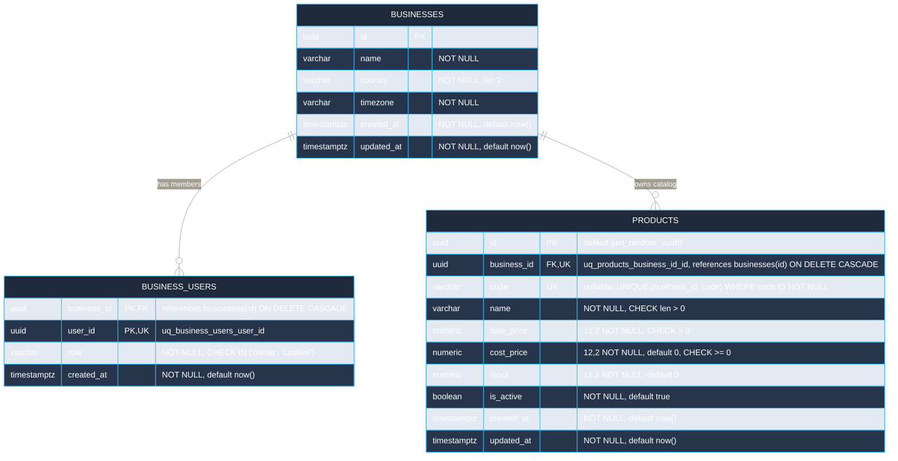

## Context

El sistema `registro-venta-micro` implementa aislamiento multitenant estricto en PostgreSQL 17 mediante Row-Level Security (RLS) forzada sobre cada tabla operativa, utilizando la variable transaccional `SET LOCAL app.current_business_id = '<uuid>'` inyectada por FastAPI (`get_tenant_db`) bajo el rol de runtime sin privilegios `app_runtime` (miembro de `app_api`).

Las migraciones `0002`–`0004` establecieron las tablas `businesses` y `business_users`, la revocación DCL a `PUBLIC`/`anon`/`authenticated`, el rol `app_runtime` (`NOBYPASSRLS`) y el trigger `updated_at` en `businesses`. Este cambio (`issue-42-esquema-productos-db`, Ticket `US-02-T03` / Issue `#42`) introduce la tabla `products` para el catálogo e inventario de cada comercio, garantizando precisión monetaria y de stock en `numeric(12,2)`, baja lógica preservando integridad referencial histórica y aislamiento multitenant en todas las operaciones DML.

### Convenciones e Infraestructura Detectada

```yaml
engine: "postgres"
migrations_dir: "backend/migrations"
security_dir: "backend/migrations"
seeds_dir: "none"
tests_dir: "backend/tests"
tests_domain_convention: "backend/tests/integration/test_db_<dominio>.py"
migration_mode: "forward-only"
rls_mode: "in-situ"
requires_seeds: false
test_cmd: "cd backend && uv run pytest"
validation_cmd: "cd backend && uv run ruff check . && uv run ruff format --check . && uv run mypy app"
sql_from_cmd: "cd backend && uv run alembic upgrade head --sql"
typecheck_cmd: "cd backend && uv run mypy app"
up_cmd: "cd backend && uv run alembic upgrade head"
down_cmd: "cd backend && uv run alembic downgrade -1"
snapshot_cmd: "none"
```

> **Notas operativas del repositorio**:
> - Las migraciones viven en Alembic Python (`backend/migrations/versions/*.py`) con políticas RLS y DCL embebidas (`rls_mode: "in-situ"`). Se declara `migration_mode: "forward-only"` con `sql_from_cmd` para compatibilidad con `validate-db-migrations.js`; no obstante, la migración Python debe implementar `upgrade()` y `downgrade()` simétricos completos porque `.github/workflows/ci-backend.yml` exige `alembic check` y `alembic downgrade base && alembic upgrade head`.
> - En un worktree nuevo sin `backend/.env` creado desde `backend/.env.example`, `backend/migrations/env.py` requiere `DATABASE_URL` en entorno para ejecutar incluso `alembic upgrade head --sql`.
> - No existe un archivo consolidado `erd.md` en el repositorio.

## Goals / Non-Goals

**Goals:**
- Crear la tabla `public.products` referenciando `businesses(id)` con `ON DELETE CASCADE`, columnas `code`, `name`, `sale_price`, `cost_price`, `stock`, `is_active`, `created_at` y `updated_at`.
- Garantizar precisión decimal exacta `numeric(12,2)` en precio de venta, costo y stock (prohibición total de `float`).
- Asegurar unicidad de `code` dentro de cada `business_id` únicamente cuando `code IS NOT NULL`, permitiendo múltiples productos sin código y códigos idénticos en comercios distintos.
- Mantener `updated_at` actualizado automáticamente mediante trigger `BEFORE UPDATE` con `clock_timestamp()`.
- Habilitar y forzar RLS (`ENABLE` + `FORCE ROW LEVEL SECURITY`) con políticas granulares (`SELECT`, `INSERT`, `UPDATE` con `USING`+`WITH CHECK`, `DELETE`) basadas en `app.current_business_id`, revocando privilegios a `PUBLIC`, `anon` y `authenticated` y otorgando DML exclusivo (sin `TRUNCATE`) a `app_api` / `app_runtime`.
- Sincronizar el modelo ORM `Product` en `backend/app/modules/catalog/models.py` + `backend/app/db/base.py` para mantener `alembic check` en verde.

**Non-Goals:**
- Endpoints REST, esquemas Pydantic ni lógica de negocio de catálogo (Issue `#43` / `TICKET-04`).
- Tablas `sales`, `sale_items`, `payments` o movimientos de kardex (Issue `#46` / `TICKET-06`).
- Vistas o estado offline de catálogo en frontend (Issue `#44` / `TICKET-05`).
- Habilitación de extensión `pg_trgm` / índices GIN (no requerida en MVP acotado y evita dependencias de extensión en `downgrade base`).

## Estado observado de la base

- **Fecha de inspección**: `2026-11-18`
- **Fuente consultada**: Base PostgreSQL 17 local de Supabase en `127.0.0.1:54422` (consulta de solo lectura sobre catálogos y conteo de filas) + inspección estática de `backend/migrations/versions/` y `backend/app/`.
- **Nota sobre `DB_DEV_RO_URL`**: La variable `DB_DEV_RO_URL` y el rol `agent_ro` no están configurados en este entorno; se inspeccionó el esquema local de desarrollo en solo lectura sin ejecutar escrituras.
- **Revisión Alembic activa**: `f8b2c1a94d07` (`20261118_0004-f8b2c1a94d07_harden_rls_and_runtime_role.py`).
- **Tablas existentes en `public`**:
  - `alembic_version` (owner `postgres`, RLS desactivada).
  - `businesses` (owner `postgres`, RLS habilitada y forzada, `62` filas de prueba/desarrollo observadas, trigger `trg_businesses_set_updated_at`).
  - `business_users` (owner `postgres`, RLS habilitada y forzada, `26` filas observadas, `uq_business_users_user_id`).
  - `products`: **no existe** todavía.
- **Roles observados**: `app_api` (`rolsuper=false`, `rolbypassrls=false`, `rolcanlogin=false`), `app_runtime` (`rolsuper=false`, `rolbypassrls=false`, `rolcanlogin=true`, miembro de `app_api`), `postgres` (`rolbypassrls=true`), `service_role` (`rolbypassrls=true`), `anon` y `authenticated` (sin permisos sobre tablas operativas).
- **Extensiones activas**: `pg_stat_statements`, `pgcrypto`, `plpgsql`, `supabase_vault`, `uuid-ossp` (`pg_trgm` no instalada).
- **Módulo ORM `catalog`**: `backend/app/modules/catalog/__init__.py` vacío; `backend/app/db/base.py` importa únicamente `Business` y `BusinessUser`.

## Reversibilidad

| Operación | Tablas | Filas reales (inspección `2026-11-18`) | Clasificación | Rollback / Compensatoria |
|---|---|---|---|---|
| `CREATE TABLE products` (incluyendo PK, FK `businesses`, `CHECK`s y `UNIQUE (business_id, id)`) | `products` | `0` *(tabla nueva)* | `reversible` | `DROP TABLE IF EXISTS products;` en `downgrade()` (tras eliminar trigger, políticas e índices). |
| `CREATE UNIQUE INDEX uq_products_business_id_code` e índice `ix_products_business_id_active_name` | `products` | `0` *(tabla nueva)* | `reversible` | `op.drop_index(...)` explícito antes de `op.drop_table("products")` en `downgrade()`. |
| `CREATE FUNCTION public.set_products_updated_at()` y `CREATE TRIGGER trg_products_set_updated_at` | `products` | `0` *(tabla nueva)* | `reversible` | `DROP TRIGGER IF EXISTS trg_products_set_updated_at ON products;` y `DROP FUNCTION IF EXISTS public.set_products_updated_at();`. |
| `ENABLE` / `FORCE ROW LEVEL SECURITY`, `CREATE POLICY` (4 políticas) y DCL (`REVOKE ALL`, `GRANT SELECT, INSERT, UPDATE, DELETE`) | `products` | `0` *(tabla nueva)* | `reversible` | `REVOKE ALL ON TABLE products FROM app_api;`, `DROP POLICY IF EXISTS ... ON products;` y `DISABLE` / `NO FORCE ROW LEVEL SECURITY` antes de `DROP TABLE`. |

## Normalización

- La entidad `products` se introduce en **Tercera Forma Normal (3NF)** como tabla nueva (`0` filas existentes): todos los atributos no clave dependen únicamente de la clave primaria `id` (y dentro del ámbito de su comercio `business_id`).
- No existen datos previos en `products` ni columnas heredadas a normalizar o migrar; por lo tanto, no aplica estrategia Expand / Contract en 2 cambios.
- La clave alternativa `UNIQUE (business_id, id)` (`uq_products_business_id_id`) habilita futuras claves foráneas compuestas desde `sale_items` (`Issue #46`), impidiendo referencialmente que una venta de negocio A referencie un producto de negocio B.

## Decisions

1. **Precisión `numeric(12,2)` en precios/stock y omisión deliberada de `CHECK (stock >= 0)` en base de datos**:
   - *Por qué*: El DoD exige `numeric(12,2)` sin `float` para `sale_price`, `cost_price` y `stock`. Para precios (`sale_price > 0`, `cost_price >= 0`), los invariantes aplican en todo ciclo de vida y se imponen con `CHECK` en PostgreSQL. Sin embargo, para `stock`, aunque el alta inicial en US-02 requiere `stock inicial >= 0` (validado en la API de `#43`), el PRD v0.2 (§1.2, §3 US-03) y `TICKET-07` dictan que **"la venta nunca se rechaza por stock insuficiente (permite stock negativo transitorio)"** mediante `UPDATE products SET stock = stock - :qty` (ej. `stock = 2`, venta `3` → `stock = -1`). Agregar `CHECK (stock >= 0)` en la tabla bloquearía las ventas del MVP en `#46`/`#47`.
   - *Alternativa descartada*: Imponer `CHECK (stock >= 0)` en BD (rompería US-03 Escenario 4) o usar `numeric(12,3)` de Entrega 1 (contradice el DoD explícito de `#42`: `numeric(12,2)`).

2. **Unicidad parcial de `code` por negocio y guarda contra cadenas vacías**:
   - *Por qué*: `code` (`varchar(50)`, nullable) representa un SKU o código de barras opcional. Se define `CHECK (code IS NULL OR char_length(trim(code)) > 0)` junto con un índice único parcial `CREATE UNIQUE INDEX uq_products_business_id_code ON products (business_id, code) WHERE code IS NOT NULL;`. Así, múltiples productos sin código (`NULL`) coexisten en el mismo negocio sin colisión, pero un `code` informado no puede duplicarse dentro del mismo `business_id`, ni colisionar por strings vacíos `''`.
   - *Alternativa descartada*: `UNIQUE (business_id, code)` sin filtro `WHERE code IS NOT NULL` o sin `CHECK` de vacío (impediría o degradaría productos con `code = ''`), o índice funcional `lower(code)` que introduce complejidad innecesaria en reflexión `alembic check`.

3. **Baja lógica con `is_active` y trigger `updated_at` con `clock_timestamp()`**:
   - *Por qué*: US-02 establece que los productos desactivados preservan integridad referencial con el histórico de ventas. `is_active BOOLEAN NOT NULL DEFAULT true` permite ocultar productos del catálogo operativo sin `DELETE` físico. Adicionalmente, el trigger `BEFORE UPDATE` `trg_products_set_updated_at` utiliza `clock_timestamp()` (siguiendo el patrón de `businesses` en migración `0004`) para avanzar `updated_at` incluso en múltiples updates dentro de una misma transacción de test.
   - *Alternativa descartada*: Agregar columna `deleted_at` redundante cuando `is_active` cubre el requerimiento MVP de forma booleana directa e indexable.

4. **Índices compuestos orientados a FK, RLS y listado de catálogo sin `pg_trgm`**:
   - *Por qué*:
     - `uq_products_business_id_id`: `UNIQUE (business_id, id)` prepara la FK compuesta para `sale_items` (`#46`).
     - `ix_products_business_id_active_name`: `INDEX (business_id, is_active, name)` tiene `business_id` como columna líder (satisfaciendo índice sobre FK para `validate-db-migrations.js` y escaneo RLS) y acelera el listado ordenado de productos activos (`US-02` Escenario 2).
     - `uq_products_business_id_code`: índice único parcial sobre `(business_id, code) WHERE code IS NOT NULL` acelera búsquedas por SKU/código.
   - *Alternativa descartada*: Instalar extensión `pg_trgm` con índice GIN (no instalada en BD actual y propensa a fricción de permisos/cleanup en `alembic downgrade base`).

5. **Políticas RLS granulares por operación y sin bloqueo por `app.current_user_role`**:
   - *Por qué*: Siguiendo el estándar de `fix-53` y `validate-db-migrations.js`, se crean políticas explícitas `FOR SELECT`, `FOR INSERT`, `FOR UPDATE` (`USING` + `WITH CHECK` para impedir tenant hijacking de `business_id`) y `FOR DELETE`, todas evaluando `business_id = NULLIF(current_setting('app.current_business_id', true), '')::uuid`. No se restringe `UPDATE` por `app.current_user_role = 'owner'` en RLS porque futuras ventas descontarán stock sobre `products` en la transacción del mostrador; la autorización de endpoints de catálogo corresponde a FastAPI (`#43`).
   - *Alternativa descartada*: Política única `FOR ALL` sin `WITH CHECK` explícito en `UPDATE` (generaría advertencias en `validate-db-migrations.js` y dificultaría auditoría granular).

6. **Sincronización del modelo SQLAlchemy `Product` en `backend/app/modules/catalog/models.py`**:
   - *Por qué*: `.github/workflows/ci-backend.yml` ejecuta `uv run alembic check`, el cual compara `Base.metadata` con la base migrada. Si la migración crea `products` sin su modelo SQLAlchemy registrado en `backend/app/db/base.py`, CI falla por deriva de esquema.
   - *Alternativa descartada*: Dejar el modelo ORM para `#43` (rompería el job `migrations-integrity` en el PR de `#42`).

### Diagrama Entidad-Relación (ERD)



### Diccionario Físico de Datos

#### Tabla: `public.products`
| Columna | Tipo Nativo | Nulabilidad | Default | Constraints / Índices | Seguridad / Clasificación |
|---|---|---|---|---|---|
| `id` | `UUID` | `NOT NULL` | `gen_random_uuid()` | `PRIMARY KEY (id)` (`pk_products`), `UNIQUE (business_id, id)` (`uq_products_business_id_id`) | Identificador subrogado de producto |
| `business_id` | `UUID` | `NOT NULL` | - | `FK -> businesses(id) ON DELETE CASCADE` (`fk_products_business_id`), índice líder en `uq_products_business_id_id`, `ix_products_business_id_active_name` y `uq_products_business_id_code` | Clave de multi-tenancy (`app.current_business_id`) |
| `code` | `VARCHAR(50)` | `NULL` | `NULL` | `CHECK (code IS NULL OR char_length(trim(code)) > 0)` (`chk_products_code_not_empty`), `UNIQUE INDEX (business_id, code) WHERE code IS NOT NULL` (`uq_products_business_id_code`) | Código interno / SKU opcional |
| `name` | `VARCHAR(150)` | `NOT NULL` | - | `CHECK (char_length(trim(name)) > 0)` (`chk_products_name_not_empty`), indexado en `ix_products_business_id_active_name (business_id, is_active, name)` | Nombre del ítem en catálogo |
| `sale_price` | `NUMERIC(12,2)` | `NOT NULL` | - | `CHECK (sale_price > 0)` (`chk_products_sale_price_positive`) | Precio de venta bruto (`Decimal`, prohibido `float`) |
| `cost_price` | `NUMERIC(12,2)` | `NOT NULL` | `0` | `CHECK (cost_price >= 0)` (`chk_products_cost_price_non_negative`) | Costo unitario de referencia (`Decimal`, prohibido `float`) |
| `stock` | `NUMERIC(12,2)` | `NOT NULL` | `0` | Sin `CHECK >= 0` en BD para permitir saldo negativo transitorio en ventas (`US-03`) | Existencia actual (`Decimal`, prohibido `float`) |
| `is_active` | `BOOLEAN` | `NOT NULL` | `true` | Indexado en `ix_products_business_id_active_name (business_id, is_active, name)` | Bandera de baja lógica (preserva integridad histórica) |
| `created_at` | `TIMESTAMPTZ` | `NOT NULL` | `now()` | - | Auditoría (UTC) |
| `updated_at` | `TIMESTAMPTZ` | `NOT NULL` | `now()` | Trigger `BEFORE UPDATE` `trg_products_set_updated_at` (`clock_timestamp()`) | Auditoría (UTC) |

### Estrategia de Seguridad RLS y DCL

1. **Activación y Forzado de RLS**:
   - `ALTER TABLE products ENABLE ROW LEVEL SECURITY;`
   - `ALTER TABLE products FORCE ROW LEVEL SECURITY;`
2. **Políticas Granulares por Operación** (todas usando `NULLIF(current_setting('app.current_business_id', true), '')::uuid`):
   - `products_select_isolation` (`FOR SELECT`):
     `USING (business_id = NULLIF(current_setting('app.current_business_id', true), '')::uuid)`
   - `products_insert_isolation` (`FOR INSERT`):
     `WITH CHECK (business_id = NULLIF(current_setting('app.current_business_id', true), '')::uuid)`
   - `products_update_isolation` (`FOR UPDATE`):
     `USING (business_id = NULLIF(current_setting('app.current_business_id', true), '')::uuid)`
     `WITH CHECK (business_id = NULLIF(current_setting('app.current_business_id', true), '')::uuid)`
   - `products_delete_isolation` (`FOR DELETE`):
     `USING (business_id = NULLIF(current_setting('app.current_business_id', true), '')::uuid)`
3. **Privilegios DCL (Mínimo Privilegio)**:
   - `REVOKE ALL ON TABLE products FROM PUBLIC, anon, authenticated;`
   - `GRANT SELECT, INSERT, UPDATE, DELETE ON TABLE products TO app_api;` *(sin `TRUNCATE`; heredado automáticamente por `app_runtime`, manteniendo ambos roles con `rolsuper = false`, `rolbypassrls = false` y sin propiedad de la tabla)*.

## Risks / Trade-offs

- **[Risk] Ausencia de `CHECK (stock >= 0)` en PostgreSQL permitiría insertar stock inicial negativo si la API omitiera validarlo** → **Mitigación**: La tabla fija `DEFAULT 0` y la validación `stock_inicial >= 0` en creación se exige en el esquema Pydantic de `#43` (`TICKET-04`), mientras la BD protege la continuidad del mostrador en `#46`/`#47` (`US-03` Escenario 4).
- **[Risk] Deriva entre `alembic check` y expresiones parciales / triggers SQL en `products`** → **Mitigación**: Definir `Index("uq_products_business_id_code", "business_id", "code", unique=True, postgresql_where=text("code IS NOT NULL"))`, `UniqueConstraint("business_id", "id", name="uq_products_business_id_id")` y los `CheckConstraint` exactos en `Product.__table_args__` (`backend/app/modules/catalog/models.py`), verificando `uv run alembic check` sobre Postgres real tras aplicar la migración.
- **[Risk] Ejecución de `alembic upgrade head --sql` o `pytest` sin `DATABASE_URL` en un worktree nuevo** → **Mitigación**: Documentar que debe existir `backend/.env` (o `DATABASE_URL` exportada en entorno apuntando a Postgres de pruebas efímero) antes de correr `alembic` o `pytest`.
- **[Risk] Uso accidental de `float` en Python o en mapeos ORM de `numeric(12,2)`** → **Mitigación**: Declarar las columnas en SQLAlchemy con `Numeric(12, 2)` y tipado `Mapped[Decimal]` (`decimal.Decimal`) en `models.py`, y validar tipos exactos contra `information_schema.columns` en `test_db_products.py`.

## Migration Plan

1. **Suite DB-TDD en ROJO (`backend/tests/integration/test_db_products.py`)**: Cubrir estructura/tipos `numeric(12,2)` (prohibiendo `float`), constraints (`NOT NULL`, `FK ON DELETE CASCADE`, `CHECK`s, unicidad parcial de `code`), baja lógica, trigger `updated_at`, aislamiento RLS en las 4 operaciones (`SELECT`/`INSERT`/`UPDATE`/`DELETE`) bajo `app_api` y `app_runtime`, rechazo sin contexto y bloqueo DCL de `PUBLIC`/`anon`/`authenticated` y `TRUNCATE`.
2. **Modelo ORM (`backend/app/modules/catalog/models.py` + `backend/app/db/base.py`)**: Definir `Product` con tipos `Decimal` / `Numeric(12, 2)`, constraints e índices alineados al diccionario físico.
3. **Nueva Migración Alembic (`down_revision = "f8b2c1a94d07"`)**: Crear tabla `products`, índices, trigger `trg_products_set_updated_at`, `ENABLE`/`FORCE ROW LEVEL SECURITY`, políticas RLS granulares y sentencias DCL (`REVOKE ALL` + `GRANT`), con `downgrade()` simétrico completo.
4. **Verificación**: Ejecutar `validate-db-migrations.js`, `uv run alembic upgrade head`, `uv run alembic check`, roundtrip `alembic downgrade -1` / `downgrade base` → `upgrade head`, `ruff`, `mypy` y `pytest` en VERDE, además de Mutation Testing sobre RLS/constraints.

## Open Questions

- Ninguna bloqueante. Se deja explícita para confirmación en el gate de Paso 1 la decisión de no imponer `CHECK (stock >= 0)` en PostgreSQL (manteniendo `DEFAULT 0` en BD y validación `>= 0` al alta en API `#43`) para preservar compatibilidad con `US-03` Escenario 4 (`stock` negativo transitorio tras venta en mostrador).
