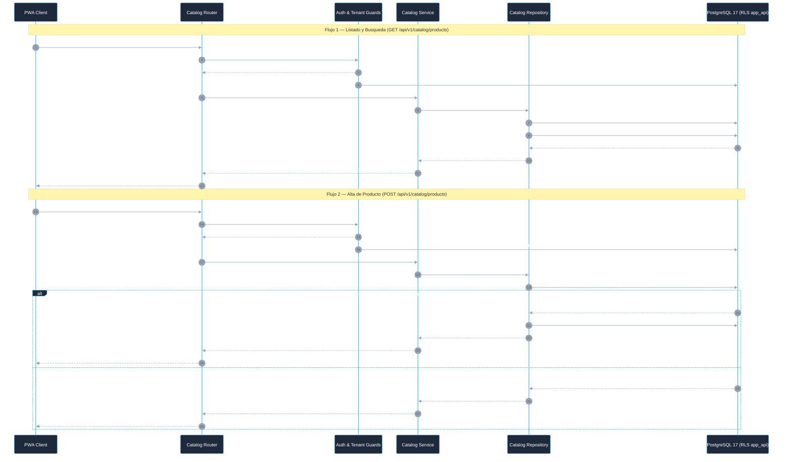
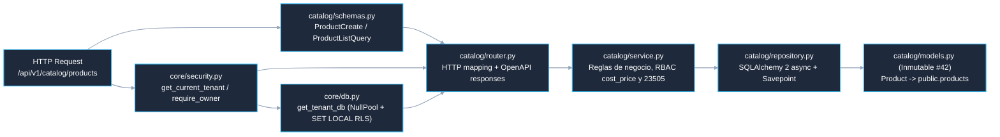

## Context

El sistema `registro-venta-micro` sigue un patrón cliente-servidor API-first con monolito modular en capas (`Router → Service → Repository`) sobre FastAPI, Pydantic v2 y SQLAlchemy 2 async (`asyncpg`) contra PostgreSQL 17 (Supabase local).

El contrato de base de datos del catálogo quedó cerrado y validado en el cambio `#42` (`openspec/specs/products-schema-and-rls/spec.md`, migración `20261118_0005-a3f9d2e1b4c8_create_products_table.py`, y modelo ORM `Product` en `backend/app/modules/catalog/models.py` registrado en `backend/app/db/base.py`). Dicho esquema impone:
- Tabla `public.products` con `id` (`UUID`, `gen_random_uuid()`), `business_id` (`UUID`, FK a `businesses.id` `ON DELETE CASCADE`), `code` (`VARCHAR(50)`, nullable, índice único parcial `uq_products_business_id_code` sobre `(business_id, code) WHERE code IS NOT NULL`), `name` (`VARCHAR(150)`), `sale_price` (`NUMERIC(12,2) > 0`), `cost_price` (`NUMERIC(12,2) >= 0`, default `0`), `stock` (`NUMERIC(12,2)`, default `0`, sin `CHECK >= 0` en BD para permitir saldo negativo transitorio en ventas), `is_active` (`BOOLEAN`, default `true`), `created_at` y `updated_at` (`TIMESTAMPTZ` con trigger `trg_products_set_updated_at`).
- Aislamiento multitenant estricto con `ENABLE` y `FORCE ROW LEVEL SECURITY` evaluando `business_id = NULLIF(current_setting('app.current_business_id', true), '')::uuid`, y privilegios DCL otorgados exclusivamente a `app_api` / `app_runtime` (`NOBYPASSRLS`).

La capa backend consume dicho esquema y modelo ORM como contrato **100% inmutable** (`No-DB-Diff` en Gate 3), reutilizando las dependencias de seguridad y sesión transaccional ya existentes en `backend/app/core/security.py` y `backend/app/core/db.py` (`get_current_tenant`, `get_tenant_db` con `NullPool` según `openspec/specs/backend/known-gotchas.md`).

### Convenciones e Infraestructura Detectada

```yaml
stack: "Python 3.14 / FastAPI"
backend_dir: "backend/app"
arch_pattern: "monolito-modular-capas"
db_mode: "with-db"
db_dirs: "backend/migrations"
migration_exts: ".py"
typegen_cmd: "none"
rls_mode: "in-situ"
auth_mode: "jwt"
contract_style: "code-first"
openapi_path: "none"
openapi_export_cmd: "none"
tests_dir: "backend/tests"
lint_cmd: "cd backend && uv run ruff check . && uv run ruff format --check ."
typecheck_cmd: "cd backend && uv run mypy app"
test_cmd: "cd backend && uv run pytest"
test_fast_cmd: "cd backend && uv run pytest tests/unit"
test_integration_cmd: "cd backend && uv run pytest tests/integration"
test_migrate_cmd: "cd backend && uv run alembic upgrade head"
scaffold_cmd: "none"
seed_cmd: "none"
mutation_cmd: "none"
```

## Goals / Non-Goals

**Goals:**
- Implementar `GET /api/v1/catalog/products` con ordenamiento determinista (`name ASC, id ASC`), buscador de texto `q` case-insensitive sobre `name` y `code` (escapando comodines `%`, `_`, `\`), filtro `include_inactive` (default `false`) y paginación acotada (`limit`, `offset`) devolviendo `{ items, total, limit, offset }`.
- Implementar `POST /api/v1/catalog/products` para crear productos en `products` tomando `business_id` exclusivamente del JWT (`CurrentUser.business_id`), validando precios brutos y stock inicial en `Decimal` (prohibiendo `float`), forzando `stock >= 0` en el alta, y mapeando duplicados de `code` (`23505` en `uq_products_business_id_code`) a `409 Conflict` (`ErrorResponse`).
- Aplicar autorización por rol (`role == "owner"` requerido en `POST`; redacción de `cost_price = null` para `cashier` en `GET`) y aislamiento RLS vía `get_tenant_db` (`SET LOCAL ROLE app_api`, `app.current_user_id`, `app.current_business_id`).
- Documentar rutas, parámetros de consulta, esquemas `Decimal` y respuestas de error (`401`, `403`, `409`, `422`) automáticamente en OpenAPI `/openapi.json`.
- Proveer pruebas unitarias (`backend/tests/unit/test_catalog_schemas.py`) y de integración/aislamiento RLS (`backend/tests/integration/test_catalog_products.py`) cubriendo cada escenario de `specs/catalog-products-api/spec.md`.

**Non-Goals:**
- Modificar `backend/migrations/`, políticas RLS o `backend/app/modules/catalog/models.py` (inmutables tras `#42`).
- Implementar endpoints de actualización (`PATCH`/`PUT /api/v1/catalog/products/{id}`), desactivación (`DELETE`) o lectura individual (`GET /api/v1/catalog/products/{id}`).
- Implementar lógica de ventas, descuento atómico de stock o kardex (`#46`/`#47`) ni componentes React/PWA (`#44`).

## Architecture & Data Flow





## API & Schema Contracts (Code-First)

### 1. Piezas Transversales en Core (`backend/app/core/`)

- **`backend/app/core/schemas.py`**:
  - `ErrorResponse(BaseModel)`: `code: str`, `message: str`, `details: Any | None = None`.
  - `_reject_nul_byte(value: str) -> str`: helper compartido para rechazar `\x00` en strings de entrada.
  - Se re-exporta `ErrorResponse` en `backend/app/modules/auth/schemas.py` y se actualiza `backend/app/main.py` para evitar acoplamiento transversal entre `catalog` y `auth`.
- **`backend/app/core/security.py`**:
  - `require_owner(current_user: CurrentUser = Depends(get_current_tenant)) -> CurrentUser`: verifica `current_user.role == "owner"`; si no lo es (p. ej. `"cashier"`), lanza `HTTPException(status_code=403, detail={"code": "FORBIDDEN", "message": "Owner role required", "details": None})`.
- **`backend/app/core/db.py`**:
  - Se reutiliza sin cambios `get_tenant_db`, que ya garantiza `401`/`403 ONBOARDING_REQUIRED`, `SET LOCAL ROLE app_api`, `app.current_user_id` y `app.current_business_id`, y `NullPool` (evitando el gotcha de loop cerrado en `pytest-asyncio`).

### 2. Esquemas Pydantic v2 (`backend/app/modules/catalog/schemas.py`)

Constantes de dominio:
- `MAX_NUMERIC_12_2 = Decimal("9999999999.99")`
- `DECIMAL_QUANTIZER = Decimal("0.01")`

Helpers de validación `Decimal` (`_parse_strict_decimal`):
1. Rechaza explícitamente `isinstance(value, (bool, float))` y `value is None` (`ValueError` → `422 VALIDATION_ERROR`).
2. Acepta `Decimal`, `int` o `str` (stripping espacios; si es string vacío falla con `ValueError`).
3. Convierte con `Decimal(...)`, verifica `parsed.is_finite()` (rechaza `NaN`, `Infinity`, `-Infinity`).
4. Verifica escala sin redondeo silencioso: si `isinstance(parsed.as_tuple().exponent, int)` y `parsed.as_tuple().exponent < -2`, rechaza con `ValueError("At most 2 decimal places are allowed")`.
5. Normaliza mediante `parsed.quantize(Decimal("0.01"))`.

Esquemas:
- **`ProductCreate(BaseModel)`**:
  - `code: str | None = Field(default=None, max_length=50, description="Código interno o SKU opcional", examples=["SKU-001"])`
    - Validator `before`/`after`: si no es `None`, rechaza `\x00`, aplica `.strip()`, exige longitud `1..50` (rechaza `""` o `"   "` con `422` alineado a `chk_products_code_not_empty`).
  - `name: str = Field(min_length=1, max_length=150, description="Nombre del producto", examples=["Yerba Mate 1kg"])`
    - Validator: rechaza `\x00`, aplica `.strip()`, exige longitud `1..150`.
  - `sale_price: Decimal = Field(gt=Decimal("0"), le=MAX_NUMERIC_12_2, max_digits=12, decimal_places=2, description="Precio de venta bruto (sin impuestos)", examples=["3500.50"])`
  - `cost_price: Decimal = Field(default=Decimal("0.00"), ge=Decimal("0"), le=MAX_NUMERIC_12_2, max_digits=12, decimal_places=2, description="Costo unitario de referencia", examples=["2200.00"])`
  - `stock: Decimal = Field(default=Decimal("0.00"), ge=Decimal("0"), le=MAX_NUMERIC_12_2, max_digits=12, decimal_places=2, description="Stock inicial del producto", examples=["10.00"])`
  - `@field_validator("sale_price", "cost_price", "stock", mode="before")` invocando `_parse_strict_decimal`.
- **`ProductListQuery(BaseModel)`** (parámetros de consulta validados en router/dependency):
  - `q: str | None = Field(default=None, max_length=150, description="Búsqueda parcial por nombre o código")` — rechaza `\x00` (`422`); si tras `.strip()` queda vacío, se normaliza a `None`.
  - `include_inactive: bool = Field(default=False, description="Incluir productos desactivados")`
  - `limit: int = Field(default=50, ge=1, le=200, description="Cantidad máxima de resultados por página")`
  - `offset: int = Field(default=0, ge=0, description="Desplazamiento para paginación")`
- **`ProductResponse(BaseModel)`** (`model_config = ConfigDict(from_attributes=True)`):
  - `id: uuid.UUID`
  - `code: str | None`
  - `name: str`
  - `sale_price: Decimal` (siempre cuantizado a `0.01`, serializado en JSON como string `"3500.50"`)
  - `cost_price: Decimal | None` (cuantizado a `0.01` para `owner`; `None` cuando es redactado para `cashier`)
  - `stock: Decimal` (cuantizado a `0.01`, **sin restricción `>= 0`** para admitir stock negativo transitorio de ventas)
  - `is_active: bool`
  - `created_at: datetime`
  - `updated_at: datetime`
- **`ProductListResponse(BaseModel)`**:
  - `items: list[ProductResponse]`
  - `total: int`
  - `limit: int`
  - `offset: int`

### 3. Rutas HTTP y Códigos de Respuesta (`backend/app/modules/catalog/router.py`)

Router: `APIRouter(prefix="/catalog", tags=["catalog"])`, registrado en `app/main.py` bajo `prefix="/api/v1"`.

| Operación | Auth / Rol | Query / Body | Respuestas Documentadas en OpenAPI |
|---|---|---|---|
| `GET /api/v1/catalog/products` | `get_current_tenant` (`owner` \| `cashier`) + `get_tenant_db` | Query: `q`, `include_inactive`, `limit`, `offset` | `200 OK` (`ProductListResponse`), `401` (`UNAUTHENTICATED`), `403` (`ONBOARDING_REQUIRED`), `422` (`VALIDATION_ERROR`) |
| `POST /api/v1/catalog/products` | `require_owner` (`owner` únicamente) + `get_tenant_db` | Body: `ProductCreate` | `201 Created` (`ProductResponse`), `401` (`UNAUTHENTICATED`), `403` (`ONBOARDING_REQUIRED` \| `FORBIDDEN`), `409` (`PRODUCT_CODE_ALREADY_EXISTS`), `422` (`VALIDATION_ERROR`) |

### 4. Estrategia de Repositorio, Servicio y Seguridad RLS

- **Contexto de Tenant**: `get_tenant_db` abre la transacción bajo `app_api` e inyecta `app.current_user_id` y `app.current_business_id` desde el JWT. El campo `business_id` en `INSERT` proviene exclusivamente de `current_user.business_id` (nunca del payload).
- **Savepoint en `CatalogRepository.create_product`**: utiliza un contexto `_transaction()` con `self._session.begin_nested()` cuando ya hay transacción activa (`get_tenant_db`), ejecutando `insert(Product).values(...).returning(Product)`. Ante `IntegrityError` (`23505` sobre `uq_products_business_id_code`), el savepoint revierte limpiamente y el router lanza `HTTPException(409, ...)` para que `get_tenant_db` ejecute rollback de la transacción externa sin `InFailedSQLTransactionError`, devolviendo `ErrorResponse` uniforme vía `http_exception_handler`.
- **Escape de comodines en búsqueda**: `CatalogRepository.list_products` escapa `\`, `%` y `_` en `q` (`escaped = q.replace("\\", "\\\\").replace("%", "\\%").replace("_", "\\_")`) y aplica `or_(Product.name.ilike(f"%{escaped}%", escape="\\"), Product.code.ilike(f"%{escaped}%", escape="\\"))`, ordenando por `Product.name.asc(), Product.id.asc()`.
- **Conteo consistente en paginación**: ejecuta `SELECT count(Product.id)` con los mismos predicados antes de `SELECT Product ... LIMIT :limit OFFSET :offset`, garantizando `total` exacto incluso cuando `offset >= total`.

## Decisions

1. **Prohibición estricta de `float` en la frontera Pydantic v2 (`mode="before"`)**:
   - *Por qué*: El PRD exige prohibición total de `float` y precisión `Decimal` / `numeric(12,2)`. En Python/Starlette, `json.loads` convierte números JSON con punto decimal en `float`, introduciendo deriva binaria antes de llegar a `Decimal`. Validar en `mode="before"` rechazando `float` y `bool` fuerza el uso de strings decimales exactos (`"19.99"`), enteros o `Decimal`, y rechazar escalas `> 2` evita redondeos silenciosos de precios.
   - *Alternativa descartada*: Aceptar `float` y convertir vía `Decimal(str(v))` (ocultaría errores de precisión en el cliente y violaría la regla de prohibición estricta de `float`).

2. **Tope explícito `<= Decimal("9999999999.99")` además de `max_digits=12, decimal_places=2`**:
   - *Por qué*: En Pydantic v2, `Decimal("100000000000")` (12 dígitos enteros, 0 decimales) cumple `max_digits=12`, pero al persistirse en PostgreSQL `numeric(12,2)` (máximo 10 enteros + 2 decimales) provocaría `NumericValueOutOfRangeError` (HTTP `500`). El tope `le=Decimal("9999999999.99")` atrapa el desbordamiento en `422`.
   - *Alternativa descartada*: Delegar el rango máximo a PostgreSQL (expondría `500` no controlado).

3. **Envelope paginado `{ items, total, limit, offset }` en `GET /api/v1/catalog/products`**:
   - *Por qué*: Evita respuestas no acotadas en memoria/red, entrega `total` exacto al frontend (`#44`) y mantiene consistencia con los contratos estructurados de la API.
   - *Alternativa descartada*: Devolver un array JSON raíz `list[ProductResponse]` sin paginación ni total.

4. **Autorización por rol en FastAPI (`require_owner` en `POST`; redacción de `cost_price` en `GET`)**:
   - *Por qué*: Siguiendo el diseño acordado en `#42` (`products-schema-and-rls`) y las reglas del README ("el cajero no accede a costos"), `POST` exige `role == "owner"` (`403 FORBIDDEN`) mientras `GET` permite consultar el catálogo activo al comercio (`owner` ve `cost_price` completo; `cashier` recibe `cost_price: null` para habilitar selección en mostrador sin exponer costos).
   - *Alternativa descartada*: Bloquear `GET` a `cashier` (impediría usar el selector de productos en mostrador si se habilitan cajeros) o exponer `cost_price` sin control de rol.

5. **Savepoint (`begin_nested`) + `HTTPException(409)` en duplicado de `code`**:
   - *Por qué*: `get_tenant_db` envuelve el request en `async with session.begin():`. Si el router retornara `JSONResponse` tras un `IntegrityError` sin savepoint ni excepción propagada, el teardown de `get_tenant_db` intentaría hacer `commit()` sobre una transacción PostgreSQL abortada. Usar savepoint en el repositorio y lanzar `HTTPException` en el router garantiza rollback limpio y formato `ErrorResponse` uniforme.
   - *Alternativa descartada*: Retornar `JSONResponse` directamente en el router sin rollback ni excepción (riesgo de `InFailedSQLTransactionError` en commit).

6. **Desacoplamiento de `ErrorResponse` y `_reject_nul_byte` en `app/core/schemas.py`**:
   - *Por qué*: Respeta el límite del monolito modular evitando que `catalog` importe desde `modules/auth/schemas.py`, manteniendo compatibilidad hacia atrás mediante re-exportación en `auth/schemas.py`.
   - *Alternativa descartada*: Duplicar `ErrorResponse` en `catalog/schemas.py` o acoplar `catalog` con `auth`.

## Risks / Trade-offs

- **[Risk]** Clientes que envíen números JSON decimales (`19.99` sin comillas) recibirán `422` en lugar de `201`.  
  → **Mitigación**: Documentar explícitamente en OpenAPI (`description` y `examples=["3500.50"]`) que los importes y cantidades viajan como string decimal, alineado con el contrato del proyecto (`README.md` §4) y el futuro generador de cliente TypeScript para `#44`.
- **[Risk]** Búsquedas con caracteres especiales `%` o `_` en `q` podrían comportarse como comodines SQL o `\x00` provocar error `500` de codificación en PostgreSQL.  
  → **Mitigación**: Validar `q` rechazando `\x00` en Pydantic (`422`) y escapar `\`, `%`, `_` explícitamente con `escape="\\"` en SQLAlchemy `.ilike()`.
- **[Risk]** Regresión accidental de tests de `auth` al mover `ErrorResponse` a `app/core/schemas.py`.  
  → **Mitigación**: Mantener `from app.core.schemas import ErrorResponse` re-exportado en `app/modules/auth/schemas.py` y ejecutar la suite completa (`pytest`, `mypy`, `ruff`) tras la implementación.

## Migration Plan

Sin migraciones de base de datos (`No-DB-Diff`). La tabla `public.products`, sus índices (`ix_products_business_id_active_name`, `uq_products_business_id_code`), trigger, RLS y privilegios DCL ya se encuentran aplicados en la revisión Alembic `a3f9d2e1b4c8` (`#42`). El despliegue consiste exclusivamente en código Python en `backend/app/` y su suite de pruebas en `backend/tests/`.
