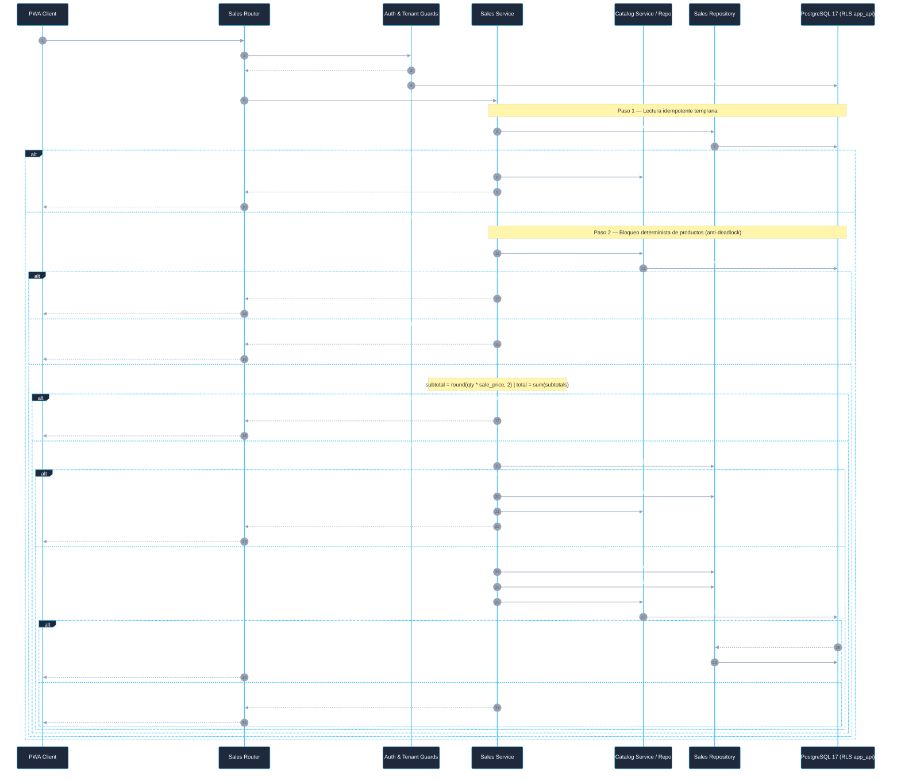
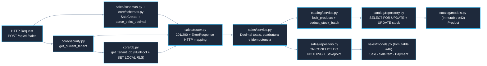

## Context

El sistema `registro-venta-micro` sigue una arquitectura cliente-servidor API-first con monolito modular en capas (`Router → Service → Repository`) sobre FastAPI, Pydantic v2 y SQLAlchemy 2 async (`asyncpg`) contra PostgreSQL 17 (Supabase local).

El contrato de base de datos de ventas y catálogo quedó cerrado e inmutable en los cambios `#42` (`openspec/specs/products-schema-and-rls/spec.md`, revisión Alembic `a3f9d2e1b4c8`) y `#46` (`openspec/specs/sales-schema-and-rls/spec.md`, revisión Alembic `d4e7f1a2b9c3`):
- `public.products` (`backend/app/modules/catalog/models.py`): `id` UUID, `business_id` UUID, `name`, `sale_price` (`numeric(12,2) > 0`), `cost_price` (`numeric(12,2) >= 0`), `stock` (`numeric(12,2)`, sin `CHECK >= 0` para admitir saldo negativo transitorio), `is_active` (`boolean`).
- `public.sales` (`backend/app/modules/sales/models.py`): `id` UUID (`gen_random_uuid()`), `business_id` UUID (`FK -> businesses.id ON DELETE CASCADE`), `client_id` UUID con unicidad compuesta `uq_sales_business_id_client_id` `(business_id, client_id)`, `total_amount` (`numeric(12,2) > 0`), `created_at` (`timestamptz`).
- `public.sale_items` (`backend/app/modules/sales/models.py`): `id` UUID, `business_id` UUID, `sale_id` UUID, `product_id` UUID, `quantity` (`numeric(12,2) > 0`), `unit_price` (`numeric(12,2) > 0`), `unit_cost` (`numeric(12,2) >= 0`), FKs compuestas `(business_id, sale_id) -> sales(business_id, id) ON DELETE CASCADE` y `(business_id, product_id) -> products(business_id, id) ON DELETE RESTRICT`.
- `public.payments` (`backend/app/modules/sales/models.py`): `id` UUID, `business_id` UUID, `sale_id` UUID, `payment_method` (`varchar(20)` `CHECK IN ('cash', 'card', 'transfer')`), `amount` (`numeric(12,2) > 0`), FK compuesta `(business_id, sale_id) -> sales(business_id, id) ON DELETE CASCADE`.
- Seguridad multitenant en runtime: `ENABLE` + `FORCE ROW LEVEL SECURITY` en todas las tablas operativas evaluando `business_id = NULLIF(current_setting('app.current_business_id', true), '')::uuid`, ejecutando bajo rol `app_api` / `app_runtime` (`NOBYPASSRLS`) con `NullPool` (`openspec/specs/backend/known-gotchas.md`).
- Hooks locales y CI activos: `.husky/pre-commit` (`lint-staged` con `ruff check --fix` + `ruff format`), `.husky/pre-push` (`mypy app` + `pytest tests/unit`), y `.github/workflows/ci-backend.yml` (`pip-audit`, `ruff check`, `ruff format --check`, `python -m app.scripts.export_openapi --check`, `mypy app`, `pytest`, `alembic check` y roundtrip de migraciones).

### Convenciones e Infraestructura Detectada

```yaml
stack: "Python 3.14 / FastAPI"
backend_dir: "backend/app"
arch_pattern: "monolito-modular-capas"
db_mode: "with-db"
db_dirs: "backend/migrations"
migration_exts: ".py"
typegen_cmd: "none"
rls_mode: "in-situ"
auth_mode: "jwt"
contract_style: "code-first"
openapi_path: "docs/api/openapi.json"
openapi_export_cmd: "uv run --directory backend python -m app.scripts.export_openapi"
tests_dir: "backend/tests"
lint_cmd: "cd backend && uv run ruff check . && uv run ruff format --check ."
typecheck_cmd: "cd backend && uv run mypy app"
test_cmd: "cd backend && uv run pytest"
test_fast_cmd: "cd backend && uv run pytest tests/unit"
test_integration_cmd: "cd backend && uv run pytest tests/integration"
test_migrate_cmd: "cd backend && uv run alembic upgrade head"
scaffold_cmd: "none"
seed_cmd: "none"
mutation_cmd: "none"
```

## Goals / Non-Goals

**Goals:**
- Implementar `POST /api/v1/sales` en `backend/app/modules/sales/` bajo `get_current_tenant` (`owner` | `cashier`) y `get_tenant_db` (`SET LOCAL ROLE app_api`, `app.current_user_id`, `app.current_business_id`).
- Recalcular en servidor subtotales por línea (`ROUND_HALF_UP` a `0.01`) y `total_amount` en `Decimal` estricto (prohibiendo `float`, `bool`, `NaN`, `Infinity`, escalas `> 2` y desbordamiento `numeric(12,2)`), congelando `unit_price` y `unit_cost` desde `products`.
- Validar cuadratura exacta `SUM(payments.amount) == total_amount` (`422 PAYMENT_TOTAL_MISMATCH`), existencia y pertenencia tenant de productos (`404 PRODUCT_NOT_FOUND`), y estado activo (`422 PRODUCT_INACTIVE`).
- Bloquear productos en orden determinista (`ORDER BY id ASC FOR UPDATE`) y ejecutar deducción atómica `stock = stock - quantity` sin rechazar saldos negativos transitorios, dentro de una única transacción ACID con rollback garantizado ante cualquier excepción.
- Garantizar idempotencia por `(business_id, client_id)` tanto en reintentos secuenciales (early lookup) como concurrentes (`INSERT ... ON CONFLICT (business_id, client_id) DO NOTHING RETURNING *` previo al descuento de stock), devolviendo `200 OK` con el mismo comprobante determinista sin duplicar filas ni re-descontar stock.
- Mantener la frontera del monolito modular (`SalesService` colabora con `CatalogService` compartiendo la misma `AsyncSession` transaccional) y sincronizar `docs/api/openapi.json` conforme a ADR-0005.

**Non-Goals:**
- Modificar `backend/migrations/`, políticas RLS o modelos ORM existentes (`auth/models.py`, `catalog/models.py`, `sales/models.py`).
- Implementar endpoints de lectura/listado de ventas (`GET /api/v1/sales`), anulaciones, notas de crédito, impuestos o sesiones de caja (`cash_sessions`).
- Implementar reportes diarios (`#50`) o UI de mostrador / calculador de vuelto en frontend (`#48`).

## Architecture & Data Flow





## API & Schema Contracts (Code-First)

### 1. Helpers Compartidos en Core (`backend/app/core/schemas.py`)

Para evitar duplicación o acoplamiento transversal entre `sales` y `catalog`:
- Se promueven desde `catalog/schemas.py` hacia `backend/app/core/schemas.py`:
  - `MAX_NUMERIC_12_2 = Decimal("9999999999.99")`
  - `DECIMAL_QUANTIZER = Decimal("0.01")`
  - `parse_strict_decimal(value: Any) -> Decimal`: rechaza `None`, `bool`, `float`, strings vacíos/NUL (`\x00`), `NaN`/`Infinity`, escalas `> 2` decimales (sin redondeo silencioso) y magnitudes `> MAX_NUMERIC_12_2`, normalizando mediante `.quantize(DECIMAL_QUANTIZER)`.
  - `quantize_decimal(value: Decimal) -> Decimal`: helper para cuantizar salidas a 2 decimales.
- `backend/app/modules/catalog/schemas.py` importa desde `app.core.schemas` manteniendo `_parse_strict_decimal = parse_strict_decimal` por compatibilidad hacia atrás.

### 2. Esquemas Pydantic v2 (`backend/app/modules/sales/schemas.py`)

- `PaymentMethod = Literal["cash", "card", "transfer"]`
- **`SaleItemCreate(BaseModel)`**:
  - `product_id: uuid.UUID` (validator `before`: si es `str`, rechaza `\x00` vía `reject_nul_byte`).
  - `quantity: Decimal = Field(gt=Decimal("0"), le=MAX_NUMERIC_12_2, max_digits=12, decimal_places=2, description="Cantidad vendida (string decimal exacto, sin float)", examples=["2.00"])` — `@field_validator("quantity", mode="before")` usa `parse_strict_decimal`.
- **`SalePaymentCreate(BaseModel)`**:
  - `payment_method: PaymentMethod = Field(description="Medio de pago admitido en MVP", examples=["cash"])` — si recibe `str`, rechaza `\x00` y valida pertenencia a `("cash", "card", "transfer")`.
  - `amount: Decimal = Field(gt=Decimal("0"), le=MAX_NUMERIC_12_2, max_digits=12, decimal_places=2, description="Importe imputado a este medio de pago (string decimal exacto)", examples=["3000.00"])` — `@field_validator("amount", mode="before")` usa `parse_strict_decimal`.
- **`SaleCreate(BaseModel)`** (`extra="ignore"` por defecto para ignorar `business_id` enviado en body):
  - `client_id: uuid.UUID = Field(description="Identificador UUID v4 generado en cliente para idempotencia")` (validator `before`: rechaza `\x00` si es `str`).
  - `items: list[SaleItemCreate] = Field(min_length=1, max_length=500, description="Líneas de la venta")`
  - `payments: list[SalePaymentCreate] = Field(min_length=1, max_length=20, description="Desglose de pagos")`
- **`SaleItemResponse(BaseModel)`** (`model_config = ConfigDict(from_attributes=True)`):
  - `id: uuid.UUID`
  - `product_id: uuid.UUID`
  - `product_name: str`
  - `quantity: Decimal` (cuantizado a `0.01`, serializado como string `"2.00"`)
  - `unit_price: Decimal` (cuantizado a `0.01`, serializado como string `"1500.00"`)
  - `subtotal: Decimal` (cuantizado a `0.01`, serializado como string `"3000.00"`)
  - *(Omite `unit_cost` intencionalmente: el costo histórico se congela en `sale_items.unit_cost` para reportes de margen `#50`, sin exponerse en el comprobante de mostrador ni a `cashier`).*
- **`SalePaymentResponse(BaseModel)`** (`model_config = ConfigDict(from_attributes=True)`):
  - `id: uuid.UUID`
  - `payment_method: PaymentMethod`
  - `amount: Decimal` (cuantizado a `0.01`, serializado como string `"3000.00"`)
- **`SaleResponse(BaseModel)`** (`model_config = ConfigDict(from_attributes=True)`):
  - `id: uuid.UUID`
  - `client_id: uuid.UUID`
  - `total_amount: Decimal` (cuantizado a `0.01`, serializado como string `"3000.00"`)
  - `items: list[SaleItemResponse]` (ordenados determinísticamente por `(created_at, id)`)
  - `payments: list[SalePaymentResponse]` (ordenados determinísticamente por `(created_at, id)`)
  - `created_at: datetime`

### 3. Ruta HTTP, Códigos de Estado y Errores (`backend/app/modules/sales/router.py`)

Router: `APIRouter(prefix="/sales", tags=["sales"])`, registrado en `app/main.py` bajo `prefix="/api/v1"`.

| Operación | Auth / Rol | Body | Respuestas Documentadas en OpenAPI |
|---|---|---|---|
| `POST /api/v1/sales` | `get_current_tenant` (`owner` \| `cashier`) + `get_tenant_db` | `SaleCreate` | `201 Created` (`SaleResponse`), `200 OK` (`SaleResponse`, reintento idempotente), `401` (`UNAUTHENTICATED`), `403` (`ONBOARDING_REQUIRED`), `404` (`PRODUCT_NOT_FOUND`), `422` (`VALIDATION_ERROR` \| `PAYMENT_TOTAL_MISMATCH` \| `PRODUCT_INACTIVE`) |

Mapeo de excepciones de dominio en `router.py` (siempre lanzando `HTTPException` para disparar rollback en `get_tenant_db` y formato uniforme `ErrorResponse`):
- `SaleProductNotFoundError` → `404 Not Found`: `{"code": "PRODUCT_NOT_FOUND", "message": "One or more products were not found", "details": {"missing_product_ids": [...]}}`
- `SaleProductInactiveError` → `422 Unprocessable Content`: `{"code": "PRODUCT_INACTIVE", "message": "Inactive products cannot be sold", "details": {"inactive_product_ids": [...]}}`
- `SalePaymentMismatchError` → `422 Unprocessable Content`: `{"code": "PAYMENT_TOTAL_MISMATCH", "message": "Sum of payments must match server-calculated sale total", "details": {"expected_total": "...", "payments_total": "..."}}`
- `SaleTotalInvalidError` → `422 Unprocessable Content`: `{"code": "VALIDATION_ERROR", "message": "...", "details": None}`

### 4. Estrategia de Repositorio, Colaboración Modular, Concurrencia y Seguridad RLS

- **Contexto de Tenant (`get_tenant_db`)**: abre la transacción PostgreSQL (`NullPool`, `READ COMMITTED`) ejecutando `SET LOCAL ROLE app_api`, `set_config('app.current_user_id', ...)`, y `set_config('app.current_business_id', ...)` desde el JWT. El campo `business_id` insertado en `sales`, `sale_items` y `payments` proviene exclusivamente de `current_user.business_id` (nunca del JSON del cliente).
- **Colaboración entre módulos (`SalesService` → `CatalogService`)**: siguiendo la frontera de monolito modular (`README.md` §2.3), `SalesRepository` opera únicamente sobre `Sale`, `SaleItem` y `Payment`, mientras `CatalogRepository` opera sobre `Product`. `get_sales_service(db: AsyncSession = Depends(get_tenant_db))` inyecta la **misma `AsyncSession`** en `SalesRepository(db)` y `CatalogRepository(db)` (vía `CatalogService`), garantizando atomicidad en una sola transacción ACID.
- **Orden determinista de bloqueo (`ORDER BY id ASC FOR UPDATE`)**: `CatalogRepository.lock_products_for_sale` ordena los `product_id` únicos ascendentemente y ejecuta `SELECT ... FROM products WHERE id IN (...) ORDER BY id ASC FOR UPDATE`. Evita *deadlocks* entre ventas concurrentes con productos cruzados y previene *lost updates* sobre `stock` y lectura inconsistente de precios.
- **Deducción agregada y stock negativo**: `SalesService` acumula `stock_deductions[product_id] += item.quantity` y `CatalogRepository.deduct_stock_batch` ejecuta `UPDATE products SET stock = stock - :qty WHERE id = :pid` en orden de `product_id ASC`. Al no existir `CHECK (stock >= 0)` en `products`, saldos negativos transitorios se persisten en exactitud `numeric(12,2)`.
- **Savepoint único alrededor del bloque de escritura ACID**: `SalesRepository.transaction()` abre `begin_nested()` cuando `session.in_transaction()` es `True` (o `begin()` si no hay transacción previa), envolviendo `try_insert_sale_header` → `insert_sale_items` → `insert_payments` → `deduct_stock_batch`. Cualquier fallo revierte el savepoint y propaga la excepción hacia `get_tenant_db`, garantizando rollback total sin dejar `InFailedSQLTransactionError`.
- **Idempotencia segura ante carreras**:
  1. Antes de bloquear productos o validar precios actuales, `get_sale_by_client_id` verifica si `(business_id, client_id)` ya existe. Si existe, devuelve `200 OK` inmediatamente incluso si el catálogo cambió precios o desactivó el producto con posterioridad.
  2. Ante solicitudes concurrentes simultáneas con el mismo `client_id`, `try_insert_sale_header` ejecuta `INSERT INTO sales (...) ON CONFLICT (business_id, client_id) DO NOTHING RETURNING *` **antes** de insertar `sale_items`, `payments` o descontar `products.stock`. Si retorna `None`, omite toda escritura de hijos/stock, consulta la venta ya confirmada bajo `READ COMMITTED` y retorna `200 OK`.

## Decisions

1. **Lectura temprana de idempotencia + `ON CONFLICT (business_id, client_id) DO NOTHING` previo a `deduct_stock_batch`**:
   - *Por qué*: Si un reintento ocurre tras un cambio de precio o desactivación de producto, la lectura temprana devuelve el comprobante original (`200 OK`) sin fallar por cuadratura contra el precio nuevo. Y si dos peticiones idénticas compiten en paralelo, ejecutar `INSERT INTO sales ... ON CONFLICT DO NOTHING` antes de tocar `products.stock` impide que la petición perdedora descuente stock duplicado.
   - *Alternativa descartada*: Descontar stock antes de insertar `sales` (produciría doble descuento en carrera si no se revierte manualmente) o validar siempre contra precios actuales antes de revisar `client_id` (rompería la idempotencia tras cambios de catálogo).

2. **Redondeo por línea `ROUND_HALF_UP` a `0.01` y suma de subtotales para `total_amount`**:
   - *Por qué*: Con cantidades fraccionarias (`numeric(12,2)`, p. ej. `1.50 * 100.33 = 150.495`), redondear cada línea a 2 decimales y sumar los subtotales garantiza consistencia matemática visible en el comprobante (`sum(item.subtotal) == sale.total_amount == sum(payment.amount)`). Se valida explícitamente `subtotal > 0` y `<= MAX_NUMERIC_12_2` antes de BD para mapear extremos (`0.01 * 0.01` o overflows) a `422` en lugar de `500`.
   - *Alternativa descartada*: Redondear solo el total final (generaría diferencias de `0.01` entre la suma de renglones del ticket y el total cobrado).

3. **Autorización de `owner` y `cashier` en `POST /api/v1/sales` con omisión de `unit_cost` en `SaleItemResponse`**:
   - *Por qué*: Tanto `owner` como `cashier` operan el mostrador (consistente con `GET /api/v1/catalog/products`), pero los costos unitarios no deben exponerse en el comprobante de venta al mostrador ni al cajero (`README.md` §2.5). El `unit_cost` queda congelado en `sale_items` en BD para el reporte de margen (`#50`).
   - *Alternativa descartada*: Restringir `POST /api/v1/sales` a `require_owner` (bloquearía el rol `cashier` previsto en `security.py`) o exponer `unit_cost` en el JSON de respuesta del ticket.

4. **Colaboración `SalesService → CatalogService` con `AsyncSession` compartida**:
   - *Por qué*: Respeta la regla del monolito modular (`README.md` §2.3: ningún módulo consulta tablas ajenas directamente) manteniendo una única transacción ACID controlada por `get_tenant_db` y facilitando unit testing de `SalesService`.
   - *Alternativa descartada*: Consultar y actualizar `Product` directamente desde `SalesRepository` (violaría límites modulares) o abrir sesiones separadas entre servicios (rompería la atomicidad ACID).

5. **Ordenamiento determinista `(created_at, id)` en `items` y `payments` de `SaleResponse`**:
   - *Por qué*: Garantiza que la respuesta `201 Created` y cualquier reintento idempotente `200 OK` devuelvan exactamente la misma serialización JSON incluso cuando los registros comparten timestamp transaccional `now()`.
   - *Alternativa descartada*: Devolver orden arbitrario de `RETURNING` vs `SELECT` sin `ORDER BY` (introduciría no-determinismo en comparaciones idempotentes).

6. **Promoción de `parse_strict_decimal` a `app/core/schemas.py` y sincronización de `docs/api/openapi.json`**:
   - *Por qué*: Evita duplicar la validación estricta de `Decimal` entre `catalog` y `sales`, y mantiene `docs/api/openapi.json` alineado con `export_openapi --check` exigido en CI (ADR-0005).
   - *Alternativa descartada*: Copiar `_parse_strict_decimal` en `sales/schemas.py` o diferir la exportación OpenAPI (rompería el job `lint` en `ci-backend.yml`).

## Risks / Trade-offs

- **[Risk]** Contención por bloqueo `FOR UPDATE` sobre productos muy vendidos en alta concurrencia.  
  → **Mitigación**: El bloqueo es de fila individual por transacción breve y en orden ascendente de `product_id`, eliminando *deadlocks* en pedidos multi-ítem y preservando consistencia estricta de stock.
- **[Risk]** Regresión accidental en `catalog` al extraer `parse_strict_decimal` hacia `app/core/schemas.py`.  
  → **Mitigación**: Re-exportar `_parse_strict_decimal` en `app/modules/catalog/schemas.py` y ejecutar la suite completa de `tests/unit` y `tests/integration/test_catalog_products.py`.
- **[Risk]** Desincronización de `docs/api/openapi.json` en CI (`export_openapi --check`).  
  → **Mitigación**: Incluir como tarea obligatoria en `tasks.md` regenerar `docs/api/openapi.json` con `uv run --directory backend python -m app.scripts.export_openapi` y verificar `--check` en Gate 4 / `opsx:verify`.

## Migration Plan

Sin migraciones de base de datos (`No-DB-Diff`). Las tablas `public.products`, `public.sales`, `public.sale_items` y `public.payments`, sus restricciones compuestas, índices, políticas RLS y privilegios DCL ya existen en la revisión Alembic `d4e7f1a2b9c3` (`#46`). El despliegue consiste exclusivamente en código Python en `backend/app/`, pruebas en `backend/tests/` y la actualización del contrato exportado en `docs/api/openapi.json`.
