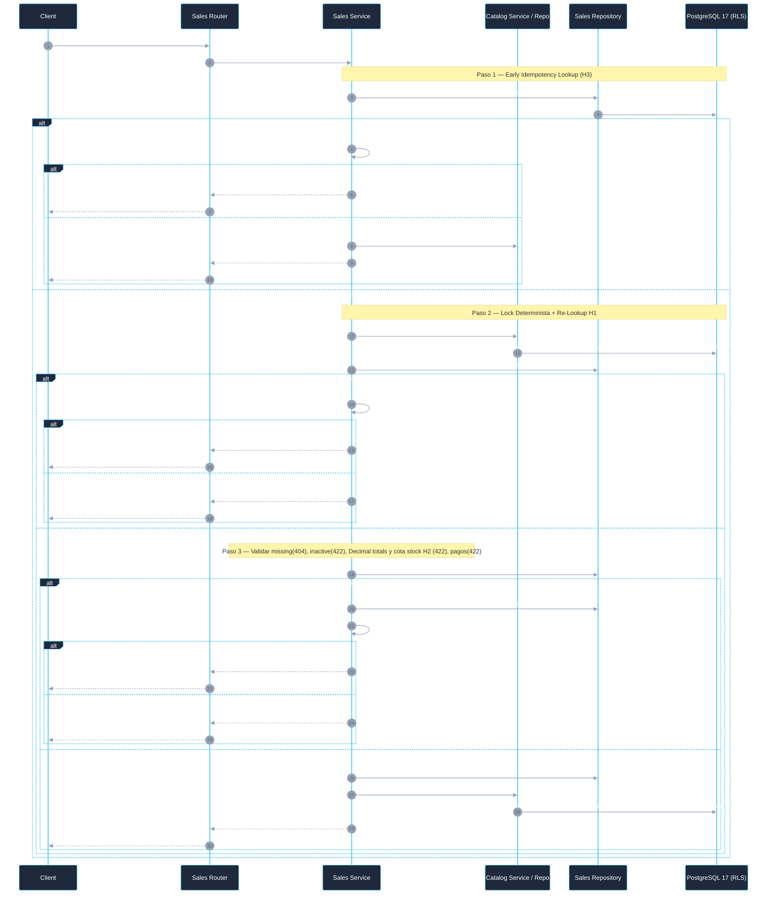
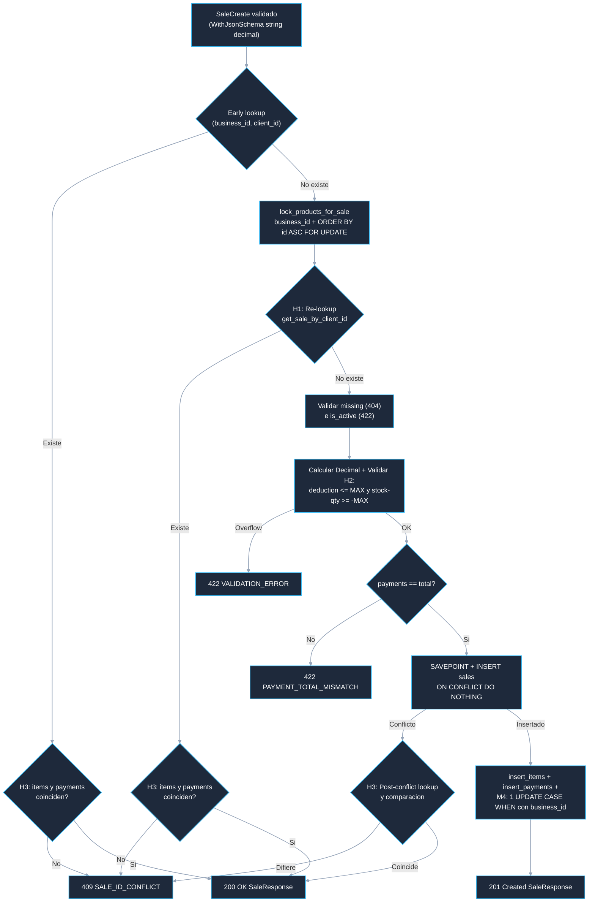

## Context

El endpoint `POST /api/v1/sales` (implementado en Issue #47 sobre las tablas inmutables de `#42` y `#46`) opera bajo arquitectura API-first en capas (`Router → Service → Repository`) con FastAPI, Pydantic v2, SQLAlchemy 2 async (`asyncpg`) y PostgreSQL 17 (Supabase local). La revisión adversarial del PR #64 (`docs/reviews/pr-64-review.md`) detectó brechas de concurrencia, cotas numéricas, idempotencia ambigua, contrato OpenAPI y cobertura de pruebas que deben cerrarse en el Issue #68 antes de integrar el mostrador offline (`#48`).

Invariantes de base de datos inmutables (revisión Alembic `d4e7f1a2b9c3`):
- `public.products`: `stock numeric(12,2)` sin `CHECK (stock >= 0)`, rango válido `[-9999999999.99, +9999999999.99]`.
- `public.sales`: unicidad `(business_id, client_id)` (`uq_sales_business_id_client_id`).
- `public.sale_items` y `public.payments`: `created_at` por defecto `now()` (mismo timestamp dentro de una transacción) e `id` por defecto `gen_random_uuid()`.
- RLS forzada en todas las tablas operativas bajo `SET LOCAL ROLE app_api` + `set_config('app.current_business_id', ...)` y `NullPool` (`openspec/specs/backend/known-gotchas.md`).

### Convenciones e Infraestructura Detectada

```yaml
stack: "Python 3.14 / FastAPI"
backend_dir: "backend/app"
arch_pattern: "monolito-modular-capas"
db_mode: "with-db"
db_dirs: "backend/migrations"
migration_exts: ".py"
typegen_cmd: "none"
rls_mode: "in-situ"
auth_mode: "jwt"
contract_style: "code-first"
openapi_path: "docs/api/openapi.json"
openapi_export_cmd: "uv run --directory backend python -m app.scripts.export_openapi"
openapi_check_cmd: "uv run --directory backend python -m app.scripts.export_openapi --check"
tests_dir: "backend/tests"
lint_cmd: "cd backend && uv run ruff check . && uv run ruff format --check ."
typecheck_cmd: "cd backend && uv run mypy app"
test_cmd: "cd backend && uv run pytest"
test_fast_cmd: "cd backend && uv run pytest tests/unit"
test_integration_cmd: "cd backend && uv run pytest tests/integration"
test_migrate_cmd: "cd backend && uv run alembic upgrade head"
scaffold_cmd: "none"
seed_cmd: "none"
mutation_cmd: "none"
```

## Goals / Non-Goals

**Goals:**
- **H1 — Cierre de carrera post-`FOR UPDATE`:** Re-ejecutar `get_sale_by_client_id` inmediatamente después de `lock_products_for_sale` (dentro de la misma transacción) antes de validar existencia, `is_active` o cuadratura de precios/pagos.
- **H2 — Guarda explícita contra overflow `numeric(12,2)` en `stock`:** Validar `stock_deductions[pid] <= MAX_NUMERIC_12_2` y `(product.stock - total_qty) >= -MAX_NUMERIC_12_2` en `SalesService.create_sale`, mapeando a `422 VALIDATION_ERROR`.
- **H3 — Rechazo `409 SALE_ID_CONFLICT`:** Comparar contenido de `items` (`product_id`, `quantity` cuantizada) y `payments` (`payment_method`, `amount` cuantizada) en los tres puntos de detección de `client_id` existente (temprano, post-lock y post-`ON CONFLICT`).
- **M1 — Contrato OpenAPI string-only:** Aplicar `WithJsonSchema` en `SaleItemCreate.quantity` y `SalePaymentCreate.amount` para emitir `type: "string"` (`format: "decimal"`) y documentar `409` en `docs/api/openapi.json`.
- **M2–M3 — Cobertura unitaria y pruebas de concurrencia/límites:** Crear `backend/tests/unit/test_sales_schemas.py` y ampliar `backend/tests/integration/test_sales_api.py` con concurrencia cruzada real (`[P1, P2]` vs `[P2, P1]`), carrera H1, overflow H2, conflicto `409` H3 y cotas (`500` items, `20` payments, `unit_cost == 0.00`).
- **M4 — Defense-in-depth y batching en `CatalogRepository`:** Filtrar explícitamente por `Product.business_id == business_id` en `lock_products_for_sale`, `deduct_stock_batch` y `get_product_names_by_ids`, y consolidar `deduct_stock_batch` en un único `UPDATE` con `CASE WHEN`.

**Non-Goals:**
- **H4 — Reconciliación de precios en sincronización offline:** Diferido explícitamente al Issue #48 / arquitectura de cola *outbox* offline.
- Alterar `backend/migrations/`, modelos ORM (`Product`, `Sale`, `SaleItem`, `Payment`) o políticas RLS.
- Modificar `CatalogCreate` / `ProductCreate` OpenAPI schemas (fuera de M1), implementar revalidación BD del JWT (M5) o agregar columna `product_name` en `sale_items` (M6).

## Architecture & Data Flow





## API & Schema Contracts (Code-First)

### 1. Contratos Pydantic v2 (`backend/app/modules/sales/schemas.py`)

Para alinear el esquema OpenAPI con el validador estricto `parse_strict_decimal` (que rechaza `float` en runtime):

```python
DecimalInput = Annotated[
    Decimal,
    WithJsonSchema(
        {
            "type": "string",
            "format": "decimal",
            "pattern": r"^\d{1,10}(\.\d{1,2})?$",
        }
    ),
]
```

- **`SaleItemCreate`**:
  - `product_id: uuid.UUID`
  - `quantity: DecimalInput = Field(gt=Decimal("0"), le=MAX_NUMERIC_12_2, max_digits=12, decimal_places=2, description="Cantidad vendida (string decimal exacto, sin float)", examples=["2.00"])`
- **`SalePaymentCreate`**:
  - `payment_method: PaymentMethod` (`Literal["cash", "card", "transfer"]`)
  - `amount: DecimalInput = Field(gt=Decimal("0"), le=MAX_NUMERIC_12_2, max_digits=12, decimal_places=2, description="Importe imputado a este medio de pago (string decimal exacto)", examples=["3000.00"])`
- En Pydantic `2.14.x`, `Annotated[Decimal, WithJsonSchema(...)]` + `Field(...)` conserva `title`, `description` y `examples` en `docs/api/openapi.json` y sustituye `anyOf: [{"type": "number"}, {"type": "string"}]` por `"type": "string", "format": "decimal", "pattern": "^\\d{1,10}(\\.\\d{1,2})?$"`, manteniendo intacta la validación en runtime.
- `SaleCreate`, `SaleItemResponse`, `SalePaymentResponse` y `SaleResponse` permanecen sin cambios de campos ni exposición de `unit_cost`.

### 2. Ruta HTTP y Mapa de Errores (`backend/app/modules/sales/router.py`)

`POST /api/v1/sales` (autenticado vía `get_current_tenant` + `get_tenant_db`):

| Código HTTP | Condición | `ErrorResponse.code` | `ErrorResponse.details` |
|---|---|---|---|
| `201 Created` | Venta nueva registrada | *(N/A — `SaleResponse`)* | — |
| `200 OK` | Reintento idempotente con `items` y `payments` equivalentes | *(N/A — `SaleResponse`)* | — |
| `401 Unauthorized` | Sin sesión o JWT inválido/expirado | `UNAUTHENTICATED` | `null` |
| `403 Forbidden` | Usuario sin onboarding (`business_id is None`) | `ONBOARDING_REQUIRED` | `null` |
| `404 Not Found` | `product_id` inexistente o de otro tenant | `PRODUCT_NOT_FOUND` | `{"missing_product_ids": [...]}` |
| `409 Conflict` | `client_id` ya existe en el comercio con distinto `items` o `payments` (**H3**) | `SALE_ID_CONFLICT` | `{"client_id": "<uuid>"}` |
| `422 Unprocessable Content` | Validación Pydantic (`float`, escala `>2`, límites `500`/`20`), total `<= 0` / `> MAX`, u overflow `numeric(12,2)` de stock (**H2**) | `VALIDATION_ERROR` | `list` (Pydantic) o `null` (dominio) |
| `422 Unprocessable Content` | Producto con `is_active = false` | `PRODUCT_INACTIVE` | `{"inactive_product_ids": [...]}` |
| `422 Unprocessable Content` | `SUM(payments.amount) != total_amount` | `PAYMENT_TOTAL_MISMATCH` | `{"expected_total": "...", "payments_total": "..."}` |

### 3. Reglas en Capa de Servicio (`backend/app/modules/sales/service.py`)

1. **Excepciones de dominio nuevas**:
   - `SaleStockOverflowError(Exception)`: lanzada cuando `stock_deductions[pid] > MAX_NUMERIC_12_2` o `(quantize_decimal(product.stock) - total_qty) < -MAX_NUMERIC_12_2`, mapeada en `router.py` a `422` (`VALIDATION_ERROR`).
   - `SaleIdConflictError(Exception)`: almacena `client_id: uuid.UUID`, mapeada en `router.py` a `409` (`SALE_ID_CONFLICT`).
2. **Validación de equivalencia idempotente (`_assert_idempotent_payload_matches`)**:
   - Compara dos multiconjuntos ordenados:
     - `sorted((item.product_id, quantize_decimal(item.quantity)) for item in payload.items)` vs `sorted((item.product_id, quantize_decimal(item.quantity)) for item in existing_items)`
     - `sorted((p.payment_method, quantize_decimal(p.amount)) for p in payload.payments)` vs `sorted((cast(PaymentMethod, p.payment_method), quantize_decimal(p.amount)) for p in existing_payments)`
   - **Por qué ordenación canónica de multiconjuntos:** `SaleItem` y `Payment` persisten dentro de una única transacción con `created_at = now()` compartido e `id = gen_random_uuid()`, por lo que `get_sale_by_client_id` ordena por `(created_at ASC, id ASC)` (orden aleatorio de UUID v4). La comparación de tuplas ordenadas es inmune al orden de UUID en BD, conserva multiplicidad de líneas idénticas y resiste cambios posteriores de `sale_price` o `is_active` en `products`.
3. **Re-lookup post-lock (`H1`)**:
   - Ejecuta `get_sale_by_client_id(business_id=business_id, client_id=payload.client_id)` inmediatamente después de `lock_products_for_sale` y antes de validar `missing_ids`, `inactive_ids` o precios/pagos.
   - Si encuentra venta existente, valida equivalencia H3 (`409` si difiere; `200 OK` si coincide), resolviendo `product_names` desde `products_by_id` cuando todos los `product_id` están presentes (con respaldo en `get_product_names_by_ids`).
4. **Cota de overflow en `stock` (`H2`)**:
   - Al acumular `stock_deductions[item.product_id] += item.quantity`, validar inmediatamente `stock_deductions[item.product_id] <= MAX_NUMERIC_12_2`.
   - Antes de `payments_total != total_amount`, iterar `stock_deductions` y validar `(quantize_decimal(products_by_id[pid].stock) - total_qty) >= -MAX_NUMERIC_12_2`. Ambas violaciones lanzan `SaleStockOverflowError` (`422 VALIDATION_ERROR`).

### 4. Estrategia de Repositorio y RLS (`CatalogRepository` & `CatalogService` — M4)

Todas las operaciones ejecutan dentro de la sesión transaccional `get_tenant_db` (`SET LOCAL ROLE app_api`, `app.current_business_id`):
- `lock_products_for_sale(self, *, business_id: uuid.UUID, product_ids: list[uuid.UUID]) -> dict[uuid.UUID, Product]`:
  - `.where(Product.business_id == business_id, Product.id.in_(ordered_ids)).order_by(Product.id.asc()).with_for_update()`
- `get_product_names_by_ids(self, *, business_id: uuid.UUID, product_ids: list[uuid.UUID]) -> dict[uuid.UUID, str]`:
  - `.where(Product.business_id == business_id, Product.id.in_(unique_ids))`
- `deduct_stock_batch(self, *, business_id: uuid.UUID, deductions: dict[uuid.UUID, Decimal]) -> None`:
  - Construye un único `UPDATE products SET stock = stock - CASE WHEN id = :p1 THEN :q1 ... ELSE 0.00 END` usando `sqlalchemy.case` y `literal(qty, type_=Numeric(12, 2))` sobre `ordered_ids = sorted(deductions)`, filtrado por `Product.business_id == business_id, Product.id.in_(ordered_ids)`.
  - Como todas las filas afectadas ya fueron bloqueadas en orden ascendente `ORDER BY id ASC FOR UPDATE` dentro de la misma transacción, un único `UPDATE` elimina N round-trips manteniendo cero riesgo de deadlock.

## Decisions

1. **Comparación por multiconjunto ordenado (`sorted`) en H3 en lugar de comparación posicional:**
   - *Por qué:* Las filas hijas insertadas en lote comparten `created_at` transaccional y reciben UUID v4 aleatorios, por lo que `ORDER BY created_at, id` en `get_sale_by_client_id` no preserva el índice de inserción; comparar posicionalmente rompería reintentos legítimos de ventas con >=2 líneas o >=2 pagos.
   - *Alternativa descartada:* Agregar columna `line_order` en `sale_items`/`payments` (violaría la inmutabilidad del esquema BD) o comparar solo `total_amount` (permitiría colisiones silenciosas entre carritos distintos de igual monto).

2. **`WithJsonSchema` en `Annotated[Decimal, ...]` sobre `SaleItemCreate.quantity` y `SalePaymentCreate.amount`:**
   - *Por qué:* Fuerza `type: "string"` + `format: "decimal"` en OpenAPI 3.1 manteniendo `title`, `description`, `examples`, validación runtime `parse_strict_decimal` y compatibilidad `mypy --strict`.
   - *Alternativa descartada:* Cambiar el tipo Python de los campos a `str` (perdería coerción/validación tipada `Decimal` en servicios y tests, además de exigir reescritura mayor de validadores).

3. **`SaleStockOverflowError` dedicado y validado antes de `PAYMENT_TOTAL_MISMATCH`:**
   - *Por qué:* Mantiene consistencia con `SaleTotalInvalidError` (cotas numéricas `numeric(12,2)` se validan antes de la cuadratura financiera de pagos) y evita que `deduct_stock_batch` dispare `SQLSTATE 22003` (`500`).
   - *Alternativa descartada:* Capturar `DBAPIError` (`22003`) tras `deduct_stock_batch` (ensuciaría el savepoint/transacción en lugar de validar determinísticamente antes de escribir).

4. **Bulk `UPDATE` con `sqlalchemy.case` y `literal(..., Numeric(12, 2))` en `deduct_stock_batch`:**
   - *Por qué:* Reduce N round-trips a 1 en ventas multi-ítem (`max_length=500` items -> máximo 500 ramas `WHEN`, muy por debajo del límite de 32,767 parámetros de `asyncpg`) y tipa explícitamente cada operando numérico para PostgreSQL.
   - *Alternativa descartada:* `UPDATE ... FROM (VALUES ...)` vía `text()` SQL crudo (menos portable con SQLAlchemy ORM y propenso a errores de cast de tipos en `asyncpg`).

## Risks / Trade-offs

- **[Risk]** Regresión de firmas en `CatalogService` / `CatalogRepository` al añadir `business_id` obligatorio (**M4**).  
  → **Mitigación**: Búsqueda en el repositorio confirma que `SalesService` es el único consumidor de `lock_products_for_sale`, `deduct_stock_batch` y `get_product_names_by_ids`; además `mypy --strict` detectará cualquier invocación desactualizada.
- **[Risk]** Que una herramienta cliente valide estrictamente el regex `pattern` del JSON Schema si un payload envía espacios o signo `+`.  
  → **Mitigación**: El patrón `^\d{1,10}(\.\d{1,2})?$` describe el formato canónico recomendado para clientes JSON (`"2"`, `"2.5"`, `"2.00"`) sin alterar `parse_strict_decimal` en runtime ni `SaleResponse`.
- **[Risk]** Flakiness en tests de concurrencia H1 al depender del *timing* entre transacciones concurrentes.  
  → **Mitigación**: Combinar pruebas reales con `asyncio.gather` contra PostgreSQL (para `[P1, P2]` vs `[P2, P1]` y colisiones) con sincronización determinista (`asyncio.Event` / wrapper controlado) para inyectar la edición de catálogo justo entre el early lookup y la adquisición de `FOR UPDATE`.

## Migration Plan

Sin cambios de base de datos (`No-DB-Diff`). No se crean ni editan archivos en `backend/migrations/` ni modelos ORM. Tras implementar el código y pruebas, se regenerará `docs/api/openapi.json` con `uv run --directory backend python -m app.scripts.export_openapi` y se validará con `--check`, `ruff`, `mypy --strict` y `pytest`.
