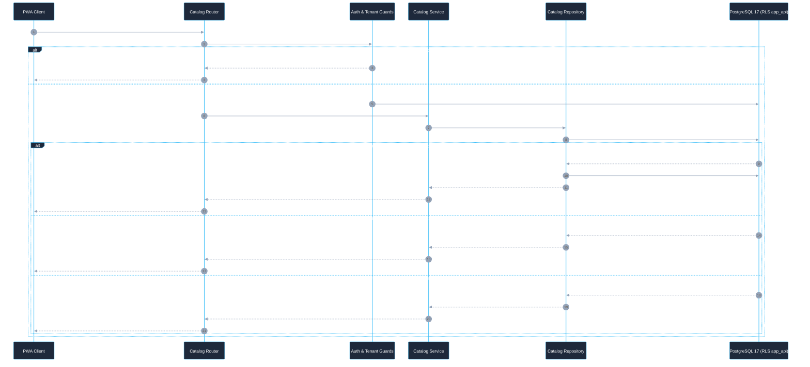
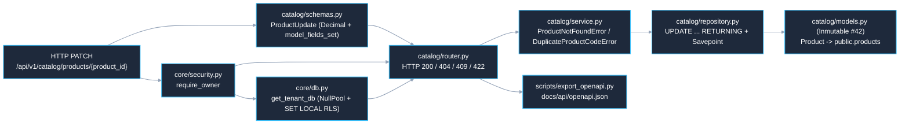

## Context

El módulo `catalog` (`backend/app/modules/catalog/`) sigue la arquitectura monolito modular en capas (`Router → Service → Repository`) sobre FastAPI, Pydantic v2 y SQLAlchemy 2 async (`asyncpg`) contra PostgreSQL 17 (Supabase local).

El contrato de base de datos (`products-schema-and-rls`, migración `20261118_0005-a3f9d2e1b4c8_create_products_table.py` y modelo ORM `Product` en `backend/app/modules/catalog/models.py`) permanece **100% inmutable** (`No-DB-Diff`):
- La tabla `public.products` posee `id` (`UUID`), `business_id` (`UUID`), `code` (`VARCHAR(50)` nullable con índice único parcial `uq_products_business_id_code` sobre `(business_id, code) WHERE code IS NOT NULL`), `name` (`VARCHAR(150)`), `sale_price` (`NUMERIC(12,2) > 0`), `cost_price` (`NUMERIC(12,2) >= 0`), `stock` (`NUMERIC(12,2)` sin `CHECK >= 0` en BD para soportar descuentos transitorios negativos en ventas futuras), `is_active` (`BOOLEAN`), `created_at` y `updated_at` (actualizado automáticamente vía trigger `BEFORE UPDATE` `trg_products_set_updated_at` usando `clock_timestamp()`).
- Políticas RLS forzadas (`ENABLE` y `FORCE ROW LEVEL SECURITY`) con `products_update_isolation` (`USING` y `WITH CHECK` evaluando `business_id = NULLIF(current_setting('app.current_business_id', true), '')::uuid`) y permisos otorgados a `app_api` / `app_runtime` (`NOBYPASSRLS`).
- Conforme al [ADR-0005](../../../docs/adr/0005-sincronizacion-contractual-openapi-y-prevencion-drift.md), el repositorio mantiene el contrato OpenAPI estático versionado en `docs/api/openapi.json`, exportado desde FastAPI mediante `backend/app/scripts/export_openapi.py` y verificado en CI (`--check`).

### Convenciones e Infraestructura Detectada

```yaml
stack: "Python 3.14 / FastAPI"
backend_dir: "backend/app"
arch_pattern: "monolito-modular-capas"
db_mode: "with-db"
db_dirs: "backend/migrations"
migration_exts: ".py"
typegen_cmd: "none"
rls_mode: "in-situ"
auth_mode: "jwt"
contract_style: "code-first"
openapi_path: "docs/api/openapi.json"
openapi_export_cmd: "uv run --directory backend python -m app.scripts.export_openapi"
tests_dir: "backend/tests"
lint_cmd: "cd backend && uv run ruff check . && uv run ruff format --check ."
typecheck_cmd: "cd backend && uv run mypy app"
test_cmd: "cd backend && uv run pytest"
test_fast_cmd: "cd backend && uv run pytest tests/unit"
test_integration_cmd: "cd backend && uv run pytest tests/integration"
test_migrate_cmd: "cd backend && uv run alembic upgrade head"
scaffold_cmd: "none"
seed_cmd: "none"
mutation_cmd: "none"
```

## Goals / Non-Goals

**Goals:**
- Implementar `PATCH /api/v1/catalog/products/{product_id}` para edición parcial de `code`, `name`, `sale_price`, `cost_price` y `stock`, devolviendo `200 OK` con `ProductResponse`.
- Definir el esquema Pydantic v2 `ProductUpdate` reutilizando validación estricta en `Decimal` (prohibiendo `float`, `bool`, `NaN`, `Infinity`, más de 2 decimales y overflow de `numeric(12,2)`), validando `sale_price > 0`, `cost_price >= 0` y `stock >= 0` cuando se informan, permitiendo limpiar `code` a `null`, y rechazando `null` en campos obligatorios o payloads vacíos `{}` con `422`.
- Garantizar autorización exclusiva para `owner` (`403 FORBIDDEN` para `cashier`), autenticación (`401 UNAUTHENTICATED`), onboarding activo (`403 ONBOARDING_REQUIRED`), aislamiento RLS vía `get_tenant_db`, respuesta `404` (`PRODUCT_NOT_FOUND`) para productos inexistentes o de otro tenant, y `409` (`PRODUCT_CODE_ALREADY_EXISTS`) con rollback limpio de savepoint ante colisión de `code`.
- Documentar el endpoint y `ProductUpdate` en FastAPI OpenAPI y regenerar `docs/api/openapi.json` con `export_openapi.py` pasando `--check`.
- Ampliar las pruebas unitarias (`backend/tests/unit/test_catalog_schemas.py`) y de integración/RLS (`backend/tests/integration/test_catalog_products.py`).

**Non-Goals:**
- Alterar `backend/migrations/`, políticas RLS o `backend/app/modules/catalog/models.py`.
- Exponer `GET /api/v1/catalog/products/{product_id}`, `DELETE /api/v1/catalog/products/{product_id}`, `PUT` o edición de `is_active`.
- Implementar UI de edición en frontend (`#44`) ni reglas de ventas/kardex (`#46`/`#47`).

## Architecture & Data Flow





## API & Schema Contracts (Code-First)

### 1. Reutilización de Validadores y Esquema `ProductUpdate` (`backend/app/modules/catalog/schemas.py`)

Para evitar duplicación de lógica entre `ProductCreate` y `ProductUpdate`, se extraen helpers compartidos en `catalog/schemas.py`:
- `_validate_optional_code(value: Any) -> str | None`: si `value is None`, retorna `None`; exige `isinstance(value, str)`, invoca `reject_nul_byte(value)`, aplica `.strip()` y rechaza strings vacíos (`ValueError("Product code cannot be empty")`).
- `_validate_product_name(value: Any) -> str`: exige `isinstance(value, str)` (rechazando `None`), invoca `reject_nul_byte(value)`, aplica `.strip()` y rechaza strings vacíos (`ValueError("Product name cannot be empty")`).
- `_parse_strict_decimal(value: Any) -> Decimal`: reutilizado sin cambios (rechaza `None`, `bool`, `float`, `NaN`, `Infinity`, `\x00`, más de 2 decimales y valores fuera de `MAX_NUMERIC_12_2 = Decimal("9999999999.99")`).

Constante de campos editables:
- `UPDATABLE_PRODUCT_FIELDS = frozenset({"code", "name", "sale_price", "cost_price", "stock"})`

Esquema **`ProductUpdate(BaseModel)`** (mantiene `extra="ignore"` por defecto en Pydantic v2, ignorando `business_id`, `id`, `created_at`, `updated_at` u otros campos no editables):
- `code: str | None = Field(default=None, max_length=50, description="Código interno o SKU opcional", examples=["SKU-001"])`
- `name: str | None = Field(default=None, min_length=1, max_length=150, description="Nombre del producto", examples=["Yerba Mate 1kg"])`
- `sale_price: Decimal | None = Field(default=None, gt=Decimal("0"), le=MAX_NUMERIC_12_2, max_digits=12, decimal_places=2, description="Precio de venta bruto (sin impuestos)", examples=["3500.50"])`
- `cost_price: Decimal | None = Field(default=None, ge=Decimal("0"), le=MAX_NUMERIC_12_2, max_digits=12, decimal_places=2, description="Costo unitario de referencia", examples=["2200.00"])`
- `stock: Decimal | None = Field(default=None, ge=Decimal("0"), le=MAX_NUMERIC_12_2, max_digits=12, decimal_places=2, description="Stock actual del producto", examples=["10.00"])`

Validadores en `ProductUpdate`:
- `@field_validator("code", mode="before")` → `_validate_optional_code(value)` (permite `"code": null` explícito para limpiar el SKU en BD, mientras que si `"code"` se omite, no entra en `model_fields_set`).
- `@field_validator("name", mode="before")` → `_validate_product_name(value)` (rechaza `"name": null` cuando se envía explícitamente).
- `@field_validator("sale_price", "cost_price", "stock", mode="before")` → `_parse_strict_decimal(value)` (rechaza `null` explícito cuando cualquiera de estos campos se envía en el JSON).
- `@model_validator(mode="after")`:
  1. Verifica que `self.model_fields_set & UPDATABLE_PRODUCT_FIELDS` no sea vacío; si está vacío (ej. `{}` o solo `{"business_id": "..."}`), lanza `ValueError("At least one editable field must be provided")` (`422 VALIDATION_ERROR`).
  2. Verifica explícitamente por defensa en profundidad que ningún campo en `("name", "sale_price", "cost_price", "stock")` presente en `self.model_fields_set` tenga valor `None`.

Semántica de respuesta (`ProductResponse`):
- Reutiliza `ProductResponse` existente sin cambios: cuando `stock` se omite en el `PATCH` sobre un producto con stock negativo transitorio (`"-1.50"`), `ProductResponse` serializa `"stock": "-1.50"` sin error.

### 2. Repositorio (`backend/app/modules/catalog/repository.py`)

Nuevo método en `CatalogRepository`:
- `async def update_product(self, *, product_id: uuid.UUID, business_id: uuid.UUID, updates: Mapping[str, Any]) -> Product | None`
  - Valida que `updates` no esté vacío y que todas sus llaves pertenezcan a `UPDATABLE_PRODUCT_FIELDS` (`ValueError` defensivo si se invocara incorrectamente).
  - Ejecuta dentro de `async with self._transaction():` (savepoint `begin_nested()` si hay transacción activa):
    ```python
    stmt = (
        update(Product)
        .where(Product.id == product_id, Product.business_id == business_id)
        .values(**dict(updates))
        .returning(Product)
    )
    result = await self._session.execute(stmt)
    return result.scalar_one_or_none()
    ```
  - La sentencia `UPDATE ... RETURNING` es atómica en un solo viaje a PostgreSQL, dispara el trigger `trg_products_set_updated_at` (`updated_at = clock_timestamp()`), aplica tanto el predicado `business_id` como las políticas RLS `products_update_isolation` (`USING` y `WITH CHECK`), y ante colisión en `uq_products_business_id_code` revierte el savepoint limpiamente dejando intacta la transacción externa.

### 3. Servicio (`backend/app/modules/catalog/service.py`)

- Nueva excepción de dominio: `class ProductNotFoundError(Exception):`
- Nuevo método en `CatalogService`:
  - `async def update_product(self, current_user: CurrentUser, product_id: uuid.UUID, payload: ProductUpdate) -> ProductResponse`
  - Valida `current_user.business_id is not None`.
  - Extrae `updates = payload.model_dump(exclude_unset=True)` (restringido a `UPDATABLE_PRODUCT_FIELDS`).
  - Invoca `self._repository.update_product(product_id=product_id, business_id=current_user.business_id, updates=updates)`.
  - Si captura `IntegrityError` con `_is_duplicate_product_code_violation(exc)` → lanza `DuplicateProductCodeError("Product code already exists for this business")`.
  - Si el repositorio retorna `None` → lanza `ProductNotFoundError("Product not found")`.
  - Retorna `self._to_product_response(product, redact_cost=False)`.

### 4. Ruta HTTP y Códigos de Error (`backend/app/modules/catalog/router.py`)

| Operación | Auth / Rol | Path & Body | Respuestas Documentadas en OpenAPI |
|---|---|---|---|
| `PATCH /api/v1/catalog/products/{product_id}` | `require_owner` (`owner` únicamente) + `get_tenant_db` | Path: `product_id: uuid.UUID`<br/>Body: `ProductUpdate` | `200 OK` (`ProductResponse`), `401` (`UNAUTHENTICATED`), `403` (`ONBOARDING_REQUIRED` \| `FORBIDDEN`), `404` (`PRODUCT_NOT_FOUND`), `409` (`PRODUCT_CODE_ALREADY_EXISTS`), `422` (`VALIDATION_ERROR`) |

Mapeo de excepciones en router:
- `ProductNotFoundError` → `HTTPException(status_code=404, detail={"code": "PRODUCT_NOT_FOUND", "message": "Product not found", "details": None})`
- `DuplicateProductCodeError` → `HTTPException(status_code=409, detail={"code": "PRODUCT_CODE_ALREADY_EXISTS", "message": "A product with this code already exists", "details": None})`

### 5. Sincronización OpenAPI (`docs/api/openapi.json`)

Al finalizar el código del router y `ProductUpdate`, se debe regenerar `docs/api/openapi.json` ejecutando:
- `uv run --directory backend python -m app.scripts.export_openapi`
Y verificar en el Gate correspondiente que no exista drift mediante:
- `uv run --directory backend python -m app.scripts.export_openapi --check`

## Decisions

1. **Distinción entre campo omitido y `null` explícito mediante `model_fields_set` y `exclude_unset=True`**:
   - *Por qué*: En `PATCH`, omitir `code` debe conservar el código actual, mientras que enviar `{"code": null}` debe limpiar el campo en PostgreSQL (`code = NULL`). A su vez, omitir `name`/`sale_price`/`cost_price`/`stock` debe conservarlos, pero enviar `null` explícito en cualquiera de esos cuatro campos no nulables debe fallar con `422 VALIDATION_ERROR` antes de tocar la BD (evitando `23502 NOT NULL violation` → `500`). `model_dump(exclude_unset=True)` combinado con validadores `mode="before"` y `model_validator(mode="after")` resuelve ambos casos de forma nativa en Pydantic v2.
   - *Alternativa descartada*: Usar un tipo sentinela `UNSET` personalizado en Pydantic (añade complejidad innecesaria en la generación de esquema JSON OpenAPI para `#44`).

2. **Rechazar payloads vacíos `{}` (sin atributos editables) con `422 VALIDATION_ERROR`**:
   - *Por qué*: Ejecutar `update(Product).values({})` en SQLAlchemy produce SQL inválido (`CompileError` → `500`), y simular un `200 OK` vacío con `SELECT` o disparando `updated_at` sin cambios oculta errores del cliente (por ejemplo, enviar solo campos ignorados como `{"business_id": "..."}`).
   - *Alternativa descartada*: Hacer un `SELECT` previo y devolver `200 OK` sin `UPDATE` ante `{}` (agregaría una consulta extra innecesaria en el happy path).

3. **Sentencia atómica única `UPDATE ... WHERE id = :id AND business_id = :business_id RETURNING *` bajo RLS**:
   - *Por qué*: Evita condiciones de carrera TOCTOU entre lectura previa y actualización, reduce la latencia a un solo round-trip de red, aprovecha el índice compuesto/PK y garantiza doble defensa junto con las políticas RLS `products_update_isolation` para devolver `404 PRODUCT_NOT_FOUND` tanto si el `id` no existe como si pertenece a otro comercio.
   - *Alternativa descartada*: Hacer `SELECT` previo y luego `UPDATE` (dos round-trips y ventana de carrera ante concurrencia o borrado/cambio).

4. **Mantener `extra="ignore"` en `ProductUpdate` (coherente con `ProductCreate`)**:
   - *Por qué*: Alinea el comportamiento con `POST /api/v1/catalog/products`, evitando romper clientes que envíen metadatos de DTO de lectura (como `id` o `business_id`), garantizando al mismo tiempo mediante `UPDATABLE_PRODUCT_FIELDS` que `business_id`, `id`, `is_active`, `created_at` y `updated_at` jamás se incluyan en el `UPDATE`.
   - *Alternativa descartada*: `extra="forbid"` (rechazaría payloads si el formulario frontend serializa el objeto completo del producto con campos de solo lectura, aunque para `is_active`/`business_id` la regla de seguridad documentada es ignorar `business_id` manteniendo `business_id` del JWT).

5. **Requerir `stock >= 0` en `ProductUpdate` sin bloquear productos existentes con stock negativo cuando `stock` se omite**:
   - *Por qué*: Cumple con el criterio de aceptación del ticket (`stock >= 0` en `ProductUpdate`) para ajustes manuales de catálogo, al tiempo que permite editar precio o nombre de un producto cuyo stock actual en BD sea negativo por ventas en mostrador (US-03) siempre que no se intente fijar manualmente un stock negativo.
   - *Alternativa descartada*: Permitir `stock < 0` en `ProductUpdate` (violaría la regla explícita del ticket `US-02-T04b`).

## Risks / Trade-offs

- **[Risk]** Olvidar regenerar `docs/api/openapi.json` tras añadir `PATCH` y `ProductUpdate` provocará fallo bloqueante en CI (`export_openapi --check`).  
  → **Mitigación**: Incluir la ejecución de `export_openapi` y `--check` como tarea explícita en `tasks.md` y validar antes de cerrar el cambio.
- **[Risk]** En un `UPDATE` con `code` duplicado (`23505`), una sesión sin savepoint abortaría la transacción externa de `get_tenant_db` (`InFailedSQLTransactionError`).  
  → **Mitigación**: Reutilizar `CatalogRepository._transaction()` (`begin_nested()` cuando ya hay transacción activa) y cubrirlo con test de integración específico análogo al de `POST`.
- **[Risk]** Enviar `{"name": null}` o `{}` en tests o clientes podría provocar error `500` de `NOT NULL` o SQL vacío si no se valida en el borde Pydantic.  
  → **Mitigación**: Cubrir explícitamente `null` en campos obligatorios y payload `{}` con pruebas unitarias en `test_catalog_schemas.py` e integración en `test_catalog_products.py`.

## Migration Plan

Sin migraciones de base de datos (`No-DB-Diff`). Se consume la tabla `public.products`, el índice parcial `uq_products_business_id_code`, el trigger `trg_products_set_updated_at` y las políticas RLS de la revisión Alembic `a3f9d2e1b4c8` (`#42`). El despliegue actualiza exclusivamente código Python en `backend/app/modules/catalog/`, el contrato estático `docs/api/openapi.json` y la suite de pruebas en `backend/tests/`.
