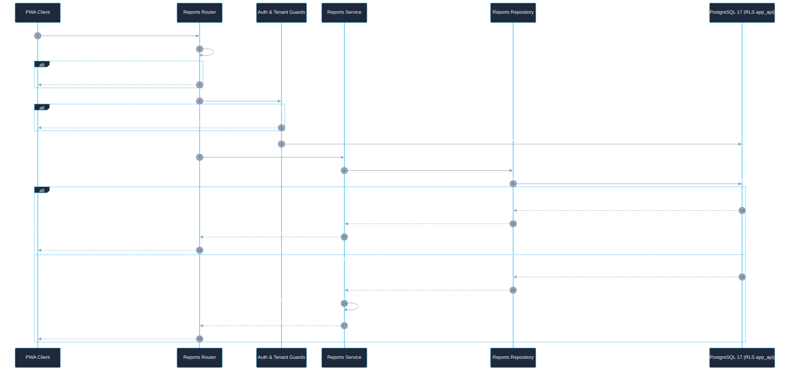

## Context

El sistema `registro-venta-micro` sigue un patrón cliente-servidor API-first con monolito modular en capas (`Router → Service → Repository`) sobre FastAPI, Pydantic v2 y SQLAlchemy 2 async (`asyncpg`) contra PostgreSQL 17 (Supabase local).

El contrato de base de datos requerido por el reporte diario quedó cerrado y validado en los cambios previos `#39`/`#54` (`businesses` con `timezone varchar(50) NOT NULL`) y `US-03-T06` / `#46` (`openspec/specs/sales-schema-and-rls/spec.md`, migración `20261119_0006-d4e7f1a2b9c3_create_sales_items_payments_tables.py` y modelos ORM `Sale`, `SaleItem`, `Payment` en `backend/app/modules/sales/models.py` registrados en `backend/app/db/base.py`). Dicho esquema impone:
- `public.businesses`: `id` (`UUID` PK), `timezone` (`VARCHAR(50) NOT NULL`, IANA válido), con política RLS `businesses_select_isolation` evaluando `id = NULLIF(current_setting('app.current_business_id', true), '')::uuid`.
- `public.sales`: `id` (`UUID`), `business_id` (`UUID`), `total_amount` (`NUMERIC(12,2) > 0`), `created_at` (`TIMESTAMPTZ NOT NULL DEFAULT now()`), índice compuesto `ix_sales_business_id_created_at (business_id, created_at)` y RLS forzada por `business_id`.
- `public.sale_items`: `quantity` (`NUMERIC(12,2) > 0`), `unit_price` (`NUMERIC(12,2) > 0`), `unit_cost` (`NUMERIC(12,2) >= 0`), índice `ix_sale_items_business_id_sale_id (business_id, sale_id)` y RLS forzada por `business_id`.
- `public.payments`: `payment_method` (`VARCHAR(20) CHECK IN ('cash', 'card', 'transfer')`), `amount` (`NUMERIC(12,2) > 0`), índice `ix_payments_business_id_sale_id (business_id, sale_id)` y RLS forzada por `business_id`.

La capa backend consume dicho esquema y sus modelos ORM (`Business`, `Sale`, `SaleItem`, `Payment`) como contrato **100% inmutable** (`No-DB-Diff` en Gate 3), reutilizando las dependencias de autenticación, rol y sesión RLS en `backend/app/core/security.py` y `backend/app/core/db.py` (`require_owner`, `get_tenant_db` con `NullPool` según `openspec/specs/backend/known-gotchas.md`), y manteniendo sincronizado el esquema estático `docs/api/openapi.json` según `ADR-0005` (`0005-sincronizacion-contractual-openapi-y-prevencion-drift.md`) y `.github/workflows/ci-backend.yml`.

### Convenciones e Infraestructura Detectada

```yaml
stack: "Python 3.14 / FastAPI"
backend_dir: "backend/app"
arch_pattern: "monolito-modular-capas"
db_mode: "with-db"
db_dirs: "backend/migrations"
migration_exts: ".py"
typegen_cmd: "none"
rls_mode: "in-situ"
auth_mode: "jwt"
contract_style: "code-first"
openapi_path: "docs/api/openapi.json"
openapi_export_cmd: "cd backend && uv run python -m app.scripts.export_openapi"
tests_dir: "backend/tests"
lint_cmd: "cd backend && uv run ruff check . && uv run ruff format --check ."
typecheck_cmd: "cd backend && uv run mypy app"
test_cmd: "cd backend && uv run pytest"
test_fast_cmd: "cd backend && uv run pytest tests/unit"
test_integration_cmd: "cd backend && uv run pytest tests/integration"
test_migrate_cmd: "cd backend && uv run alembic upgrade head"
scaffold_cmd: "none"
seed_cmd: "none"
mutation_cmd: "none"
```

## Goals / Non-Goals

**Goals:**
- Implementar `GET /api/v1/reports/daily` con query opcional `date` (`YYYY-MM-DD`, por defecto fecha actual en la zona horaria IANA del comercio `businesses.timezone`).
- Ejecutar una consulta SQL optimizada con CTEs desacoplados que agrupe ventas por fecha local (`(s.created_at AT TIME ZONE b.timezone)::date = :fecha`) aprovechando los índices `ix_sales_business_id_created_at`, `ix_sale_items_business_id_sale_id` y `ix_payments_business_id_sale_id` sin multiplicación cartesiana (anti fan-out) entre ítems y pagos.
- Calcular `total_cost` sumando `quantity * unit_cost` de `sale_items`, `gross_margin = total_sales - total_cost` y `margin_percentage` en `Decimal` (cuantizado a 2 decimales con `ROUND_HALF_UP`), protegiendo la división por cero y devolviendo totales en `"0.00"` / `0` sin nulos en días sin ventas.
- Restringir el endpoint al rol `owner` (`require_owner` → `403 FORBIDDEN` antes de consultar la base de datos), aislar lecturas por tenant bajo `get_tenant_db` (`app_api` + `app.current_business_id`), devolver `404 BUSINESS_NOT_FOUND` si el comercio no existe bajo RLS y unificar errores en `ErrorResponse`.
- Documentar el endpoint y sus DTOs en OpenAPI (`tags=["reports"]`), regenerar `docs/api/openapi.json` (`python -m app.scripts.export_openapi`) y cubrir todos los escenarios con tests unitarios y de integración.

**Non-Goals:**
- Modificar `backend/migrations/`, políticas RLS o modelos ORM existentes (`auth/models.py`, `catalog/models.py`, `sales/models.py`).
- Implementar reportes por rango de fechas, ranking por producto, cierres de caja (`cash_sessions`) o asistente de IA.
- Implementar la vista de reportes en el frontend (`TICKET-10` / `#51`).

## Architecture & Data Flow

```mermaid
flowchart LR
    classDef default fill:#1e293b,stroke:#38bdf8,stroke-width:1.5px,color:#ffffff;
    linkStyle default stroke:#94a3b8,stroke-width:1.5px;

    REQ["HTTP GET<br/>/api/v1/reports/daily"] --> VAL["reports/schemas.py<br/>DailyReportQuery (YYYY-MM-DD)"]
    VAL --> SEC["core/security.py<br/>require_owner (role == owner)"]
    SEC --> DBDEP["core/db.py<br/>get_tenant_db (NullPool + SET LOCAL RLS)"]
    DBDEP --> RTR["reports/router.py<br/>HTTP mapping + OpenAPI responses"]
    RTR --> SVC["reports/service.py<br/>Calculo Decimal de margen y % protegido"]
    SVC --> REPO["reports/repository.py<br/>Single CTE query sin fan-out"]
    REPO --> ORM["ORM Inmutable<br/>Business + Sale + SaleItem + Payment"]
```





## API & Schema Contracts (Code-First)

### 1. Piezas Reutilizadas en Core (`backend/app/core/`)

- **`backend/app/core/security.py`**: `require_owner` (ya valida `get_current_tenant` y exige `current_user.role == "owner"`, lanzando `403 FORBIDDEN` en `ErrorResponse`).
- **`backend/app/core/db.py`**: `get_tenant_db` (exige `business_id` del JWT, abre transacción con `NullPool` y fija `SET LOCAL ROLE app_api`, `app.current_user_id` y `app.current_business_id`).
- **`backend/app/core/schemas.py`**: `ErrorResponse` y `reject_nul_byte`.

### 2. Esquemas Pydantic v2 (`backend/app/modules/reports/schemas.py`)

Constantes de dominio:
- `DECIMAL_QUANTIZER = Decimal("0.01")`
- `PERCENT_MULTIPLIER = Decimal("100")`
- `MIN_REPORT_DATE = dt.date(1970, 1, 1)`
- `MAX_REPORT_DATE = dt.date(2100, 12, 31)`
- `_ISO_DATE_PATTERN = re.compile(r"^\d{4}-\d{2}-\d{2}$")`

Esquemas:
- **`DailyReportQuery(BaseModel)`**:
  - `date: dt.date | None = Field(default=None, description="Fecha local del reporte en formato ISO YYYY-MM-DD (por defecto, fecha actual en la zona horaria del comercio)", examples=["2026-11-19"])`
  - `@field_validator("date", mode="before")`:
    1. Si `value is None`: retorna `None`.
    2. Si `isinstance(value, (bool, int, float, dt.datetime))`: rechaza con `ValueError("Date must be an ISO YYYY-MM-DD string or date")`.
    3. Si `isinstance(value, str)`: aplica `reject_nul_byte(value)`, `.strip()`, exige coincidencia exacta con `_ISO_DATE_PATTERN` (`YYYY-MM-DD`) y convierte con `dt.date.fromisoformat(cleaned)` (rechaza `""`, `"2026-02-30"`, `"2026-11-19T12:00:00"`, `"19-11-2026"`).
    4. Si `isinstance(value, dt.date)`: acepta.
    5. Valida `MIN_REPORT_DATE <= parsed <= MAX_REPORT_DATE` (atrapa fechas fuera de rango antes de consultar PostgreSQL).
- **`PaymentMethodBreakdown(BaseModel)`**:
  - `cash: Decimal = Field(description="Total recaudado en efectivo", examples=["15000.00"])`
  - `card: Decimal = Field(description="Total recaudado con tarjeta", examples=["10000.00"])`
  - `transfer: Decimal = Field(description="Total recaudado por transferencia/QR", examples=["5000.00"])`
  - `@field_validator("cash", "card", "transfer", mode="after")`: cuantiza a `Decimal("0.01")` con `ROUND_HALF_UP`.
- **`DailyReportResponse(BaseModel)`**:
  - `date: dt.date = Field(description="Fecha local consolidada en la zona horaria del comercio", examples=["2026-11-19"])`
  - `timezone: str = Field(description="Zona horaria IANA aplicada al corte diario", examples=["America/Argentina/Buenos_Aires"])`
  - `total_sales: Decimal = Field(description="Total bruto facturado en el día", examples=["30000.00"])`
  - `transactions_count: int = Field(ge=0, description="Cantidad total de ventas registradas en el día", examples=[3])`
  - `total_cost: Decimal = Field(description="Costo total acumulado de mercadería vendida (SUM(quantity * unit_cost))", examples=["21000.00"])`
  - `gross_margin: Decimal = Field(description="Margen bruto estimado (total_sales - total_cost)", examples=["9000.00"])`
  - `margin_percentage: Decimal = Field(description="Porcentaje de rentabilidad sobre ventas ((gross_margin / total_sales) * 100); 0.00 si no hay ventas", examples=["30.00"])`
  - `payment_breakdown: PaymentMethodBreakdown = Field(description="Desglose de recaudación por medio de pago")`
  - `@field_validator("total_sales", "total_cost", "gross_margin", "margin_percentage", mode="after")`: cuantiza a `Decimal("0.01")` con `ROUND_HALF_UP`.

### 3. Ruta HTTP y Códigos de Respuesta (`backend/app/modules/reports/router.py`)

Router: `APIRouter(prefix="/reports", tags=["reports"])`, registrado en `backend/app/main.py` bajo `prefix="/api/v1"`.

| Operación | Auth / Rol | Query Params | Respuestas Documentadas en OpenAPI |
|---|---|---|---|
| `GET /api/v1/reports/daily` | `require_owner` (antes de `get_reports_service` → `get_tenant_db`) | `DailyReportQuery` (`date` opcional) | `200 OK` (`DailyReportResponse`), `401` (`UNAUTHENTICATED`), `403` (`ONBOARDING_REQUIRED` \| `FORBIDDEN`), `404` (`BUSINESS_NOT_FOUND`), `422` (`VALIDATION_ERROR`) |

*Nota de orden de dependencias en FastAPI*: Declarar `query: Annotated[DailyReportQuery, Query()]` y `current_user: CurrentUser = Depends(require_owner)` antes de `service: ReportsService = Depends(get_reports_service)` garantiza que tanto la validación `422` de query como la autorización `401`/`403` se resuelvan antes de abrir una transacción en PostgreSQL.

### 4. Estrategia SQL Optimizada en Repositorio (`backend/app/modules/reports/repository.py`)

Para cumplir con las dos restricciones técnicas clave —agrupación por zona horaria `(created_at AT TIME ZONE b.timezone)::date = :fecha` e inmunidad frente a fan-out de múltiples ítems y múltiples pagos por venta— el repositorio ejecuta una única consulta SQL con CTEs usando tipos explícitos en los parámetros (`bindparam("business_id", type_=PG_UUID(as_uuid=True))` y `bindparam("report_date", type_=Date())`):

```sql
WITH target_business AS (
    SELECT
        b.id AS business_id,
        b.timezone AS timezone,
        COALESCE(
            :report_date,
            (now() AT TIME ZONE b.timezone)::date
        ) AS report_date
    FROM businesses b
    WHERE b.id = :business_id
),
day_bounds AS (
    SELECT
        tb.business_id,
        tb.timezone,
        tb.report_date,
        (tb.report_date::timestamp AT TIME ZONE tb.timezone) AS start_utc,
        ((tb.report_date + 1)::timestamp AT TIME ZONE tb.timezone) AS end_utc
    FROM target_business tb
),
filtered_sales AS (
    SELECT
        s.id,
        s.business_id,
        s.total_amount
    FROM sales s
    CROSS JOIN day_bounds db
    WHERE s.business_id = db.business_id
      AND s.created_at >= (db.start_utc - interval '2 hours')
      AND s.created_at < (db.end_utc + interval '2 hours')
      AND (s.created_at AT TIME ZONE db.timezone)::date = db.report_date
),
sales_agg AS (
    SELECT
        COUNT(fs.id)::integer AS transactions_count,
        COALESCE(SUM(fs.total_amount), 0) AS total_sales
    FROM filtered_sales fs
),
items_agg AS (
    SELECT
        COALESCE(SUM(si.quantity * si.unit_cost), 0) AS raw_total_cost
    FROM sale_items si
    INNER JOIN filtered_sales fs
        ON fs.business_id = si.business_id
       AND fs.id = si.sale_id
),
payments_agg AS (
    SELECT
        COALESCE(SUM(CASE WHEN p.payment_method = 'cash' THEN p.amount ELSE 0 END), 0) AS cash_total,
        COALESCE(SUM(CASE WHEN p.payment_method = 'card' THEN p.amount ELSE 0 END), 0) AS card_total,
        COALESCE(SUM(CASE WHEN p.payment_method = 'transfer' THEN p.amount ELSE 0 END), 0) AS transfer_total
    FROM payments p
    INNER JOIN filtered_sales fs
        ON fs.business_id = p.business_id
       AND fs.id = p.sale_id
)
SELECT
    db.report_date,
    db.timezone,
    sa.transactions_count,
    sa.total_sales,
    ia.raw_total_cost,
    pa.cash_total,
    pa.card_total,
    pa.transfer_total
FROM day_bounds db
CROSS JOIN sales_agg sa
CROSS JOIN items_agg ia
CROSS JOIN payments_agg pa
```

Propiedades de esta consulta:
1. **Sargabilidad sobre `ix_sales_business_id_created_at`**: La ventana `[start_utc - 2h, end_utc + 2h)` acota el rango en el índice B-tree `(business_id, created_at)` sin perder filas en transiciones DST de medianoche (como `America/Santiago`), mientras `(s.created_at AT TIME ZONE db.timezone)::date = db.report_date` aplica el corte exacto en hora local del comercio.
2. **Aislamiento RLS y 404 explícito**: `businesses`, `sales`, `sale_items` y `payments` corren bajo `SET LOCAL ROLE app_api` y `app.current_business_id`. Si `businesses` no devuelve fila para `business_id`, la consulta completa retorna 0 filas (`None` → `404 BUSINESS_NOT_FOUND`); si el negocio existe pero no tuvo ventas en esa fecha, `CROSS JOIN` con `sales_agg`/`items_agg`/`payments_agg` retorna exactamente 1 fila con ceros (`COALESCE(..., 0)`).
3. **Cero fan-out y precisión exacta**: `sales_agg`, `items_agg` y `payments_agg` agregan independientemente sobre `filtered_sales` usando los índices compuestos `(business_id, sale_id)` y preservan toda la precisión `numeric` hasta la capa de servicio en Python (`Decimal`).

### 5. Capa de Servicio (`backend/app/modules/reports/service.py`)

`ReportsService.get_daily_report(current_user: CurrentUser, target_date: dt.date | None) -> DailyReportResponse`:
1. Verifica `current_user.business_id is not None`.
2. Obtiene `DailySalesAggregate | None` desde `ReportsRepository`; si es `None`, lanza `BusinessNotFoundError`.
3. Aplica aritmética exacta en `Decimal` (sin `float` en ningún paso):
   - `total_sales = agg.total_sales.quantize(DECIMAL_QUANTIZER, rounding=ROUND_HALF_UP)`
   - `total_cost = agg.raw_total_cost.quantize(DECIMAL_QUANTIZER, rounding=ROUND_HALF_UP)`
   - `gross_margin = (total_sales - total_cost).quantize(DECIMAL_QUANTIZER, rounding=ROUND_HALF_UP)`
   - `margin_percentage = Decimal("0.00") if total_sales == Decimal("0.00") else ((gross_margin / total_sales) * PERCENT_MULTIPLIER).quantize(DECIMAL_QUANTIZER, rounding=ROUND_HALF_UP)`
   - `cash_total`, `card_total`, `transfer_total` cuantizados a `DECIMAL_QUANTIZER` (`ROUND_HALF_UP`).

## Decisions

1. **CTEs separados (`sales_agg`, `items_agg`, `payments_agg`) en una sola consulta vs. JOIN plano o múltiples round-trips**:
   - *Por qué*: Un `JOIN` directo entre `sales`, `sale_items` y `payments` produce producto cartesiano (fan-out) cuando una venta tiene >1 ítem y >1 pago, inflando `total_sales`, `total_cost` y montos de pago. Los CTEs separados sobre `filtered_sales` evitan el fan-out y resuelven todo el reporte en 1 solo round-trip de red bajo RLS (crítico en Vercel + Supabase Pooler).
   - *Alternativa descartada*: Ejecutar 4 consultas Python separadas (mayor latencia y riesgo de lectura inconsistente ante ventas concurrentes si no se usara snapshot) o subconsultas correlacionadas por fila.

2. **Ventana acotada `±2h` en índice `ix_sales_business_id_created_at` + predicado exacto `(created_at AT TIME ZONE db.timezone)::date = db.report_date`**:
   - *Por qué*: El predicado puro `(created_at AT TIME ZONE b.timezone)::date = :fecha` no es sargable por sí solo sobre `(business_id, created_at)`, pero un rango estricto `[start_utc, end_utc)` podría fallar si una zona horaria IANA del catálogo (`America/Santiago`) cambia de DST exactamente a las `00:00`. Añadir la envolvente `[start_utc - 2h, end_utc + 2h)` habilita `Index Cond` sobre `ix_sales_business_id_created_at` y deja al filtro exacto `(created_at AT TIME ZONE db.timezone)::date = db.report_date` la decisión final sin riesgo de borde DST.
   - *Alternativa descartada*: `WHERE (s.created_at AT TIME ZONE b.timezone)::date = :fecha` sin rango en `created_at` (obligaría a leer todas las ventas históricas del comercio).

3. **Cuantización de `total_cost` antes de calcular `gross_margin = total_sales - total_cost` en `Decimal`**:
   - *Por qué*: Al multiplicar `quantity` (`numeric(12,2)`) por `unit_cost` (`numeric(12,2)`), cada línea puede aportar hasta 4 decimales. Sumar primero con precisión completa en SQL (`SUM(si.quantity * si.unit_cost)`) elimina el sesgo por redondeo acumulado por línea; cuantizar luego `total_cost` a 2 decimales (`ROUND_HALF_UP`) y restarlo de `total_sales` garantiza invariante contable exacta en la respuesta (`total_sales - total_cost == gross_margin` sin diferencias de 1 centavo en empates `.xx5`).
   - *Alternativa descartada*: Redondear cada línea `ROUND(quantity * unit_cost, 2)` antes de sumar o restar antes de redondear (podría producir `total_sales - total_cost != gross_margin` en pantalla).

4. **Porcentaje de rentabilidad `margin_percentage` igual a `"0.00"` (no `null`) cuando `total_sales == 0`**:
   - *Por qué*: El DoD de `TICKET-09` y el Escenario 2 de `US-04` exigen explícitamente valores en cero **sin nulos** ni errores de división por cero en días sin ventas.
   - *Alternativa descartada*: Devolver `margin_percentage: null` en días sin ventas (contradice el criterio explícito "valores en cero sin nulos" del ticket).

5. **Restricción de acceso exclusivamente a `role == "owner"` mediante `require_owner`**:
   - *Por qué*: Alinea el endpoint con la regla de seguridad del proyecto ("el cajero no accede a costos, reportes") y con `catalog` (`POST` con `require_owner`, redacción de costos en `GET`), evitando filtrar costos ni márgenes si existen cuentas `cashier`.
   - *Alternativa descartada*: Permitir `get_current_tenant` abierto a `cashier` (expondría `total_cost`, `gross_margin` y `margin_percentage`).

6. **Lectura directa en `ReportsRepository` sobre modelos ORM de `auth` y `sales` (CQRS de lectura) + `bindparam` tipado para `report_date`**:
   - *Por qué*: El módulo `reports` es exclusivamente de lectura analítica sobre las tablas consolidadas (`businesses`, `sales`, `sale_items`, `payments`) y evita acoplarse a módulos de servicio de `sales` aún pendientes (`TICKET-07`). Tipar explícitamente `:report_date` como `sa.Date()` y `:business_id` como `UUID` previene `AmbiguousParameterError` de `asyncpg` cuando `date` es `None`.
   - *Alternativa descartada*: Pasar `None` sin tipo SQL en `text()` (falla en PostgreSQL/asyncpg al inferir tipo en `COALESCE`).

## Risks / Trade-offs

- **[Risk]** Diferencia mínima de reloj si un test congela solo el reloj de Python y llama a `GET /api/v1/reports/daily` sin `?date` cerca de la medianoche local.  
  → **Mitigación**: Al usar `(now() AT TIME ZONE b.timezone)::date` en PostgreSQL, la resolución de "hoy" es 100% consistente con `sales.created_at DEFAULT now()` en la misma base de datos, y el payload devuelve el campo `date` resuelto para trazabilidad del cliente y tests.
- **[Risk]** Olvidar regenerar `docs/api/openapi.json` provocaría fallo en CI (`export_openapi --check`).  
  → **Mitigación**: Incluir explícitamente la regeneración (`cd backend && uv run python -m app.scripts.export_openapi`) y verificación (`--check`) en `tasks.md`.
- **[Risk]** `asyncpg` podría fallar con `AmbiguousParameterError` si `:report_date` es `None` en SQL crudo sin tipado explícito.  
  → **Mitigación**: Usar `bindparam("report_date", type_=Date())` y `bindparam("business_id", type_=PG_UUID(as_uuid=True))` en el query del repositorio y verificarlo con tests de integración sin parámetro `date`.

## Migration Plan

Sin migraciones de base de datos (`No-DB-Diff`). Las tablas `public.businesses`, `public.sales`, `public.sale_items` y `public.payments`, sus índices (`ix_sales_business_id_created_at`, `ix_sale_items_business_id_sale_id`, `ix_payments_business_id_sale_id`), políticas RLS y privilegios DCL ya existen en la revisión Alembic `d4e7f1a2b9c3` (`TICKET-06`). El despliegue consiste únicamente en el nuevo módulo `backend/app/modules/reports/`, su registro en `backend/app/main.py`, la actualización de `docs/api/openapi.json` y su suite de pruebas en `backend/tests/`.
