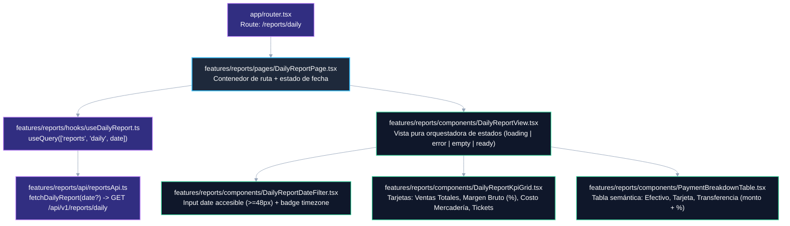

## Context

La aplicación cliente de `registro-venta-micro` es una PWA construida con **React 19 + Vite 8 + TypeScript 6 + Tailwind CSS v4 (`@theme`) + TanStack Query v5 + React Router 8**, probada con **Vitest 5 + Testing Library + MSW 3** (`ADR-0006`, `ADR-0007`).

El backend ya implementa y documenta en `docs/api/openapi.json` el endpoint `GET /api/v1/reports/daily` (`TICKET-09` / Issue `#50`, `openspec/specs/daily-sales-report-api/spec.md`), el cual:
- Acepta un query param opcional `date` (`YYYY-MM-DD`, por defecto la fecha local actual en `businesses.timezone`).
- Devuelve `200 OK` con `DailyReportResponse`:
  - `date` (`string`, formato `date`, ej. `"2026-11-19"`)
  - `timezone` (`string`, IANA timezone, ej. `"America/Argentina/Buenos_Aires"`)
  - `total_sales` (`string`, decimal exacto a 2 decimales, ej. `"30000.00"`)
  - `transactions_count` (`integer >= 0`, ej. `3`)
  - `total_cost` (`string`, decimal exacto a 2 decimales, ej. `"21000.00"`)
  - `gross_margin` (`string`, decimal exacto a 2 decimales, puede ser negativo, ej. `"9000.00"` o `"-250.00"`)
  - `margin_percentage` (`string`, decimal exacto a 2 decimales, `"0.00"` cuando `total_sales == "0.00"`, ej. `"30.00"`)
  - `payment_breakdown` (`PaymentMethodBreakdown`: `{ cash: string, card: string, transfer: string }`)
- Devuelve `ErrorResponse` (`{ code: string, message: string, details?: unknown | null }`) en códigos `401` (`UNAUTHENTICATED`), `403` (`ONBOARDING_REQUIRED` | `FORBIDDEN`), `404` (`BUSINESS_NOT_FOUND`) y `422` (`VALIDATION_ERROR`).

Este cambio (`TICKET-10` / Issue `#51`) construye la vista `/reports/daily` en la capa frontend bajo modalidad `contract-first`, manteniendo inmutables `docs/api/openapi.json`, `backend/` y la ruta `/` existente en `frontend/src/app/router.tsx`.

### Convenciones e Infraestructura Detectada

```yaml
stack: "React 19.3 + Vite 8.3 + TypeScript 6.0 + Tailwind CSS v4.3 + TanStack Query v5 + React Router v8"
frontend_dir: "frontend/src"
tests_dir: "frontend/src"
protected_dirs: "backend,docs/api/openapi.json"
contract_mode: "contract-first"
openapi_path: "docs/api/openapi.json"
tokens_path: "frontend/src/index.css"
catalog_cmd: "cd frontend && npm test -- src/features/reports"
a11y_cmd: "cd frontend && npm test -- src/features/reports"
e2e_cmd: "none (cubierto por Vitest + Testing Library + MSW en entorno headless jsdom; smoke E2E existente en tests/e2e/smoke.spec.ts se mantiene intacto)"
state_lib: "TanStack Query v5 (@tanstack/react-query) + React local state / URL SearchParams"
offline_store: "none"
pwa_mode: "none"
lint_cmd: "cd frontend && npm run lint && npm run format:check"
typecheck_cmd: "cd frontend && npm run typecheck"
test_cmd: "cd frontend && npm test"
build_dev_cmd: "cd frontend && npm run build"
build_prod_cmd: "cd frontend && npm run build"
bundle_dir: "frontend/dist/assets"
max_bundle_kb: 250
```

### Inventario del Sistema de Diseño Existente

1. **Archivo de Tokens (`tokens_path`: `frontend/src/index.css`, regido por `ADR-0007`)**:
   - Colores semánticos en `@theme`:
     - `--color-primary` (`#4f46e5`), `--color-primary-hover` (`#4338ca`), `--color-primary-light` (`#eef2ff`), `--color-primary-dark` (`#3730a3`)
     - `--color-background-light` (`#f9fafb`), `--color-background-dark` (`#111827`)
     - `--color-surface-light` (`#ffffff`), `--color-surface-dark` (`#1f2937`)
     - `--color-text-light` (`#111827`), `--color-text-dark` (`#f9fafb`)
     - `--color-text-muted-light` (`#4b5563`), `--color-text-muted-dark` (`#9ca3af`)
     - `--color-border-light` (`#e5e7eb`), `--color-border-dark` (`#374151`)
     - `--color-error` (`#dc2626`), `--color-error-light` (`#fef2f2`)
     - `--color-success` (`#16a34a`)
   - Tipografía: `--font-sans` (system font stack sin descargas de red).
   - Utilidad ergonómica POS: `.touch-target` (`min-height: 48px; min-width: 48px;`).
2. **Catálogo de Componentes Existente en `frontend/src/`**:
   - `Providers` (`frontend/src/app/providers.tsx`): `QueryClientProvider` global.
   - `router` / `routes` (`frontend/src/app/router.tsx`): definición de rutas con `createBrowserRouter`.
   - `SUPPORTED_COUNTRIES` / `COUNTRY_TIMEZONES` (`frontend/src/shared/constants/countries.ts`).
   - No existen librerías externas de componentes (shadcn/MUI/Chakra descartadas por `ADR-0007`); todas las piezas visuales nuevas se declaran explícitamente como `nueva-declarada` consumiendo únicamente las variables/clases de Tailwind v4 mapeadas en `@theme` (`bg-surface-light`, `text-text-light`, `border-border-light`, `text-primary`, `text-success`, `text-error`, `bg-error-light`, `.touch-target`, etc.).
3. **Piezas fuera de catálogo y conteo inicial de colores literales**:
   - Piezas fuera de catálogo: `0`.
   - Conteo inicial de colores literales fuera de `frontend/src/index.css`: `0` ocurrencias en `frontend/src/`.

## Goals / Non-Goals

**Goals:**
- Implementar la pantalla de reporte diario en `/reports/daily` conectada a `GET /api/v1/reports/daily` mediante TanStack Query v5.
- Renderizar tarjetas accesibles de KPIs (Ventas Totales, Margen Bruto + `%` de rentabilidad, Costo Mercadería, Tickets) y tabla de desglose por medio de pago (Efectivo, Tarjeta, Transferencia) con monto y porcentaje sobre el total facturado.
- Garantizar exactitud decimal en el formateo de importes y cálculo de proporciones de medios de pago operando con enteros en centavos (`BigInt` / aritmética entera desde strings `"XXXX.YY"`) sin errores de coma flotante ni división por cero.
- Soportar los 4 estados de pantalla observables (`loading`, `empty` en día sin ventas con totales en cero, `ready` con ventas, `error` con mensaje del backend y botón `Reintentar` con área táctil `>= 48px`).
- Soportar filtro por fecha (`YYYY-MM-DD`) sincronizado con la fecha local resuelta por el comercio en su `timezone` IANA.

**Non-Goals:**
- Alterar `docs/api/openapi.json`, `backend/` o la ruta `/` actual.
- Añadir almacenamiento offline en Dexie o caché de Service Worker para reportes diarios.
- Incorporar librerías externas de gráficos o componentes UI.

## Component Hierarchy & Data Flow



## Contracts, Types & Formatting Strategy (1:1 with OpenAPI)

### 1. Tipos DTO Exactos (`frontend/src/features/reports/types/reports.types.ts`)

Espejo estricto 1:1 de `components.schemas` en `docs/api/openapi.json`:

```ts
export interface PaymentMethodBreakdown {
  cash: string;
  card: string;
  transfer: string;
}

export interface DailyReportResponse {
  date: string;
  timezone: string;
  total_sales: string;
  transactions_count: number;
  total_cost: string;
  gross_margin: string;
  margin_percentage: string;
  payment_breakdown: PaymentMethodBreakdown;
}

export interface ApiErrorResponse {
  code: string;
  message: string;
  details?: unknown | null;
}
```

### 2. Formateo Monetario y Porcentual sin Deriva de Punto Flotante (`frontend/src/features/reports/utils/formatters.ts`)

- **`parseDecimalCents(decimalStr: string): bigint`**:
  - Valida el patrón `/^(-?\d+)(?:\.(\d{1,2}))?$/` sobre la cadena serializada por el backend (`"30000.00"`, `"-250.00"`).
  - Convierte directamente a centavos enteros (`BigInt`) sin pasar por `Number` flotante para cálculos intermedios.
- **`formatCurrencyFromDecimal(decimalStr: string): string`**:
  - Formatea en formato monetario local legible con signo (`$30.000,00`, `$0,00`, `-$250,00`) preservando exactamente los 2 decimales de la cadena original.
- **`formatPercentageFromDecimal(decimalStr: string): string`**:
  - Retorna `${decimalStr}%` normalizado a 2 decimales (`"30.00%"`, `"0.00%"`, `"-25.00%"`).
- **`calculatePaymentSharePercentage(methodAmountStr: string, totalSalesStr: string): string`**:
  - Si `parseDecimalCents(totalSalesStr) <= 0n`, retorna `"0.00%"` (protección determinista contra división por cero).
  - Calcula el porcentaje con redondeo `HALF_UP` a 2 decimales a partir de centavos enteros (`(methodCents * 10000n)` dividido por `totalSalesCents`).

### 3. Cliente API y Gestión de Errores (`frontend/src/features/reports/api/reportsApi.ts`)

- `fetchDailyReport(date?: string, signal?: AbortSignal): Promise<DailyReportResponse>`:
  - Construye la URL `/api/v1/reports/daily` y añade `?date=${encodeURIComponent(date)}` **únicamente** cuando `date` es un string no vacío.
  - Incluye `credentials: "include"` para enviar la cookie `HttpOnly` (`access_token`) según `ADR-0002`.
  - Si `!response.ok`, parsea el cuerpo JSON como `ApiErrorResponse` (`code`, `message`, `details`) y lanza una instancia `ReportsApiError(status, code, message, details)` con mensaje accesible de respaldo si el cuerpo no es JSON válido.

### 4. Estado Cliente y Caché (`frontend/src/features/reports/hooks/useDailyReport.ts`)

- Usa `useQuery` de `@tanstack/react-query`:
  - `queryKey: ["reports", "daily", date ?? "today"]`
  - `queryFn: ({ signal }) => fetchDailyReport(date, signal)`
  - `retry: false` para respuestas HTTP `4xx` (`401`, `403`, `404`, `422`), evitando reintentos inútiles ante errores de autorización o validación.
- En `DailyReportPage`:
  - Lee el parámetro opcional `?date=` desde `useSearchParams()` de `react-router`.
  - En la carga inicial sin `?date=`, consulta `GET /api/v1/reports/daily` sin query param y muestra en el control `Fecha del reporte` el valor `data.date` resuelto por el servidor en la zona horaria del comercio.
  - Cuando el usuario cambia el input `Fecha del reporte` (`onChange`), actualiza el estado/search param `date` (`YYYY-MM-DD`), disparando la consulta para la nueva fecha.

### 5. Estrategia de Mocks (MSW) y Catálogo de Estados Headless

- En `frontend/src/test/mocks/handlers.ts`:
  - Agregar handler base `http.get("/api/v1/reports/daily", ...)` alineado 1:1 con `DailyReportResponse` de `docs/api/openapi.json` (devolviendo por defecto un reporte válido para `"2026-11-19"` o la fecha recibida por query param, y `422 VALIDATION_ERROR` si `date` no cumple `YYYY-MM-DD`).
- Los tests unitarios y de integración en `frontend/src/features/reports/` validarán de forma *Design-Blind* (solo `getByRole`, `getByLabelText`, `getByText`, `within`):
  1. Catálogo de los 4 estados de `DailyReportView` (`loading`, `empty`, `ready`, `error`) con verificación de roles/etiquetas ARIA y ausencia de violaciones de accesibilidad.
  2. Precisión de formateadores monetarios/porcentuales (incluyendo margen negativo y día con ventas en `"0.00"`).
  3. Flujo completo de `DailyReportPage` contra MSW: carga inicial sin `?date=`, cambio de fecha a `?date=2026-11-18`, día sin ventas (`empty`), error HTTP `403`/`500` (`role="alert"`) y recuperación con botón `Reintentar`.

### 6. Presupuesto de Bundle y PWA

- **Sin almacenamiento offline (`offline_store: none`, `pwa_mode: none`)**: El reporte diario consolida transacciones desde PostgreSQL con zona horaria del tenant; no debe servirse desde caché offline para no presentar datos financieros desactualizados.
- **Presupuesto de bundle (`max_bundle_kb: 250`)**: No se instalan dependencias nuevas. El módulo `features/reports` suma `< 5 KB` minificados al bundle en `frontend/dist/assets`.

## Decisions

1. **Formateo y cálculo de proporciones basados en centavos enteros (`BigInt`) desde strings `Decimal` vs. `parseFloat`**:
   - *Por qué*: El contrato OpenAPI serializa todos los montos y porcentajes como `string` con 2 decimales (`"30000.00"`) específicamente para evitar pérdida de precisión binaria (`IEEE 754`). Parsear a centavos enteros preserva la invariante financiera de extremo a extremo.
   - *Alternativa descartada*: `Number.parseFloat` con `.toFixed(2)` (vulnerable a artefactos como `19.99 * 100 = 1998.9999999999998`).

2. **Omitir `?date=` en la carga inicial y poblar el input con `DailyReportResponse.date` vs. inicializar con `new Date().toISOString().slice(0, 10)` en el navegador**:
   - *Por qué*: `new Date().toISOString()` usa UTC en el cliente, lo que a las 22:00 en Argentina (`UTC-3`) enviaría la fecha del día siguiente en UTC y rompería el requisito central de `US-04` (corte diario en la zona horaria IANA del comercio). Al omitir `?date=` en la carga inicial, el backend resuelve `(now() AT TIME ZONE b.timezone)::date` y devuelve `date` y `timezone` exactos.
   - *Alternativa descartada*: Calcular la fecha actual con `toISOString()` en el navegador.

3. **Tabla HTML semántica (`<table>`, `<thead>`, `<tbody>`, `<th scope="row">`) para `Desglose por Medio de Pago` vs. librería de gráficos (`recharts` / `chart.js`)**:
   - *Por qué*: El ticket `TICKET-10` permite "gráfico o tabla simple de medios de pago". Una tabla semántica con barra visual CSS opcional basada en tokens de `@theme` es 100% accesible para lectores de pantalla, determinista en tests *Design-Blind* y añade `0 KB` de dependencias externas.
   - *Alternativa descartada*: Instalar una librería de gráficos en canvas/SVG (añadiría >100 KB al bundle y dificultaría la accesibilidad y legibilidad rápida en mostrador móvil).

4. **Mantener tarjetas KPI visibles con valores `$0,00` / `0` junto al banner de estado `empty` en días sin ventas**:
   - *Por qué*: El Escenario 2 de `US-04` y el DoD de `TICKET-10` requieren tanto "pantalla vacía para días sin ventas" como "mostrar totales en cero sin generar errores de división por cero ni valores nulos". Mostrar el aviso informativo de jornada sin ventas junto con los KPIs en `$0,00` y `0.00%` satisface ambos criterios simultáneamente.
   - *Alternativa descartada*: Ocultar por completo los KPIs cuando `transactions_count === 0` (impediría verificar en pantalla los totales en cero exigidos por `US-04`).

## Risks / Trade-offs

- **[Risk]** Diferencias de implementación de `Intl.NumberFormat` entre motores/locales en entornos de test (`jsdom` vs. navegadores) al usar espacios de no separación (`\u00a0`).  
  → **Mitigación**: Implementar un formateador determinista en `formatters.ts` que produzca formato canónico consistente (`$30.000,00`, `-$250,00`, `$0,00`) independiente del locale del sistema operativo donde corra CI.
- **[Risk]** Peticiones no interceptadas en tests unitarios hagan fallar la suite por `onUnhandledFrame: "error"` (`ADR-0006`).  
  → **Mitigación**: Registrar el handler por defecto de `GET /api/v1/reports/daily` en `frontend/src/test/mocks/handlers.ts` y sobreescribirlo con `server.use(...)` en escenarios específicos (día vacío, margen negativo, errores `403`/`422`/`500`).
- **[Risk]** Uso accidental de colores hexadecimales o `rgb()` en componentes active advertencias en Gate 3 (`checkLiteralVisualValues`).  
  → **Mitigación**: Usar exclusivamente clases utilitarias mapeadas a los tokens de `frontend/src/index.css` (`bg-surface-light`, `text-text-light`, `text-text-muted-light`, `border-border-light`, `text-primary`, `bg-primary-light`, `text-success`, `text-error`, `bg-error-light`).

## Migration Plan

No requiere migraciones de datos ni variables de entorno adicionales. Se agrega el módulo `frontend/src/features/reports/` y se registra la ruta `/reports/daily` en `frontend/src/app/router.tsx` conservando la ruta `/` intacta.
