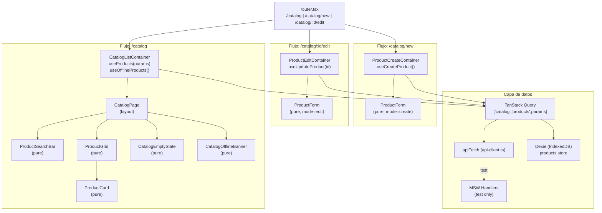

# Design: issue-44-catalogo-productos-frontend

**Ticket:** #44 — US-02-T05: Vista de administración y selector de productos en frontend
**Contract mode:** contract-first
**OpenAPI path:** `docs/api/openapi.json`
**Fecha:** 2026-11-19

---

## Convenciones detectadas (opsx:explore)

```yaml
stack: "React 19 + Vite 8 + TypeScript 6 + TanStack Query 5 + React Router 8"
frontend_dir: "frontend/src"
app_dir: "frontend/src/app"
features_dir: "frontend/src/features"
shared_ui_dir: "frontend/src/shared/ui"
tests_dir: "frontend/src/test"
e2e_dir: "frontend/tests/e2e"
contract_mode: "contract-first"
openapi_path: "docs/api/openapi.json"
tokens_path: "frontend/src/index.css"  # @theme directiva Tailwind v4
catalog_cmd: "none"                    # sin Storybook/Ladle configurado
a11y_cmd: "none"                       # sin axe-playwright configurado aún
e2e_cmd: "cd frontend && npm run test:e2e"
state_lib: "tanstack-query + react-context"
offline_store: "dexie"
pwa_mode: "enabled"                    # vite-plugin-pwa instalado
lint_cmd: "cd frontend && npm run lint"
typecheck_cmd: "cd frontend && npm run typecheck"
test_cmd: "cd frontend && npm test"
build_dev_cmd: "cd frontend && npm run dev"
build_prod_cmd: "cd frontend && npm run build"
bundle_dir: "frontend/dist"
max_bundle_kb: "250"                   # objetivo razonable para PWA POS
node_version: "26 (vía fnm, .nvmrc)"

feature_pattern: "features/{domain}/{components,containers,pages,api,types,validation}.ts"
api_client: "frontend/src/lib/api-client.ts"
api_client_fn: "apiFetch<T>(url, options)"
auth_hook: "useAuthSession() de @/features/auth/AuthContext"
router_file: "frontend/src/app/router.tsx"
providers_file: "frontend/src/app/providers.tsx"
msw_handlers: "frontend/src/test/mocks/handlers.ts"
msw_server: "frontend/src/test/mocks/server.ts"
msw_setup: "frontend/src/test/setup.ts (strict: onUnhandledFrame='error')"
test_pattern: "frontend/src/test/{domain}/*.test.tsx"
test_render_helper: "createMemoryRouter + Providers wrapper"
```

### Patrón de arquitectura de feature existente (feature/auth)

Cada feature sigue esta estructura de directorios:
```
features/{domain}/
  api.ts          # funciones que llaman apiFetch<T>
  types.ts        # DTOs TypeScript 1:1 con OpenAPI
  validation.ts   # funciones de validación client-side
  components/     # componentes presentacionales puros (sin hooks de datos)
  containers/     # orquestan TanStack Query / mutaciones + handlers
  pages/          # páginas presentacionales simples (layouts)
```

### Sistema de diseño — inventario

**Componentes en `frontend/src/shared/ui/` (catálogo):**

| Componente | Variantes / Props clave | Origen |
|-----------|------------------------|--------|
| `Button` | `variant: primary\|secondary\|danger`, `isLoading` | catalogo |
| `TextField` | `hasError`, `helperText`, area táctil 48 px | catalogo |
| `ErrorAlert` | `role="alert"`, `aria-live="assertive"` | catalogo |
| `SelectField` | desconocida (existe archivo) | catalogo |
| `ThemeToggleButton` | `isDark`, `onToggle` | catalogo |

**Tokens Tailwind v4 `@theme` disponibles en `frontend/src/index.css`:**

| Token | Valor | Uso previsto en esta feature |
|-------|-------|------------------------------|
| `--color-primary` | `#4f46e5` | CTA "Agregar producto", acciones primarias |
| `--color-primary-hover` | `#4338ca` | Hover en botones primarios |
| `--color-primary-light` | `#eef2ff` | Fondo de badges de stock bajo |
| `--color-background-light/dark` | `#f9fafb / #111827` | Fondo de página `/catalog` |
| `--color-surface-light/dark` | `#ffffff / #1f2937` | Tarjeta de cada producto |
| `--color-text-light/dark` | `#111827 / #f9fafb` | Texto principal |
| `--color-text-muted-light/dark` | `#4b5563 / #9ca3af` | Label de precio, stock |
| `--color-border-light/dark` | `#e5e7eb / #374151` | Bordes de cards |
| `--color-error` | `#dc2626` | Mensajes de error, `aria-invalid` |
| `--color-error-light/dark` | `#fef2f2 / #450a0a` | Fondo del `ErrorAlert` |
| `--color-success` | `#16a34a` | Indicador stock > 0 |
| `--radius-control` | `0.5rem` | Bordes redondeados consistentes |

**Clase utilitaria:** `.touch-target { min-height: 48px; min-width: 48px; }` — aplicar a todos los controles interactivos.

**Piezas fuera del catálogo (detectadas):** 0 colores literales (`#xxx`) en componentes existentes — todos usan `var(--color-*)`. Convención a mantener.

---

## DTOs TypeScript — trazabilidad 1:1 con OpenAPI

Archivo destino: `frontend/src/features/catalog/types.ts`

```typescript
// ProductCreate — POST /api/v1/catalog/products requestBody
export interface ProductCreate {
  code?: string | null;         // maxLength: 50
  name: string;                 // minLength: 1, maxLength: 150 — REQUIRED
  sale_price: string | number;  // exclusiveMinimum: 0, maximum: 9999999999.99 — REQUIRED
  cost_price?: string | number; // minimum: 0, default "0.00"
  stock?: string | number;      // minimum: 0, default "0.00"
}

// ProductUpdate — PATCH /api/v1/catalog/products/{product_id} requestBody
export interface ProductUpdate {
  code?: string | null;
  name?: string | null;
  sale_price?: string | number | null;
  cost_price?: string | number | null;
  stock?: string | number | null;
}

// ProductResponse — respuesta de POST (201), PATCH (200) y cada item en GET (200)
export interface ProductResponse {
  id: string;             // UUID
  code: string | null;
  name: string;
  sale_price: string;
  cost_price: string | null;
  stock: string;
  is_active: boolean;
  created_at: string;     // ISO-8601
  updated_at: string;     // ISO-8601
}

// ProductListResponse — respuesta de GET /api/v1/catalog/products
export interface ProductListResponse {
  items: ProductResponse[];
  total: number;
  limit: number;
  offset: number;
}

// Parámetros de query para listado
export interface ProductListParams {
  q?: string | null;
  include_inactive?: boolean;
  limit?: number;
  offset?: number;
}
```

---

## Rutas React Router nuevas

Archivo a modificar: `frontend/src/app/router.tsx`

| Ruta | Componente | Descripción |
|------|-----------|-------------|
| `/catalog` | `<CatalogListContainer>` | Lista + búsqueda de productos |
| `/catalog/new` | `<ProductCreateContainer>` | Formulario alta |
| `/catalog/:productId/edit` | `<ProductEditContainer>` | Formulario edición (carga producto por id de la lista) |

La ruta `/` (CounterShellContainer) se mantiene como shell de navegación; los links al catálogo se agregan dentro del shell existente o en un futuro componente de navegación del shell. Las rutas de catálogo son accesibles solo para usuarios autenticados (protección consistente con el resto de rutas que redirigen a `/login` si `status !== "authenticated"`).

---

## Árbol de componentes

```
features/catalog/
  api.ts
  types.ts
  validation.ts
  containers/
    CatalogListContainer.tsx   # useProducts hook, estado offline
    ProductCreateContainer.tsx # useCreateProduct mutation
    ProductEditContainer.tsx   # useUpdateProduct mutation
  components/
    ProductSearchBar.tsx       # input debounced, puro
    ProductGrid.tsx            # grilla/lista de cards, puro
    ProductCard.tsx            # tarjeta de un producto, puro
    ProductForm.tsx            # formulario compartido create/edit, puro
    CatalogEmptyState.tsx      # estado vacío, puro
    CatalogOfflineBanner.tsx   # aviso modo offline, puro
  pages/
    CatalogPage.tsx            # layout de la sección catálogo
```

---

## Diagrama Mermaid — Jerarquía y flujo de datos



---

## Estado global / local

| Estado | Responsable | Mecanismo |
|--------|-------------|-----------|
| Lista de productos (server) | `useProducts(params)` | TanStack Query `useQuery` — query key: `['catalog', 'products', params]` |
| Parámetro de búsqueda activo | `CatalogListContainer` | `useState<string>` + debounce interno (setTimeout/clearTimeout) |
| Paginación (limit, offset) | `CatalogListContainer` | `useState<number>` |
| Estado de mutación crear | `useCreateProduct()` | TanStack Query `useMutation` |
| Estado de mutación editar | `useUpdateProduct(id)` | TanStack Query `useMutation` |
| Errores de formulario client-side | `ProductCreateContainer` / `ProductEditContainer` | `useState` local en container |
| Productos offline | `useOfflineProducts()` | Dexie `useLiveQuery` |
| Conectividad | `CatalogListContainer` | `navigator.onLine` + `online/offline` events |

**Invalidación de caché tras mutaciones:** ambas mutaciones invocan `queryClient.invalidateQueries({ queryKey: ['catalog', 'products'] })` en `onSuccess`.

---

## Integración offline (IndexedDB / Dexie)

**Tabla Dexie propuesta** (en archivo `frontend/src/lib/db.ts` o similar ya existente):

```typescript
// En la instancia Dexie del app:
class AppDatabase extends Dexie {
  products!: Table<ProductResponse>;
  // ...otras stores existentes
}
// Schema versión que incluye catalog:
db.version(N).stores({
  products: 'id, name, is_active'
});
```

**Estrategia read-through:**
1. `useProducts` primero intenta la petición de red. Si la respuesta es exitosa, persiste los `items` en Dexie.
2. Si falla la petición (sin red o error 5xx), `useOfflineProducts` lee desde Dexie y `CatalogOfflineBanner` se muestra.
3. Las mutaciones de escritura (create/edit) requieren conectividad: si `navigator.onLine === false`, el formulario muestra un aviso y deshabilita el envío.

---

## Estrategia de mocks MSW

Archivo: `frontend/src/test/mocks/handlers.ts` — extender con:

```typescript
// GET /api/v1/catalog/products
http.get("/api/v1/catalog/products", () => {
  return HttpResponse.json({
    items: [/* fixtures */],
    total: 1,
    limit: 50,
    offset: 0,
  });
});

// POST /api/v1/catalog/products → 201
http.post("/api/v1/catalog/products", () => {
  return HttpResponse.json({ /* ProductResponse fixture */ }, { status: 201 });
});

// PATCH /api/v1/catalog/products/:product_id → 200
http.patch("/api/v1/catalog/products/:product_id", () => {
  return HttpResponse.json({ /* ProductResponse fixture actualizado */ });
});
```

Los tests que necesiten 409, 422, 404 o error de red usan `server.use(...)` local para sobrescribir el handler por caso.

---

## Presupuesto de bundle

| Chunk | Estimación | Estrategia |
|-------|-----------|------------|
| `features/catalog` (lazy) | ~15-25 KB gzip | Carga diferida con `React.lazy` desde `router.tsx` |
| Dependencia nueva | 0 KB | No se agrega ninguna dependencia; Dexie ya instalado, TanStack Query ya instalado |
| Total impacto en bundle inicial | 0 KB adicionales | El módulo catálogo se carga solo al navegar a `/catalog` |
